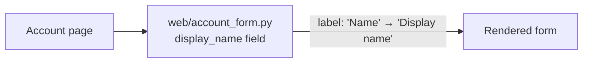

The skill says settled small changes stay direct, so I skipped the candidate cards, the competing-designs comparison and the `arch.py` gate. This is a label text change, not a structural one.

**Verdict:** No structural change is needed. This is a one-line text edit in the code that already owns the form.

**One thing to check first:** `fixture/` holds only `requirements.md`. `web/account_form.py` isn't in the fixture, so I couldn't read it. The claim that it is the form's only owner comes from the requirements, not from code I opened.

**Structure:** Before and after are the same. The account form in `web/account_form.py` owns the `display_name` field, and only its visible label changes.

**Smallest step:**
1. In `web/account_form.py`, change the label of the `display_name` field from `Name` to `Display name`. Leave the field name, validators, API, storage and layout alone.
2. Before editing, search for the text `"Name"` near `display_name` (for example in templates, translation files or test snapshots). If the label is also hard-coded somewhere else, that copy is the only other place to change. Don't add a constant or translation setup for this.
3. **Proof:** render the account form, or run its existing test, and confirm it shows `Display name` while the field name is still `display_name`. If a test asserts the old `Name` label, update that one assertion.

**Risk:** Easy to reverse. It's visible text only, with no stored data or public contract involved, so there's nothing to record as a design decision.

**Not adding:** a new component, a label constant, translation setup or any new module. Nothing in this change needs them.