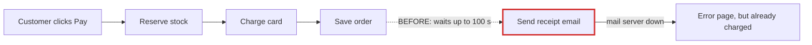
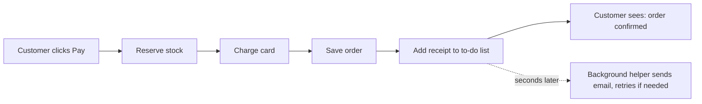
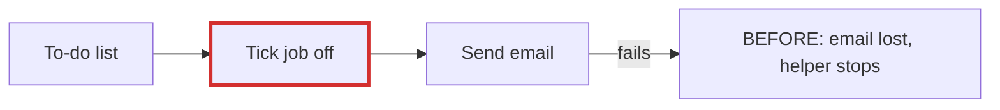

# Your shop: what's wrong and what better looks like

**Short answer: messy in places.** Checkout waits for the email server before telling the customer "done." That's why checkout sometimes takes ages, and why some customers were charged but saw an error page.

I opened a visual version of this report in your browser: `<tmp>\architecture-review-shop-checkout-20261026.html`. I haven't changed anything in your shop.

## ⚠ First: your design notes are wrong

Your notes (`docs/architecture.md`, lines 8 and 14–15) say the receipt email goes on a background to-do list and "the customer never waits for email." **The code doesn't work that way.** Checkout sends the email itself while the customer waits (`shop/checkout.py:12`). The background helper doesn't even know how to send receipts (`shop/jobs/worker.py:6-8`). Anyone who reads those notes would think this problem is already fixed.

## 1. Stop making customers wait for the receipt email (Strong)

**What you feel:** checkout is slow sometimes, and some customers were charged but saw an error.

**Why it happens:** after the card is charged, checkout tries to send the receipt. If the mail server is slow or down, it waits up to 30 seconds per try, tries 3 times, and pauses 5 seconds between tries. That adds up to **100 seconds**. If every try fails, the customer sees an error, but the money is already taken. **I tested this** on a copy of your shop with the mail server switched off. The card was charged, the order was saved, and the customer got an error.

**After:**

**What gets better:**
- Checkout's wait for email goes from up to 100 seconds to about zero.
- A mail outage can no longer cause "charged but error."
- Refunds already use this to-do list, so there's nothing new to buy or run.
- **The catch:** receipts arrive a few seconds later instead of instantly.

## 2. The to-do list loses emails that fail (Strong, needed for #1)

The background helper ticks a job off *before* sending the email. If sending fails, the email is never retried. **I tested this:** with mail down, a refund email failed and no jobs were left to retry. Also, any error stops the helper completely until someone restarts it.

The better shape: send first, and only tick the job off once it worked. A failed job stays on the list to be retried, and the helper keeps going.

## 3. Stock gets "stuck" when an order fails partway (Worth exploring)

Checkout sets aside the cart's items one at a time. If a later item is out of stock (or a card is declined, once you use a real payment provider), the items already set aside are never put back (`shop/checkout.py:6-9`). Items could show as sold out while they're on the shelf. I found this by reading the code; I didn't test it.

## 4. Orders are only kept in memory (Speculative)

Orders aren't saved to a file or database (`shop/db.py:4`). If the program restarts, they would all be gone. This may just be a placeholder, so I'd check with your developer before acting. How orders are stored is **hard to change later**, so we'd compare the options before touching it.

## What I'd do first

I'd fix **#1 and #2 together**, since #1 needs #2 so receipts aren't lost when mail is down. Both are easy to undo, and they reuse the to-do list you already have.

For your developer, the plan is in three safe steps:
1. Teach the background helper to send receipts.
2. Tick jobs off only after they succeed.
3. Change one line in checkout so it adds the receipt to the to-do list instead of sending it.

There's a check that passes now and should be re-run after each step. It confirms checkout still succeeds and exactly one receipt goes out. The full plan and file references are in `<tmp>\arch-design\df461174ddb1\move.md`.

**Which one would you like to explore?** There's one question only you can answer for #1: is it fine if the receipt email arrives a few seconds after the order instead of instantly?