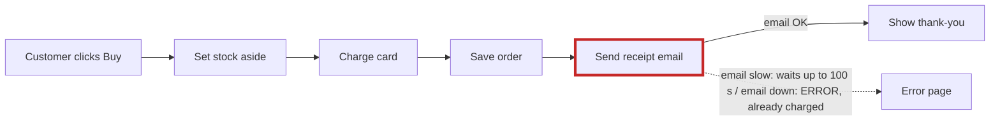
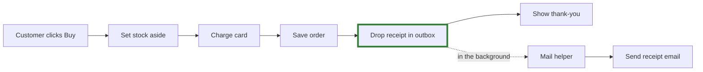

## In short

**The shop is mostly fine, but one step is in the wrong place.** Checkout waits for the email server before it shows the "thank you" page. That causes both problems you've noticed: checkout sometimes takes ages, and some customers are charged and then see an error page.

I ran checkout on a copy of the shop with the mail server switched off. The card was charged, the order was saved, and after 100 seconds of waiting the customer saw an error page.

I opened a visual version of this report in your browser: `<tmp>\architecture-review-20261026.html`. I didn't change anything in your shop.

## ⚠ Your architecture document is wrong

`docs/architecture.md` says the receipt goes into a background "outbox" and the customer never waits for email. The code doesn't do that:
- Checkout sends the receipt itself while the customer waits (`shop/checkout.py:12`).
- The background helper doesn't know how to send receipts at all (`shop/jobs/worker.py:6-8`).

Anyone who reads that document, person or AI, would assume this problem is already solved.

## 1. Checkout waits for email after the card is charged · *Strong*

**Today:**

**Better:**

- **Why 100 seconds:** the shop tries 3 times, waits up to 30 seconds each time, and pauses 5 seconds between tries (`shop/emailer.py:8-16`).
- **What gets better:** checkout waits 0 seconds for email instead of up to 100. A mail outage can no longer show an error to someone who has already paid.
- **Nothing new to buy or run:** the outbox already exists, and refund emails already go through it (`shop/refunds.py:7`). Receipts would just start using it too.
- **Risk:** low and easy to undo. It's about two lines of code, and no stored data changes.

## 2. The background mail helper can lose emails and stop for good · *Strong*

The helper ticks an email off as "done" *before* it tries to send it (`shop/jobs/queue.py:18`). If sending fails:
- that email is lost;
- the helper crashes, so every email behind it stays stuck until someone restarts it.

It also crashes straight away if it starts before anything has ever been put in the outbox. I ran that and saw it happen.

Only refund emails use the helper today. Once receipts go through it (card 1), this is what would cause "I never got my receipt". So 1 and 2 should be done together.

## Found in passing (not about structure)

- **Stock can go missing.** Stock is set aside before the card is charged, and it's never put back if the charge fails (`shop/checkout.py:6-9`). I found this by reading the code; I didn't run it.
- **Orders and stock are only kept in memory, and the card charge is a stand-in** (`shop/db.py:3-4`, `shop/payments.py:4`). These look like placeholders in this sample. If the real shop works like this, every order is lost when it restarts, and that would be the first thing to fix.

I didn't find other structural problems worth changing in a shop this small, so the list stops here.

## For an engineer

The plan has four steps, and the shop should behave the same after each one:
1. Teach the helper to send receipts.
2. Have checkout put the receipt in the outbox instead of sending it.
3. Make the helper mark an email as done only after it's sent, and set up the outbox when it starts.
4. Fix the architecture document.

There's a check command for this: it places an order and confirms exactly one receipt goes to the customer.
- It passes on today's shop and on a correct version of the change.
- It fails if step 2 is done without step 1.

The plan file, with the full command, is at `<tmp>\arch-design\87195b1b15fa\move.md`.

## Your call

1. **Which card should we go through in detail?** I'd do 1 and 2 together.
2. **Is it OK if the receipt email arrives a few seconds to a minute after the customer pays?** That's the only thing this change gives up.