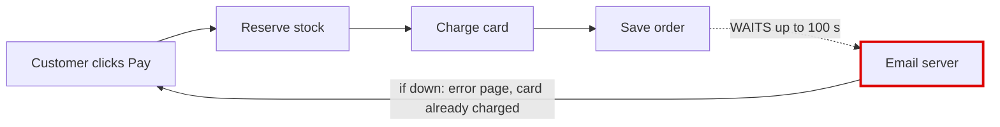
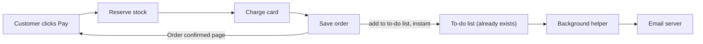
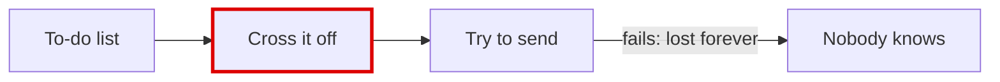

## In one sentence

Your shop is **messy in places**: checkout makes the customer wait for the email server after their card has already been charged. That one problem causes both things you noticed, the slow checkouts and the customers who were charged but saw an error page.

I tested every finding below by running your shop's code in a throwaway copy with the email server switched off. Nothing in your shop folder was changed.

## ⚠ Your architecture document says this is already solved, but it isn't

`docs/architecture.md` (line 8 and lines 14–15) says the receipt goes onto a background "to-do list" and that "the customer never waits for email." The code doesn't do that. Checkout sends the email itself while the customer waits (`shop/checkout.py:12`), and the background helper doesn't know how to send a receipt at all. Anyone reading that document, a person or an AI, would think the problem is fixed.

## 1. Send the receipt in the background, not during checkout · *Strong*

**Why it happens:** once the card is charged and the order is saved, checkout calls the email server and waits. If that server is slow or down, checkout waits up to 30 seconds, tries 3 times, and pauses between tries. That adds up to **100 seconds** at worst. If all three tries fail, the customer gets an error page even though they've already paid.

**Before**

**After**

- **What gets better:** an email problem can no longer slow checkout down or show a paying customer an error page.
- **Cost:** about 2 small edits. Refund emails already go out this way, so nothing new gets added.
- **Risk:** easy to undo. The receipt arrives a few seconds later instead of instantly.

## 2. Failed emails are silently thrown away · *Strong*

The background helper crosses a job off its list *before* it tries to do it. If an email fails, nobody ever retries it. I tested this: a refund confirmation failed and was gone for good. A job the helper doesn't recognise also makes it stop sending all emails. This becomes important as soon as #1 is done, because receipts will then go through that same list.

**After:** try to send first, and only cross the job off once it worked. A failed email stays on the list and gets retried.

## 3. A failed checkout keeps stock locked · *Worth exploring*

If one item in a cart is out of stock, or the card is declined, the items already set aside are never put back. I tested a cart with a mug and an out-of-stock hat: the checkout failed, but the mug's stock still went down from 4 to 3. Over time, things can show as "out of stock" while they're on the shelf.

## Something I need you to check

Your orders and stock counts seem to be kept only in the program's memory, so restarting it would wipe them. That may just be how this copy is set up, so it's only a suspicion. If your real shop works like this, it's the most important thing to fix, and it's hard to undo once chosen (it decides where your data lives), so we'd plan it carefully.

## What I'd do first

I'd start with **#1**: it fixes both of the problems you described and reuses something you already have. Then **#2**, so the receipts that now go through the to-do list can't get lost.

The full illustrated report with all the diagrams (it works in dark mode and on a phone) is at `<tmp>\architecture-review-20261026.html`. Each problem has a collapsed "Details for engineers" section with the exact lines of code and the steps. The skill's own checker passed on the plan for #1, including a test that confirms the shop still works the same.

**Which one would you like to explore together?** I won't change anything until you choose.