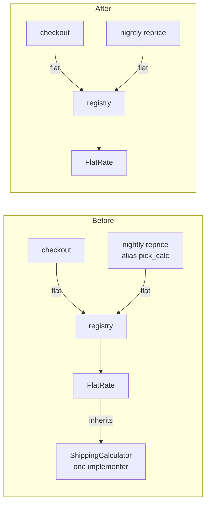

**Answer:** Yes, it's safe to remove, but not by just deleting the file. The interface is `ShippingCalculator` in `shipping/base.py:8`, and it is in use: the only real calculator inherits from it. Delete `base.py` alone and both checkout and the nightly reprice job crash on import (`ModuleNotFoundError: No module named 'shipping.base'`). I ran that in a throwaway copy.

**Verdict:** the code is clean overall. This is one small piece of structure nobody needs.

## Why it looks unused

Neither caller ever names the class. They ask the registry for a calculator by the string `"flat"`, and one of them renames the lookup function on import:

- `checkout/cart.py:5`: `get_calculator("flat")`
- `jobs/reprice.py:2,6`: `get_calculator as pick_calc`, then `pick_calc("flat")`
- `shipping/registry.py:3`: `{"flat": FlatRateCalculator}`

So searching the callers for `ShippingCalculator` (or even `FlatRateCalculator`) finds nothing. The class is only referenced in `shipping/flat_rate.py:1` (the import) and `:4` (as the base class). Nothing anywhere checks against it with `isinstance` or `issubclass`. Its own comment says why it exists: "kept as a seam in case a second carrier is ever needed" (`base.py:3-4`). That's a guess about the future, and today it has one implementer. There's no git history here, so that comment is the only record of intent.



## What has to change

Two edits and one deletion, all in `shipping/`:

1. In `shipping/flat_rate.py`, remove line 1 (`from shipping.base import ShippingCalculator`).
2. On line 4 of the same file, change `class FlatRateCalculator(ShippingCalculator):` to `class FlatRateCalculator:`.
3. Delete `shipping/base.py`.

Nothing else needs editing. `cart.py`, `reprice.py` and `registry.py` only call `.quote()`, which `FlatRateCalculator` still has.

**Proof** (run from `fixture/`): it prints `ok` today, and also printed `ok` in a temp copy with all three changes applied:
```
python -c "from checkout.cart import total_with_shipping as t; from jobs.reprice import reprice_open_orders as r; o=[{'subtotal':10}]; assert t(o[0])==15.0; r(o); assert o[0]['shipping']==5.0; print('ok')"
```

**Easy to undo:** the class is internal, it isn't stored anywhere, and it hasn't shipped, so nothing outside the code depends on it. If a second carrier ever arrives, it just needs a class with a `quote()` method and one entry in the registry dict (`registry.py:3`), which already does the job of picking a carrier by name. A shared base class or `typing.Protocol` can come back then in a few minutes.

**What I checked:** I'm calling it unused based on the five files in `fixture/`. If code outside `fixture/` imports `shipping.base`, I didn't see it. The audit gate passed (`ARCH-GATE: done`). I changed nothing in the repo. My first test run left `__pycache__` folders behind, and I deleted them. No bugs turned up while reading.

Do you want to apply this change, or look at anything else in the structure first?