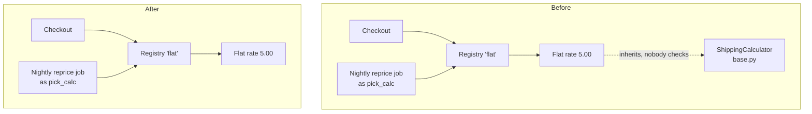

**Verdict: messy in places.** Yes, you can safely remove it. `ShippingCalculator` is a placeholder "interface" with one implementer, and nothing anywhere checks against it. Removing it means editing one file and deleting another. Your three call sites don't change.

## What I checked
- **Every reference to the interface:** two lines, both in `shipping/flat_rate.py`. Line 1 imports it and line 4 subclasses it. I also searched for `isinstance`, `issubclass`, string imports like `"shipping.base"`, `importlib` and `getattr`, and found none.
- **Who actually uses shipping:** two flows, and they go through the registry, not the interface.
  - `checkout/cart.py:5-6` calls `get_calculator("flat").quote(order)`.
  - `jobs/reprice.py:2,6,8` imports `get_calculator` **under an alias, `pick_calc`**, and calls it with the string `"flat"`. A search for `get_calculator(` misses this nightly job. It doesn't matter for this change, but it would if someone goes on to remove the registry too.
  - `quote()` is found by plain method lookup (duck typing), so the base class adds nothing at runtime.
- **Proven, not just read:** in a throwaway copy I deleted `base.py` and removed the base class. Checkout still returns subtotal + 5.00 and the reprice job still sets shipping to 5.00, both before and after. The skill's gate passed (`ARCH-GATE: done`) and the repo itself is unchanged.



## What has to change
1. In `shipping/flat_rate.py`, delete line 1 (`from shipping.base import ShippingCalculator`) and change line 4 to `class FlatRateCalculator:`.
2. Delete `shipping/base.py`.

Nothing else changes: not `registry.py`, `cart.py` or `reprice.py`.

**Proof:** run this from `fixture/` before and after each step. It prints `OK`:
```
python -c "import sys; sys.path.insert(0,'.'); from checkout.cart import total_with_shipping as t; from jobs.reprice import reprice_open_orders as r; o=[{'subtotal':10}]; r(o); assert t({'subtotal':10})==15.0 and o[0]['shipping']==5.0; print('OK')"
```

**Easy to undo.** No stored data or public API depends on it. If a second carrier ever arrives, putting the base class back is one new file and two changed lines. `shipping/registry.py:3` already owns "which calculator", so that's the place to extend.

## Caveats
- **Why it exists:** there's no git history to check (this isn't a git repo). The docstring at `base.py:3` explains it: "in case a second carrier is ever needed." With one carrier, that's a guess, not a requirement.
- **Outside this folder:** I can only vouch for `fixture/`. If any code outside it imports `shipping.base`, such as another repo or a plugin, that breaks. "Before it ships" suggests there's none yet.
- **Second candidate (Worth exploring):** the registry is also a seam with only one entry, a string lookup for `"flat"`. Removing it would mean editing `cart.py:1,5` and `reprice.py:2,6`, and the alias in the reprice job is the easy one to miss. It's a separate decision from deleting the interface.
- **Not done:** I didn't build the HTML report because there's no page host here; the diagram above stands in for it. I found no bugs or security issues while reading.

I've made no changes. Should I go ahead with the interface removal, or look at the registry candidate as well?