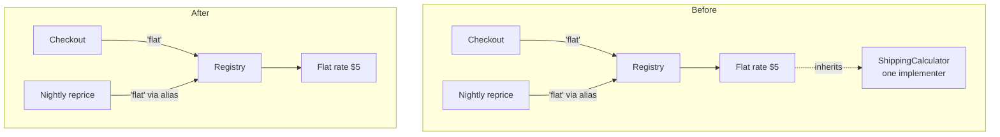

Yes, it's safe to remove `ShippingCalculator` (`shipping/base.py:8`), but it isn't actually unused. The only class that inherits from it is `FlatRateCalculator` (`shipping/flat_rate.py:4`), so deleting `base.py` on its own would break both checkout and the nightly reprice job. You have to change `flat_rate.py` at the same time.

**Verdict: messy in places.** The code is small and readable, but it has an interface kept "in case a second carrier is ever needed" (`base.py:3`) that only one class implements. There's no project map or decision record to check this against, and `fixture/` isn't a git repo, so that docstring is the only record of why it exists.

## Why it looks unused
None of the code that uses shipping costs ever names the interface. They all go through the registry, which looks up a calculator by a text key:

- `checkout/cart.py:5` calls `get_calculator("flat")`.
- `jobs/reprice.py:2,6` imports the same function under another name, `pick_calc`, then calls `pick_calc("flat")`.
- `shipping/registry.py:3` maps `"flat"` to `FlatRateCalculator`, which inherits from `ShippingCalculator`.

A search for callers of `ShippingCalculator` therefore finds nothing. The only references are the import and the base class in `flat_rate.py:1` and `:4`. Nothing uses `isinstance` on it, nothing else subclasses it, and no test fake implements it.



## What has to change (2 lines and 1 deleted file)
1. In `shipping/flat_rate.py`, delete line 1 (`from shipping.base import ShippingCalculator`) and change line 4 to `class FlatRateCalculator:`.
2. Delete `shipping/base.py`.

Nothing else needs to change. The registry and both callers stay exactly as they are.

## Evidence
I tested the deletion in a temporary copy, not the repo. This command runs both the checkout and the nightly job, and checks that they still produce $15 and $5:
```
python -B -c "from checkout.cart import total_with_shipping as t; from jobs.reprice import reprice_open_orders as r; assert t({'subtotal': 10}) == 15.0; o=[{'subtotal': 1}]; r(o); assert o[0]['shipping'] == 5.0; print('PROOF OK')"
```
- **Before the change:** it passes.
- **After the two steps:** it passes.
- **With only `base.py` deleted:** it fails with `ModuleNotFoundError: No module named 'shipping.base'`. That's the failure you'd get if `flat_rate.py` isn't updated, and it shows the check can catch a broken deletion.

The skill's gate finished with `ARCH-GATE: done`, and it confirmed nothing in `fixture/` was changed.

## Risk and what I'm not suggesting
- **Easy to undo.** If a second carrier ever arrives, adding the base class back is one file plus one line in each carrier class.
- **Not adding:** a replacement interface "just in case." With one implementer it's a guess about the future, not something the code needs.
- **Not doing:** removing the registry. It also has only one entry, but removing it would mean editing both callers (one of which uses the `pick_calc` name) and the `"flat"` key, and nothing would get cheaper.

## Limits
I could only check code inside `fixture/`. If anything outside it subclasses or type-checks `ShippingCalculator`, it would break. Since the interface hasn't shipped yet, there probably isn't any.

Nothing has been changed. Do you want me to make the edit, or look at something else first?