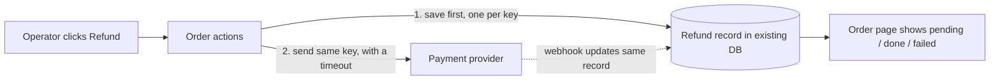

My recommendation is to store each refund as a record in the database you already have, saving it *before* calling the payment provider. Every retry and webhook then goes through that one record. Don't add a queue or worker for this launch.

**Before you rely on any of this:** `fixture/` contains only `requirements.md`. None of the modules it names (`orders/service.py`, `web/order_views.py`, `payments/gateway.py`, `db/connection.py`) are there, so I couldn't check any claim about existing code against real code. Treat those claims as unverified. The design itself is a same-model comparison done in this session; no isolated workers or second model were used. Nothing in the repo was changed.

## Why
Right now nothing keeps track of a refund request (`requirements.md:11`). A double-click, a retry after a timeout, or a duplicate webhook can't tell that the money already went back.

## What I compared
I ranked the criteria before looking at options: (1) never refund twice, (2) the operator sees the outcome, (3) retries are safe, (4) the fewest new things to run, (5) how easy it is to change later.

| | Refund record, called during the request **(recommended)** | Queue + worker + status endpoint |
|---|---|---|
| Refund once | Unique key in the database, plus the same key sent to the provider | Same mechanism |
| Operator sees outcome | On the existing order page; a timeout shows as *pending* | Needs a new status endpoint |
| New things to run | None | 3: queue, worker, public status contract |
| Justified by requirements? | Yes: 20 refunds a day, no response-time target (`requirements.md:7`) | No: speculative at this volume |

You can switch to the queue later without changing the stored data, because a worker would just pick up the saved *requested* records. A cheaper variant is to put refund columns on the orders table instead of a separate table. That only works if an order can never have more than one full refund, and partial refunds would force a migration later.

## What's hard to undo
- **The table and its stored idempotency key (the unique token that makes repeats harmless) are permanent decisions.** Proposed fields: `id, order_id, amount, currency, idempotency_key UNIQUE, status (requested→pending→succeeded|failed), provider_refund_id UNIQUE NULL, last_error, attempts, timestamps`. While refunds are full-only, also allow at most one non-failed refund per order. If they're wrong, you'll need a migration and a reconciliation of historical refunds.
- **Don't add a public status contract yet.** Show the status on the existing page.
- The folder layout and keeping the refund logic in `orders/service.py` are easy to change later.

## Safe first implementation plan
Each step keeps current behaviour until step 5.
1. **Check the provider.** Find out whether it accepts an idempotency key, or lets us look up a refund by our own reference, and what it does on a timeout. If it does neither, every retry must look up the existing refund first and only then re-send.
2. **Add the migration** for the refund table. Nothing uses it yet. Proof: the migration applies and rolls back on a copy of the database.
3. **Add the refund logic in `orders/service.py`, behind a flag.**
   - Save the record and commit it first.
   - Call the gateway with a timeout.
   - Record the outcome. A timeout becomes *pending*, never *failed*.
   - A retry reuses the same record and key.
   - Statuses only move forward.
4. **Add the webhook handler.** It looks up the record by provider reference or key, so a duplicate webhook does nothing.
5. **Add the button and status display** to the existing order page in `web/order_views.py`, then turn on the flag.
6. **Prove it with tests** that would fail on a broken build, using a fake gateway:
   - two concurrent requests → one provider call
   - a duplicate webhook → no change
   - a timeout then a retry → one refund
   - a failure then a retry → succeeded, still one refund

**Likeliest ways this fails a year from now:**
- The provider doesn't actually deduplicate by key. Step 1 checks this.
- Records get stuck in *pending*. Add a small reconcile action the operator can run, with no scheduler needed at 20 a day.
- Partial refunds arrive. The table already handles them; only the per-order constraint changes to a check on the total refunded.

The full report, with before/after diagrams for all three options, is at `<tmp>\architecture-review-20261026-025329.html`.

**Two questions for you:**
- Are refunds always full, or can they be partial?
- Can you share the provider's API docs, or the `payments/gateway.py` code?

Which option should we work through in detail: the recommended refund record, the queue variant, or the order-columns variant?