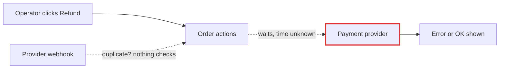
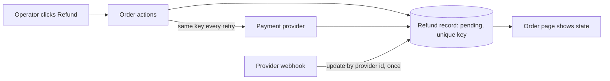

# Operator refunds: arch-design (design mode)

**Recommendation:** Store each refund as a row in the existing database before calling the payment provider. Give the row a unique key so the same refund can only happen once. Run it synchronously inside the existing order-actions module and show its state on the existing order page. At 20 refunds a day with no response-time target, a queue or worker would add parts without making anything cheaper.

## Map check (read this first)
`fixture/` contains only `requirements.md`. None of the modules it describes exist here: `orders/service.py`, `web/order_views.py`, `payments/gateway.py` and `db/connection.py` are all missing. So every edge below is **suspected**: it comes from the requirements text, not from code I traced. No step here can carry a one-way decision until it is checked against the real code. In particular, two things need checking:
- whether the provider accepts an idempotency key (a key that makes a repeated request count only once);
- how the gateway handles timeouts and retries.

## Decision criteria (set before the options)
Must-haves:
1. The same amount is never refunded twice, whether the duplicate comes from the operator or from a provider webhook.
2. The operator sees whether the refund completed or failed.
3. A provider failure can be retried without refunding twice.

Preferences, in order:
4. Reuse the existing owners.
5. Fewest new things to run.
6. Fewest one-way contracts.

Labelled assumptions: 20 refunds a day, no latency target, and the provider's response time is unknown.

## Two shapes compared
I drew both sketches in this session with the same model. There were no isolated workers and no second model.

| | **A. Refund record, synchronous (recommended)** | **B. Queue, worker and status endpoint** |
|---|---|---|
| No double refund | Unique key in the DB, plus the same key sent to the provider | Same mechanism; it still needs A's record |
| Operator sees the outcome | Order page shows pending, succeeded or failed | Operator polls a new status endpoint |
| Retry safety | Retry reuses the stored key | Same |
| New parts | 1 table | Queue, worker, endpoint, monitoring |
| One-way contracts | Table shape and key rule | Those, plus a public refund-state API |

B satisfies no must-have that A misses. It only helps with a latency or volume need that doesn't exist yet. A is also the base B would need anyway, so picking A now doesn't block B later.

**Before:**

**After (A):**

**What gets better:**
- A duplicate click or request causes no extra refund, because the database's unique constraint rejects the second one.
- A duplicate webhook changes nothing.
- A provider timeout no longer leaves the operator with an unknown outcome. The refund stays `pending` and can be retried with the same key.

**Door:**
- **One-way:** the refund table's shape and the key rule, because they are stored data and recovery depends on them. Don't add a public status endpoint, which would be a second one-way contract.
- **Two-way:** where the code lives (service, gateway, view).

## Safe first implementation plan
Each step leaves current behaviour unchanged until step 5 turns the feature on.

1. **Check the facts.** Read the real `payments/gateway.py` and the provider's documentation:
   - Does the provider accept an idempotency key?
   - What does a timeout look like?
   - What do refund webhook payloads look like?

   If the provider has no idempotency key, add a step: before any retry, look up existing refunds at the provider.
2. **Migration.** Add `refunds(id, order_id, amount, idempotency_key UNIQUE, status, provider_refund_id UNIQUE NULL, last_error, attempts, timestamps)` through `db/connection.py`. Nothing reads it yet.
3. **Gateway.** Add `refund(charge_id, amount, idempotency_key)` with an explicit timeout. A timeout returns "unknown", never "failed".
4. **Service.** Add `orders/service.py: refund_order(...)`:
   1. Check the order is settled.
   2. Insert the refund row, or fetch the existing one by key.
   3. Call the gateway.
   4. Status only moves forward: pending → succeeded or failed. Pending can be retried.
5. **Webhook and view.** The webhook handler updates the row by `provider_refund_id`, so repeats are no-ops. The order detail page gets a Refund button (hidden after success) and shows the refund state, with Retry on pending or failed.

**Proof:** tests that fail if the protection is removed, run against a fake gateway that counts calls:
- Two identical requests produce one row and one refund.
- Replaying the webhook leaves the row unchanged.
- A timeout followed by a retry sends the same key and produces one refund.
- A request on an unsettled order is rejected.

Each test should go red if the unique constraint or the key reuse is deleted.

**Pre-mortem: likely reasons this fails a year on**
- **The provider ignores the key**, so a retry refunds twice. Step 1 checks this, and the fallback is the lookup before retry.
- **Rows stuck in `pending`.** A small reconcile command that re-checks pending rows older than N minutes handles this. It's an accepted risk at 20 refunds a day.
- **Partial refunds arrive and the key rule is wrong.** The question below settles this.

The visual report is at `<tmp>\architecture-review-refunds-20261026.html`. I wrote it outside the fixture and didn't open it. Nothing in `fixture/` was changed. Exploration cost about $0.18 and a few minutes.

## Before going further
1. **Which candidate should I take into the deep dive?** I recommend A.
2. **Are refunds always the full order amount, or can an operator refund part of an order?** Full only means the key can simply be one refund per order. Partial means the key has to identify each separate request, and the system has to cap the total refunded at the amount paid. This is the one-way choice in the table design.