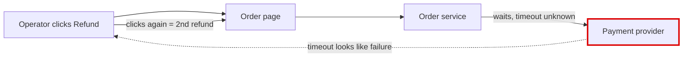
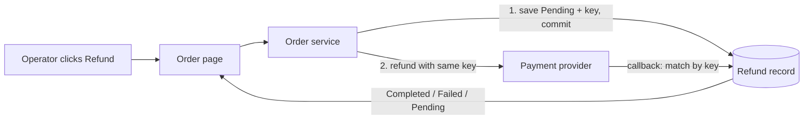

**Recommendation:** build refunds inside the existing order service, backed by a new refund record in the existing database. The provider gets called with the same idempotency key every time for a given refund, and the operator sees the result on the order page. Don't add a queue, worker or status endpoint. At 20 refunds a day with no response-time target, nothing calls for them.

## The code isn't there to check
`fixture/` contains only `requirements.md`. None of the modules it describes exist here: `orders/service.py`, `web/order_views.py`, `payments/gateway.py`, `db/connection.py`. So everything below about how they behave is **suspected**: taken from the document, not checked against code. Under the skill's rule, the one-way choices (refund table, key format) are a proposal until someone checks them against the real code.

## Scope: the three changes most likely next
1. **Partial refunds.** The requirement's wording, "the same amount", hints at them. Partial refunds would change the key and the table.
2. **A second caller**, such as customer self-service or automated refunds. So the logic belongs in the service, not in the view.
3. **More volume, or a slow provider.** Only this would earn a queue.

## Candidates
I set the criteria first, then sketched both options myself in this session. No workers or second model were used.

**Criteria, ranked:**
1. Money never goes back twice: not on a repeated request, a repeated provider callback, or a retry.
2. The operator sees whether it completed or failed.
3. Provider failures can be retried safely.
4. Reuse what already owns each job.
5. As few stored or public contracts as possible.

### A. Refund record + provider key, done inside the request (**Strong**, recommended)

Before:

After:

- **What gets better:** the ways money could go back twice (double click, two operators at once, repeated callback, retry after a timeout) go from 4 to 0. It adds one table and no new service.
- **What each part owns:**
  - The order service owns the refund steps and state changes.
  - The gateway only passes the key through.
  - The view only renders the state.
  - The callback handler only finds the matching record and moves it forward.
- **Reuse:** the existing database (`db/connection.py`) and the existing order page. There's no new status endpoint; the page shows the state itself.

### B. Queue + worker + polled status endpoint (**Speculative**)
- **What it adds:** a queue, a worker and a public status endpoint, which are three new things to run and secure, plus a public contract.
- **What it buys:** nothing the requirements ask for. It would only pay off if provider calls regularly outlast a web request.
- **Overlap with A:** B still needs A's record and key, so choosing A now doesn't block moving to B later.

### Which way to go on the one-way choices
| Decision | Option 1 (simplest) | Option 2 | Cost of being wrong |
|---|---|---|---|
| Refund record and key | **One refund per order**: unique `order_id`; key = `refund:<order_id>` | One row per refund request, with a check that the total refunded stays at or below the settled amount | Option 1 is wrong if partial refunds come: you'd need a migration and a new key scheme. **This is the owner's call.** |
| Refund state | Shown on the existing page only | A public status API | A public API means callers depend on the state names. Option 1 keeps them internal. |

## A year on, the three likeliest failures
1. **A timeout gets recorded as "failed", and a retry sends a second refund.** Fix: a timeout or unclear answer leaves the refund as `pending_unknown`. A retry reuses the same key, or asks the provider for the refund's status before calling again.
2. **The provider's callback arrives before our record is saved.** Fix: save the `pending` record before calling the provider. The callback finds the record by key and only moves it forward (`pending → succeeded/failed`), never back.
3. **The gateway doesn't support idempotency keys.** Fix: check this first (see step 0 below). If it doesn't, store a reference we generate and look it up before any retry.

## A safe first implementation plan
Each step keeps current behavior unchanged until the last one.

0. **Check facts against the real code.**
   - Does the gateway accept an idempotency key? Can it look up a refund by our reference? What is its timeout?
   - Is there an existing handler for provider callbacks?
   - Ask the owner: are partial refunds coming?
1. **Migration:** add a `refunds` table with columns `order_id`, `idempotency_key` (unique), `amount`, `status`, `provider_ref`, `error` and timestamps. Nothing uses it yet.
2. **Gateway:** add a `refund(order_ref, amount, idempotency_key)` method to `payments/gateway.py`, with an explicit timeout, and a fake version for tests.
3. **Service:** add `request_refund(order_id, operator)` to `orders/service.py`:
   - In one transaction: check the order is settled, then insert or fetch the refund row.
   - Commit, then call the gateway.
   - Classify the result as succeeded, failed (retryable), or unknown.
4. **Callback handler:** find the refund by key or provider reference and apply only forward state changes. A repeat does nothing.
5. **View:** add a Refund button and a status display to the order page, plus a Retry button that reuses the same key. Release it behind a flag.

**Proof:** these tests run against the fake gateway, and each must fail if the protection is removed:
- double submit → one provider call
- duplicate callback → no change
- timeout then retry → same key sent
- two operators at once → one row

Use the verify-loop helper to show that each test actually fails when its protection is broken.

**Where the full report is:** `<tmp>\architecture-review-refunds-20261026.html`. I didn't change anything in the repo, and spend was well under budget, about $0.20.

**Do you want to explore A in detail?** If so, the first question is for the owner: should partial refunds be supported?