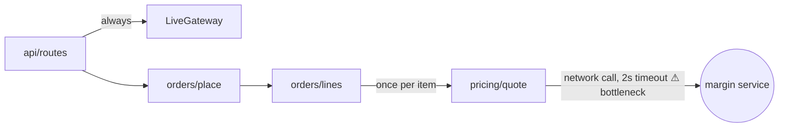
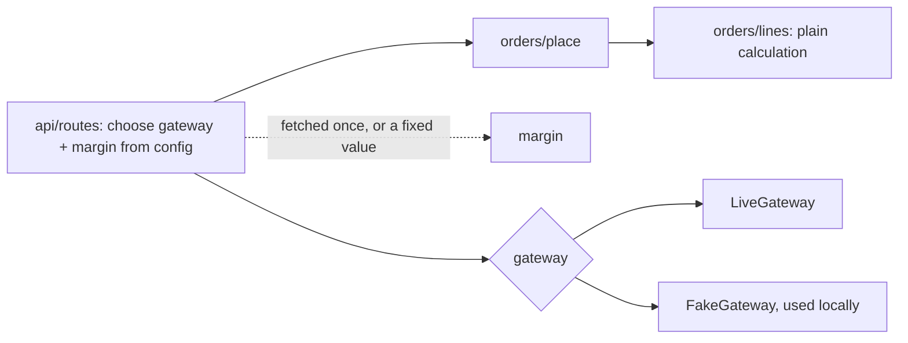
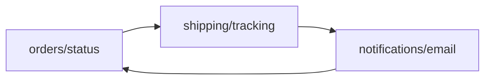

I ran the arch-design skill in audit mode over `fixture/`: 53 files, 431 lines, all read. I also ran the order flow with a probe script kept outside the repo (`/tmp/archprobe/probe.py`) so the main claims below are measured, not guessed. I changed no files.

**Verdict: messy in places, and the mess sits in the order flow.** Placing an order calls an outside service once per line item and always uses the live payment gateway. That's why it won't run properly offline. Four modules (orders, shipping, notifications, customers) import from each other, often in a loop, so a change in one spreads to the others.

**Map:** there's no `docs/architecture.md`, ADR folder or CLAUDE.md, so there was no existing map to check. The edges below come straight from the imports.

**Next likely changes (my guesses, not checked):** there's no git history or tracker, so these come from the code:
1. Sending an SMS on delivery: `notifications/sms.py` exists, but delivery only sends email.
2. Changing pricing or margin rules.
3. Running locally with the fake payment gateway, which exists but nothing uses.

---

### 1. Order placement makes outside calls inside the customer's wait — **Strong** (proven)

**How it feels:** on a slow network, placing an order hangs for seconds. With no network, the order goes through at the wrong price. And any order placed through the API charges the live gateway, even on a laptop.

**What causes it:**
- `api/routes.py:10` hard-codes `LiveGateway()`. `payments/fake.py` exists, but nothing in the API path uses it.
- For each line item, `orders/place.py:10` calls `orders/lines.py:6`, which calls `unit_price` at `pricing/quote.py:19`. That calls `_fetch_margin` (`pricing/quote.py:12`), a network call with a 2-second timeout.
- When that call fails, `pricing/quote.py:15` quietly uses a margin of 1.0.

**Measured (3-item order):**

| Scenario | Network calls | Wait | Total |
|---|---|---|---|
| Rates host unreachable | 3 | 0.07 s | 3785 |
| Slow network (each call waits out its timeout) | 3 | **6.0 s** | 3785 |
| Margin service up (margin 1.3) | 3 | — | **4748** |

So offline orders come out about 20% cheaper, and nothing reports it.

**What gets better:** network calls per order go from N (one per item) to 1, or 0 offline. The worst-case wait goes from 2 s × N to 2 s. Pricing can be tested with no network. Swapping the gateway becomes 1 config change instead of editing code.

### 2. A declined card keeps the stock reserved — **Strong** (proven)
**The problem:** `orders/place.py:14-15` reserves stock first. The card is charged later, at `orders/place.py:16`, and nothing releases the stock if the charge fails. The probe confirms it: one declined 3-item order left stock at **A/B/C 7→6**, with no order created. The same thing happens if `reserve` fails partway through: items already reserved stay reserved.

**Fix:** release everything already reserved if a later step fails (`inventory/reserve.py:11` already has `release`). This is about 5 lines in one file.

### 3. Orders, shipping and notifications import each other in a loop — **Worth exploring** (traced)
**The loop:** `orders/status.py:1` imports `shipping.tracking`, which imports `notifications.email` (`shipping/tracking.py:1`), which imports `orders.status` (`notifications/email.py:1`). The bare `import x` style is likely there to avoid a circular-import error.

**Why it matters:** adding SMS on delivery (likely change 1) means editing `tracking.py`, which sits inside this loop. Fix it in two places:
- Move `subject_for` (`notifications/email.py:14`) into `orders/status`, or pass the label in as a string.
- Have whoever calls `mark_delivered` send the notification, instead of `shipping/tracking.py:10` sending it.

After the fix, the arrows run one way: orders → shipping, and orders → notifications.

### 4. "Which country do we ship to?" is answered in 3 places — **Worth exploring** (traced)
**The copies:** the same `(default_address(cid) or {}).get(...)` lookup appears at `orders/place.py:11`, `shipping/rates.py:10` and `shipping/labels.py:6`. The fallback `'US'` is written twice (place.py:11 and rates.py:10).

**What gets better:** add one `ship_country(cid)` to `customers/addresses.py`. A change to address rules then means 1 edit instead of 3.

### 5. False dependencies — **Speculative** (tidying; it makes the import list honest)
- `services/order_service.py:5` does nothing but forward a call, and its only caller is `api/routes.py:2`.
- `lines_total` is imported but never used in `orders/status.py:2` and `reporting/sales.py:1`. That second one makes reporting look like it depends on the networked pricing code.
- `as_cents` is imported in 6 files and used in none.

I'd only do this alongside #1 or #3, not as a task of its own.

**Not flagged, on purpose:**
- `core/util` is imported by many modules but imports nothing itself, so it's a stable base, not a problem.
- `PaymentGateway` has two real implementations (live and fake) behind a network boundary, so that interface is justified.

**Noticed, not ranked:** nothing stores orders. `place_order` returns a dict that is never saved, `orders/history.record` is never called, and `jobs/nightly.run(orders)` expects someone to hand it the orders. Any change that touches order status will run into this. Decide where orders live before building more on top of them.

---

### Top move (#1), step by step — each step keeps behaviour the same
1. Fetch the margin once per order: add a `margin` parameter to `unit_price` and `build_lines`, and have `place_order` fetch it a single time. Same prices, 1 network call instead of N.
2. Let `api/routes.py` choose the gateway and margin from config, e.g. `PAYMENTS=fake|live` (default `live`) and `MARGIN=<number>` (if set, no network call). With nothing set, behaviour is unchanged.
3. Make the offline fallback a deliberate choice instead of a silent 1.0 (see the question below).

**Two options:**
- **(A) Pass the margin in as a plain number.** I recommend this: it's the simplest and fully testable.
- **(B) A `MarginSource` interface with live and fixed versions,** like the payment gateway. It's justified because the margin comes over the network from a service that isn't yours, but it's more structure than one number needs today.

**How hard to undo:** easy. It changes internal function signatures only, with no stored data or public API. Step 3 changes what customers pay, so that part is your call.

**Proof:** re-run the probe. Under the slow-network test it should show **1 call and about 2 s**. With `PAYMENTS=fake MARGIN=1.3` it should show **0 calls, total 4748, and no live charge**.

**Your call on step 3:** if the margin service can't be reached, should the order fail, use the last margin we saw, or use a configured default? Right now it quietly gives a discount of about 20%.

Which candidate do you want to explore? I'd start with #1 and do #2 alongside it, since both are in `orders/place.py`. I haven't changed anything.