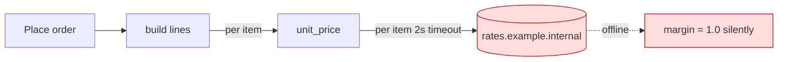
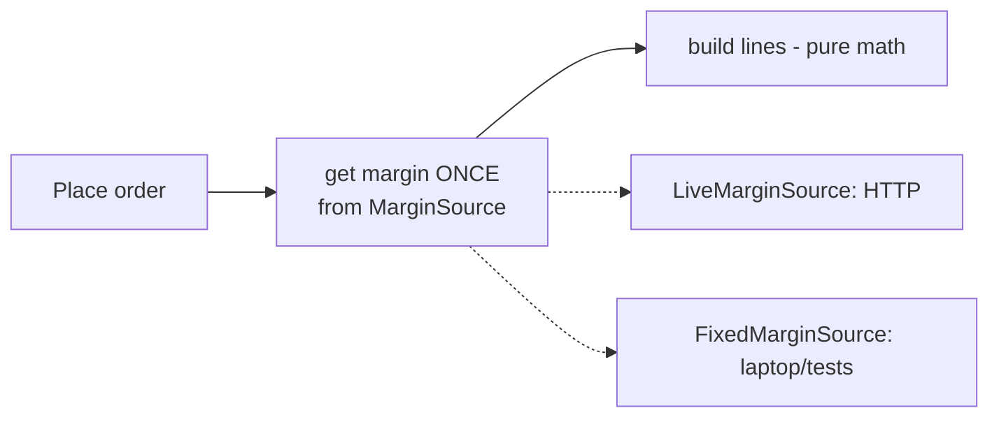
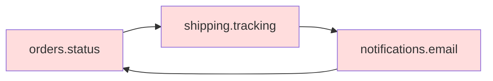
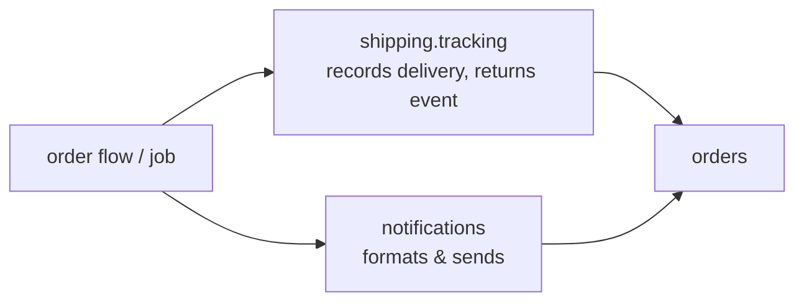

# arch-design audit: `fixture/`

**Verdict: messy in places.** Most packages are small and clean. Both symptoms come from two spots in the order path. Pricing makes a network call for every order line, which is why the order flow won't run offline. And `orders`, `shipping` and `notifications` import each other in a loop, which is why one change spreads across several files.

**Map:** there's no `docs/architecture.md`, no ADRs, no git history and no tests, so I built the map from the entry point (`api/routes.py:7`) and checked each import edge with an AST scan. Because there's no history, the "likely next changes" used for ranking are guesses from the code, not from a log: a new price or margin source, a new notification (for example "shipped" by SMS), and new country rules for tax and shipping.

Evidence: **proven** means I ran it with probe scripts kept in `/tmp/archprobe`, outside the repo. **traced** means I read the whole chain.

---

## 1. Pricing calls the network once per order line *(Strong, proven)*

**What you feel:** with no network, placing an order with 3 items hangs for **6.0 s**, and then succeeds at the **wrong price**.

**Chain:** `routes.post_order` → `order_service.place` → `place_order` (`orders/place.py:10`) → `build_lines` (`orders/lines.py:6`, once per item) → `unit_price` (`pricing/quote.py:19`) → `_fetch_margin` (`pricing/quote.py:12`) calls `urlopen` with a 2 s timeout. On `OSError` it quietly returns `1.0` (`quote.py:15`).
- **Proven:** 3 lines produced 3 network calls and 6.0 s of waiting. Offline, every price silently drops the margin.
- The price-decision code can't run without the network, so it can't be tested, and a failure turns into a silently different price instead of an error.

**What gets cheaper:** network calls per order go from N to 1 (or 0 offline). Pricing becomes pure arithmetic you can test. A failed fetch becomes a decision someone made (fail, or use a known default), not a hidden price change. This also covers likely change #1: swapping the margin source becomes a one-file edit. The service isn't yours, so it earns a port. That's the same pattern `payments/gateway.py` already uses; reuse it, don't invent a new one.

## 2. `orders` → `shipping` → `notifications` → `orders` import cycle *(Strong, traced, edges proven by scan)*

**What you feel:** "I changed the order status label and email and tracking broke," or the reverse.

**Chain:** `orders/status.py:1` imports `shipping.tracking`. `shipping/tracking.py:1,10` imports and calls `notifications.email.send`. `notifications/email.py:1,15` imports `orders.status.label`. All three use `import x.y` rather than `from x import y`. Python tolerates the cycle that way, and the same style hides it.
- The loop means these 3 modules change together. Shipping also sends email itself (`tracking.py:10`), so a new notification (likely change #2) touches shipping code.

**Fix:** shipping records the delivery and returns. The caller, at the flow level, decides to notify. Email gets its subject from the caller instead of importing `orders.status`. Imports then point one way, toward `orders` and `core`.

## 3. Declined charge leaves stock reserved; the card gateway is hard-wired *(Strong, proven)*

**What you feel:** inventory slowly "leaks" after declined cards. On a laptop you can't use the fake gateway through the real API.

**Chain:** `orders/place.py:14-15` reserves stock, then charges at `:16`. Nothing calls `inventory/reserve.py:11 release` (found **0 callers**). **Proven:** after a declined card, stock went 5 → 3. Separately, `api/routes.py:1,10` constructs `LiveGateway()` inline, so `FakeGateway`, which already exists (`payments/fake.py`), can't be selected at the entry point. The `PaymentGateway` protocol is earned (two implementers, one of them network), but only half used.

**Fix:** charge in a try block, release on failure (or reserve → charge → commit). Choose the gateway in one place, from config.

## 4. "Customer's country" has 3 owners *(Worth exploring, traced)*

`(default_address(cid) or {}).get(...)` appears at `orders/place.py:11`, `shipping/rates.py:10` and `shipping/labels.py:6`, with the `'US'` fallback repeated twice. One order looks up the address twice. Likely change #3 (country rules) means 3 edits. **Fix:** `place_order` resolves the address once and passes `country` into `quote_shipping`, and `customers.addresses` owns the fallback.

## 5. Grab-bag imports and a pass-through layer *(Speculative, mostly tidying)*

- `core.util` names are imported far more than they're used: `as_cents` imported 6 times, used **0** times; `clamp` 10/4; `slug` 7/2; `first` 6/1. Five files copy the same `from core.util import clamp, as_cents, slug, first` line (for example `catalog/search.py:2`, `customers/accounts.py:2`). Any rename in `util` touches all of them. Cleaning this up is cheap. `as_cents` also overlaps with `core/money.py`, so money has two owners.
- `services/order_service.py:4-5` only forwards to `place_order` (deletion test: nothing is lost). I'd call removing it suspected, not proven. Something outside this fixture might import it, and I can't prove it's unused.

---

## What to do first: candidate #1, as a sequence of moves

Each step keeps behavior the same:
1. In `pricing/quote.py`, split `unit_price(sku, code, margin)` (pure) from `_fetch_margin()`. `build_lines` fetches the margin **once** and passes it in. Same prices, N calls → 1.
2. Add a `MarginSource` with `fetch()`, a live implementation (current code) and a fixed one (returns a configured value). Wire it where the gateway is wired (`api/routes.py`), alongside fix #3.
3. Decide the offline policy explicitly (question below), and delete the silent `except OSError: return 1.0`.

**Proof:** `python -I /tmp/archprobe/probe.py <fixture>` should report **0–1 network calls and ~0 s** with the fixed source, and the same order total as today when the margin is 1.0 (currently `3464`).

**Second option:** cache the margin in-process with a TTL. Fewer edits, but pricing still depends on the network for the first call and in tests, so I'd choose the port.

**Door:** two-way. It's an internal function signature and a small class, with no stored data or public API changes. Fix #3 is also two-way, but it changes when charging happens relative to stock, so check that against your real gateway's semantics before landing it.

I haven't changed anything in `fixture/`. **Which candidate do you want to explore?** If it's #1, there's one question only the owner can answer: when the margin service is unreachable, should an order **fail**, or go through at a **known fallback margin** with a logged warning?