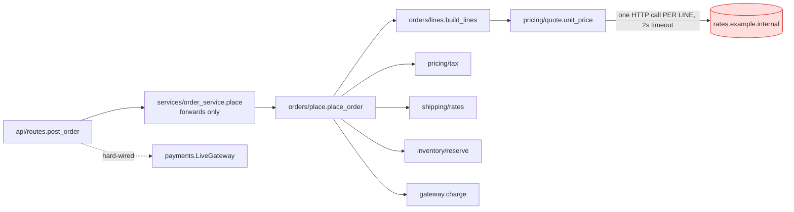
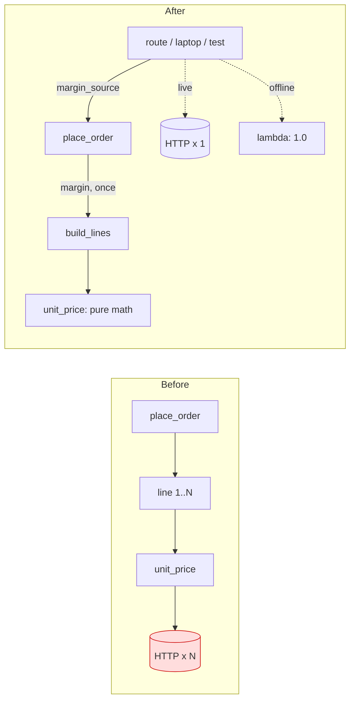
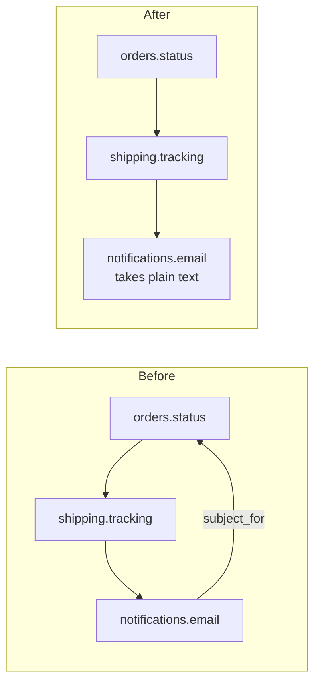

I ran the audit over all 53 files in `fixture/`. Verdict: **the structure is messy in places, not tangled.** The packages are split sensibly, but the order flow makes a network call deep inside the pricing code, and a few modules reach into each other in ways that make one change spread across many files.

There was no architecture doc, no ADRs and no git history, so I couldn't find files that often change together. I inferred the three changes most likely to come next from code that exists but isn't connected to anything yet:

1. **Multi-currency or pricing changes.** `pricing/currency.py:7` `convert()` has no callers.
2. **Cancel/refund.** `inventory/reserve.py:11` `release()` has no callers.
3. **New order states or notifications.** The `'shipped'` template in `notifications/templates.py:4` is never sent.

Evidence labels: **proven** means I ran it; **traced** means I read the whole chain.

## Map of the order flow

---

### 1. Pricing calls the network once per line item, and hides failures — *Strong* (proven)

**What it feels like:** you can't run the order flow on a train. On bad wifi checkout hangs, and then it quietly charges a different price.

**Why:** `orders/lines.py:6` calls `unit_price()` once per line. Each call runs `_fetch_margin()` (`pricing/quote.py:10-15`), which makes an HTTP request with a 2-second timeout. If the request fails, it silently uses a margin of 1.0.

**What I measured** (scratch script, `FakeGateway`, 5-line order):
- With no network: **5 HTTP calls** for one order.
- With a hanging network: **10.0 s** for one order.
- In both cases the total came back as 7825 at margin 1.0, with no error or log. When the network is down, nothing tells the business it is selling at cost.

Also, `api/routes.py:1,10` hard-codes `LiveGateway`, so the real entry point can't run against the fake. The gateway interface itself is justified: it has two implementations (`payments/fake.py`, `payments/live.py`).

**What gets better:** network calls per order go from N to 1 (0 offline), worst-case wait from 2 s × lines to 2 s, and pricing can be tested without a network.

### 2. A failed charge leaves stock reserved — *Strong* (proven)

`orders/place.py:14-16` reserves stock for every line and only then calls `gateway.charge()`. Nothing releases the stock if the charge fails. In my test, a declined card on 3 units of A left stock at **8 → 5**. `release()` already exists for this (`inventory/reserve.py:11`), so reuse it rather than adding anything new. The fix is about 4 lines: wrap the charge and release the reserved lines on failure. Change 2 (cancel/refund) will need the same code.

### 3. Import cycle: orders → shipping → notifications → orders — *Strong* (proven)

The chain is `orders/status.py:1,9` → `shipping/tracking.py:1,10` → `notifications/email.py:1,15` → `orders.status.label`. The code uses `import x.y` style specifically to avoid a crash. When I rewrote it as `from orders.status import label`, I got `ImportError: ... partially initialized module`.

These three packages now have to change together, which hits change 3 (new states or notifications) directly. The edge closing the loop is `email.subject_for` (`email.py:14-15`), which has **0 callers** in the fixture. Notifications should receive text and never need to know about orders.

### 4. One parameter is passed through 6 files — *Worth exploring* (traced)

The discount `code` is threaded by hand through `api/schemas.py:5` → `api/routes.py:10` → `services/order_service.py:4-5` → `orders/place.py:9-10` → `orders/lines.py:5-6` → `pricing/quote.py:18-20`. Adding currency (change 1) would mean editing the same ~6 files again.

Two causes:
- **A layer that only forwards.** `services/order_service.py` is 2 lines that pass the call straight through. Removing it is a 1-line change in `routes.py:2`.
- **A rule copied in two places.** "No address means US" is written out separately in `orders/place.py:11` and `shipping/rates.py:10`, which is why tax and shipping can drift apart. That rule belongs in `customers/addresses.py`.

### 5. Modules reach into other modules' stored data — *Worth exploring* (traced)

Four places read or change another module's internal data directly:
- `inventory/reserve.py:1,8` subtracts from `stock.ON_HAND`.
- `jobs/nightly.py:2-3` reads `orders.history.LOG` and `inventory.stock.ON_HAND`.
- `catalog/search.py:1` reads `PRODUCTS`.

The day stock moves to a database, all of those places change, not just `stock.py`. Separately, 5 files copy the same line, `from core.util import clamp, as_cents, slug, first`, mostly for names they don't use. That makes it look like more modules depend on each other than really do. It's cheap to clean up but doesn't hurt anyone yet.

*Not flagged:* `core/*` is imported by everything and imports nothing, which is a healthy foundation. The `PaymentGateway` interface has a real fake behind it, so it has earned its place.

---

## What to do first: candidate 1, written out as a move

Every step below keeps current behavior:

1. **Fetch the margin once per order.** Change `quote.unit_price(sku, code, margin)` to take the margin as an argument. Have `place_order` call `fetch_margin()` once and pass it down through `build_lines`. This is the same result unless the remote margin changes during one order.
2. **Let the caller choose where the margin comes from.** Change the signature to `place_order(cid, items, gateway, code=None, margin_source=fetch_margin)`. The route keeps the live source; a laptop or test passes `lambda: 1.0` with `FakeGateway`. A small interface is justified here because the margin comes over the network from a service that isn't yours.
3. **Stop hiding the fallback.** Log or flag the order when margin 1.0 is used. Whether such an order should be refused, priced, or held is your call (see the question below).

**Second option:** a module-level cache with a time limit inside `quote.py`. That's fewer edits, but the first order still waits on the network, tests still need monkeypatching, and the hidden fallback stays. I recommend the injected margin source.

**Door:** two-way. It's an internal function signature, with no stored data shape and no public API involved.

**Proof:** rerun the probe script against the changed code. Expected results: offline, **0 HTTP calls and well under 1 s**; with a hanging network, **about 2 s instead of 10 s** for 5 lines; totals equal to today's 7825. Doing candidate 2 at the same time is cheap; its proof is that stock A stays at 8 after a declined charge.

I haven't changed anything in `fixture/`; the probe scripts are in `/tmp/ad-scratch`.

**Which candidate do you want to explore?** If it's 1, one question only you can answer: when the rates service is down, should an order go through at cost (margin 1.0), be refused, or be held for re-pricing?