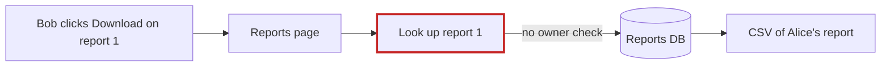
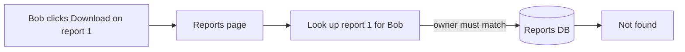
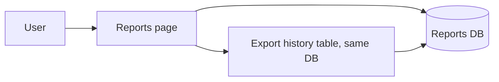

# Reports CSV export: arch-design review

**Verdict:** the code is small and clean enough to take this feature, but there's a security hole to fix first: **any signed-in user can open any report just by knowing its number**. A "download as CSV" button built on the current lookup would make taking other people's reports a one-click job.

**Map check:** there's no `docs/architecture.md`, no decision records and no git history. Nothing in `fixture/` creates the database tables either. Everything below comes from reading all 4 source files.

---

## 1. Check the report belongs to the user before exporting it (Strong, **proven**)

**What you feel:** nothing yet, which is the danger. Bob's report list only shows his own reports, but if he enters Alice's report number he gets her report.

- `app/reports/models.py:6`: `list_reports` filters by `owner_id`.
- `app/reports/models.py:10-14`: `get_report` filters by `id` only.
- `app/reports/views.py:9-11`: `report_detail` never passes `request.user_id`.

**How I proved it:** I loaded the app code against a throwaway SQLite database. User 200's list came back empty (`[]`), but `report_detail(user 200, report 1)` returned `(1, 'Alice payroll', '2026-10-01', 'secret')`.

Before:

After:


**Landing steps:**
1. Add `get_report_for_owner(report_id, owner_id)` that adds `AND owner_id = ?` to the query.
2. Switch `report_detail` over to it. This is a deliberate behavior change: non-owners now get "not found".
3. The export view uses only this lookup from the start.
4. Once nothing calls the old `get_report`, delete it.

**Proof:** rerun the probe above. Bob's request for report 1 should come back `None`, and Alice's should still return her report.

**Door:** two-way.

## 2. Export history: one table in the database you already have (Strong)

Reuse `app/db.py:11` (`execute`), which is already the one place that talks to the database. Don't add a second store, a queue, or a file store for generated CSVs.

```
report_exports(id, user_id, report_id, report_title, exported_at)  -- UTC ISO-8601 text
index (user_id, exported_at DESC)
```

The history screen reads the newest 5 rows for the user. Keep every row, since rows are tiny; pruning old ones can be added later.



**Door: one-way** (this is stored data). Two real options:
- **A, recommended:** a server-side table. History follows the user across devices and can be audited.
- **B:** keep history in the browser (localStorage). It needs no schema, but it's per-device and disappears when browser data is cleared.

Three things I decided myself:
- **Order of steps:** build the CSV first, then record the export. If recording fails, log it and still serve the file, because history isn't critical.
- **Clock:** pass the timestamp in rather than reading the clock inside the logic, so it can be tested.
- **Atomicity:** each `execute` opens its own connection and commits right away (`db.py:12-15`). That means building the export and recording it aren't one atomic step. That's fine here; I'm not adding a transaction helper.

## 3. Make the CSV in one plain function (Worth exploring)

Create `app/reports/export.py` with `to_csv(report) -> str`, using Python's built-in `csv` module. Don't build an exporter interface or plugin system: there's one format, so it's one function. Put it inside `reports/` because it changes for the same reasons reports do (two-way door). The payoff: CSV rules can be tested with no database, and "add a column" touches 1 file.

**Gap:** `render` at `views.py:14` just hands back whatever it's given, so the real response layer (file type, download filename) lives outside `fixture/` and I haven't seen it.

## 4. Nobody owns database schema changes (Speculative)

No file creates `reports` or `users`. Find out where those tables are created before adding a third one. Don't introduce a migration tool for a single table.

---

### Questions for product

These change the stored shape:
1. **Which report gets exported?** Is it one report's contents from the report page, or the whole list? The "report title" in the history suggests one report. Also, `body` is a single text field. What should its columns be?
2. **If a report is renamed or deleted, what should the history show?** I've designed for keeping the title as it was at export time (`report_title`), so history stays readable. If you'd rather show the current title, that column goes away and the history looks it up instead.
3. **Is history that only exists on one device acceptable?** Only a yes would make option B worth considering.

### Assumptions that change the design if wrong
- Reports are small, a few MB at most, so the CSV can be built during the request with no background job.
- SQLite stays the database.

**Start here:** do #1 first. It's a fix worth shipping on its own and the feature depends on it. Then #2 and #3 together are the feature itself. **Which candidate do you want to explore in depth?** I haven't changed any code.

The full visual report (light/dark, works on mobile) is at `<tmp>\architecture-review-20261026.html`. My probe left a bytecode cache in `fixture/app/`, and I deleted it, so the repo is as I found it.