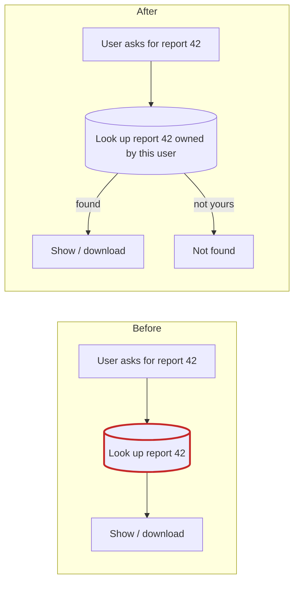
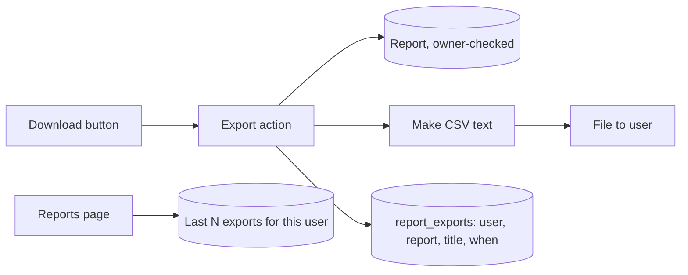

The code is small and clean, so this feature fits without new infrastructure. You need one new table in the SQLite database you already have, one small CSV function, and two new page actions. One thing has to be fixed first: anyone can open any report just by knowing its number, and a download button would let them take it away as a file.

I made no changes to `fixture/`. I also wrote the visual version of this report to `<tmp>\architecture-review-20261026.html` and opened it.

**Map check:** `fixture/` has no architecture doc, no decision records and no git history. Nothing in it creates tables: there's no `CREATE TABLE` anywhere and no migrations. I'm assuming tables are set up somewhere outside this folder.

## What the code has today (I read all 4 files)

- `app/db.py:7-18` is the only place that opens a database connection. Everything else goes through `execute()`.
- `reports/models.py:4-7` lists a user's reports and filters by `owner_id`.
- `reports/models.py:10-14` `get_report(report_id)` filters by `id` only. `reports/views.py:9-11` never passes the user in.
- `render()` (`views.py:14`) is a placeholder. There's no web framework or response layer in the fixture, so how a file download is returned is up to whatever surrounds this code.

## Candidates, best first

### 1. Check who owns a report before showing or exporting it (Strong)



- **The problem:** the list page checks ownership (`models.py:6`) but the detail page doesn't (`models.py:12`, `views.py:10`). Once there's a CSV button, being able to view someone else's report becomes being able to download it.
- **The fix:** change it to `get_report(report_id, owner_id)` with `WHERE id = ? AND owner_id = ?`. That gives 2 callers (view and export) one checked lookup.
- **Door:** two-way, easy to undo.

### 2. Export history as one table in the existing database (Strong)



- **Reuse:** `app/db.py` already owns storage. I'm deliberately not adding a second store (Redis, browser storage, a log file); each of those would be one more thing to run, secure and back up.
- **Stored shape:**
  ```
  report_exports(id INTEGER PK, user_id INTEGER NOT NULL, report_id INTEGER,
                 report_title TEXT NOT NULL, exported_at TEXT NOT NULL)  -- UTC ISO-8601
  INDEX (user_id, exported_at DESC)
  ```
- **Reading it:** `ORDER BY exported_at DESC LIMIT N`. There's no clean-up job at launch.
- **Door: one-way**, because it's stored data. The real fork is how to show the title:
  - **Option A (recommended): copy the title into the history row at export time.** History stays correct if the report is renamed or deleted, and it shows what the user actually exported. Cost: one duplicated text column.
  - **Option B: store only `report_id` and look up the title when showing history.** It's the simplest schema, but renamed reports show their new name, and deleted reports either drop out of history or need extra handling.

  Getting this wrong means a migration and backfill later. I'd keep `report_id` in both options so a re-download link can be added without a migration.
- **When to write the row:** after the CSV builds successfully, just before sending the file. Failed exports don't appear.

### 3. Keep "make the CSV" separate from the page and the database (Strong)

- Add a plain function in `reports/csv_export.py` that takes a report and returns CSV text, using Python's built-in `csv` module.
- Nothing inside it touches the database or the clock, so it can be tested without either.
- One format was asked for, so it's one function, not a plug-in system for exporters.
- **Door:** two-way.

### 4. Export code in its own module or inside `reports/` (Worth exploring)

- **Option A (recommended): keep it in `reports/`.** Add `record_export` and `recent_exports` to `reports/models.py`, and add the export action and history to `reports/views.py`. It changes for the same reason the reports feature does.
- **Option B: a separate `app/exports/` module.** That only earns its place once a second kind of thing gets exported.
- **Door:** two-way; it's a folder layout, so I've decided it here.

## Top move: the order to build it

1. **Ownership fix:** add `owner_id` to `get_report`, update `report_detail`, and add a test that user B gets nothing for user A's report.
2. **CSV function:** test it on its own, including commas, quotes, line breaks and non-English titles.
3. **History table:** create the table, add `record_export` and `recent_exports(user_id, limit)`, and test against a temporary SQLite file. `db.py` uses SQLite, so a real temp database works and no fake storage layer is needed.
4. **Page changes:** add the export action (owner-checked lookup, build CSV, record it, send it with `text/csv` and `Content-Disposition: attachment`), and show recent exports on the reports page.

**How to prove it once built:** run `pytest` with a temporary database (`DB_PATH` set to a temp file). It should show:
- user B gets a 404 on user A's export;
- an export adds exactly one history row;
- history lists the newest first and stops at N.

## What I'm assuming (labelled, since the fixture doesn't say)

- Reports are small enough to build in memory; `get_report` already loads the whole body.
- Exports are fast enough to run while the user waits, so there's no job queue.
- N = 10 history entries.
- History stores only the title and time, not the file itself.

## How this could fail a year from now

| Likely failure | What the design does about it |
|---|---|
| Someone downloads another user's report | Candidate 1 goes first; the export only uses the owner-checked lookup. |
| A title or body starting with `=`, `+`, `-` or `@` runs as a formula when opened in Excel | The CSV function escapes those leading characters; add a test for it. |
| The history table grows forever | It's indexed by user and time, and reads use `LIMIT`. Add clean-up only if the size ever matters (accepted risk). |

## Questions for product before anyone codes

1. **What goes in the CSV?** A report has one `body` text field (`models.py:12`). Is the body already table-shaped, or is the CSV meant to be the list of reports (title, created date)? This decides candidate 3 and whether history rows need a `report_id` at all.
2. **How many entries is "last few"?** And should a user be able to download a past export again? If yes, we'd need to keep the files, which is a much bigger change.
3. **Where are tables created today?** Nothing in `fixture/` does it.

Which candidate do you want to explore first? My recommendation is to answer question 1, then go through candidate 2's stored shape together, since it's the only decision that's expensive to undo.