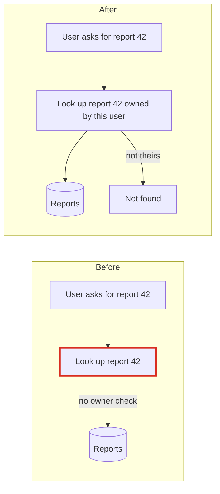
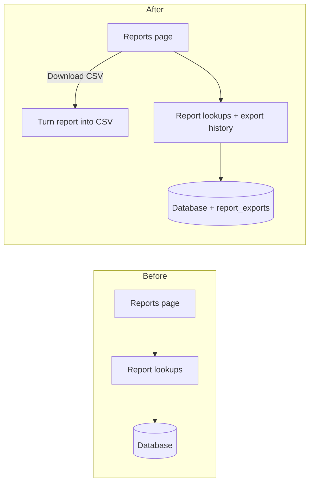

## Verdict: clean, with one safety gap to fix first

The app is small. It has one owner for database access (`app/db.py`), and reports already have their own module. So CSV export and export history fit as **one new table, one CSV function and two new page actions**. You don't need a new datastore, queue or library.

The problem is that **opening a single report never checks who owns it**. If the download button is built on today's code, anyone can download anyone's report by changing the id in the link. Fix that before adding the button.

**Map check:** `fixture/` has no architecture doc, no ADRs, no git history, no schema or migrations, and no tests. I only know the `reports` columns (`id, title, created_at, body, owner_id`) from the queries that read them. Everything below comes from reading all four files (traced). None of it has been run.

**The three changes most likely to come next** (I'm guessing these from the feature, since there's no tracker or history to check): exporting the whole list rather than one report, a second format (xlsx or PDF), and richer history (re-download, row counts). The design stays cheap for all three.

---

### 1. Check the owner in the report lookup (*Strong*)

**What users would see:** someone edits `/reports/42` to `/reports/43` and gets a colleague's report, and now a CSV of it too.

**Why:** `list_reports` filters by owner (`app/reports/models.py:4-7`), but `get_report(report_id)` doesn't (`models.py:10-14`). `report_detail` calls it without any check (`views.py:9-11`).

**What changes:** `get_report(report_id, owner_id)` with `WHERE id = ? AND owner_id = ?`. One query changes. The detail page, the CSV download and the history write all share this one lookup. It's easy to undo.

### 2. Export history as one table in the existing database (*Strong*)

- **Reuse:** all queries go through `app/db.py:11` `execute()`. History queries sit next to the report queries in `app/reports/models.py`, because they change for the same reason.
- **Not adding:** a separate store (Redis, files, a log), which would be another thing to secure, back up and run. Also not adding a background job: building a CSV from one row fits within the request.
- **Folder layout** (easy to change later): keep it in `app/reports/`, not a new `exports/` package. If more export kinds show up, it can move.

### 3. Keep the CSV builder a pure function (*Worth exploring*)

`app/reports/export.py`: `to_csv(report) -> str`, using the stdlib `csv` module, with no database or clock calls. It can be tested without a database. A second format later would just be a second function. There's no exporter interface or registry, because only one format has been asked for.

---

### The decision that's hard to undo: the shape of stored history

Once rows are written, changing the shape means a migration. I compared two options here myself, without separate design runs.

| | **A. Copy the title at export time (recommended)** | B. Store only `report_id` and look up the title |
|---|---|---|
| Table | `report_exports(id, user_id, report_id, report_title, exported_at DEFAULT CURRENT_TIMESTAMP)`, index `(user_id, exported_at)` | same, without `report_title` |
| A report is renamed | history shows the title as it was when exported | history shows the new title |
| A report is deleted | the history line stays | the line disappears, or needs an outer join and a placeholder |
| Cost if wrong | adding a lookup later is just a query change | getting past titles back is impossible |

**Why A:** it's the only option that keeps "what I ran" accurate, and the cost of being wrong is lower. "Last few" is a `LIMIT 5` in the query, so you don't need pruning at launch. The table grows by one row per export, which is fine at this size. `exported_at` uses SQLite's `CURRENT_TIMESTAMP` (UTC), so the Python code never reads the clock. Display it in the user's local time.

### Top move: landing steps (each one keeps current behaviour)

1. Add `owner_id` to `get_report` and pass `request.user_id` from `report_detail`. Detail pages still work for owners, and other users now get "not found".
2. Add `export.py` with `to_csv`. Nothing calls it yet.
3. Create the `report_exports` table. There's no migration mechanism in `fixture/`, so someone has to decide where `CREATE TABLE` lives. Add `record_export(...)` and `recent_exports(user_id, limit=5)` to `reports/models.py`.
4. Add a `report_csv` view that does lookup → `to_csv` → `record_export` → returns the file with `Content-Disposition: attachment`. Record only after the CSV is built, so failed exports don't show up in history. Show `recent_exports` on the list page.

**Proof:** there are no tests yet, so add them as you go. Owner A can't fetch or export B's report. `to_csv` round-trips through `csv.reader`, including commas, quotes and newlines in the body. After one export, `recent_exports` returns exactly one row with the right title. Run them with `pytest`.

The full report with diagrams is at `<tmp>\architecture-review-20261026.html` (outside the repo; I opened it in your browser). I haven't changed anything in `fixture/`.

**Product needs to answer: what goes in the CSV?** Is it one report's contents? If so, what is the shape of `body`: free text or tabular data? Or is it the list of reports on the page? Their answer changes `to_csv` and whether history records a `report_id` at all. After that, tell me which candidate to work through in detail. I'd start with 1.