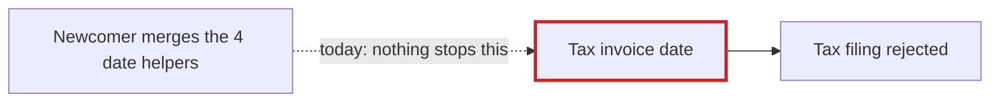
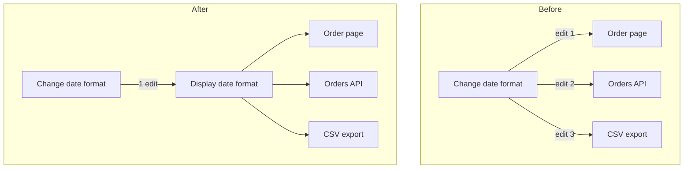

## The short version

The codebase is in OK shape, with a few messy spots. It's small (7 files, 45 lines) and mostly clean, but there's one trap a newcomer could fall into.

**The most important thing to know:** four files format dates, and three of them are identical. A newcomer will want to merge all four. **The fourth must not be merged.** `billing/invoice.py:1-5` uses ISO dates (`2026-03-04`) because the tax authority requires that format. If it changes, the whole tax filing is rejected. Right now a code comment (`billing/invoice.py:2-4`) is the only thing protecting it.

**What I checked:** there's no architecture doc, no decision records, no tests and no git history. So this comes from reading all 7 files and running each module once. The display functions all printed `04/03/2026` and the invoice printed `7|2026-03-04`. Running them created `__pycache__` folders in `fixture/`, which I deleted. Nothing in the repo has changed.

## Things I'd fix, best first

**1. Add a test that protects the tax-invoice date** (Strong)
Add one test that fails if `invoice_date` stops returning `2026-03-04` for that date. That turns a rejected filing into a failing test before the change is merged. It's about 5 lines and easy to undo.

**2. Keep the customer-facing date format in one place** (Strong, but needs one answer from the owner first)
The same day/month/year one-liner is written three times under three names:
- `web/views.py:1` `fmt_date`
- `api/serializers.py:1` `format_date`
- `jobs/export.py:1` `date_str`

If someone changes the format, they have to edit all three. If they miss one, the order page, the API and the CSV export show different dates.

- **Question for the owner:** other people's software reads the API and CSV dates. Should those dates change whenever the order page's format changes? If not, only the page should use the shared format, and the API and CSV should each get their own fixed format, like the invoice.
- **Steps:** each one keeps the output the same.
  1. Write tests that pin the current output of all four functions.
  2. Add one ~3-line shared function. Nothing like it exists to reuse.
  3. Switch the agreed callers over to it.
  4. Delete the old copies.
- **Proof:** run this from `fixture/`. It must print the same line before and after. The `-B` flag stops it creating `__pycache__`.
  `python -I -B -c "import sys;sys.path.insert(0,'.');import datetime as d;from web.views import order_page;from api.serializers import order_json;from jobs.export import rows;from billing.invoice import line;o={'id':7,'placed_at':d.date(2026,3,4)};print(order_page(o),order_json(o),rows([o]),line(o))"`
- **Cheaper option:** keep the three copies and add one test that checks they agree. There's no new module, but a format change is still three edits.
- **Risk:** easy to undo.

**3. A plug-in system for message providers with only one provider** (Speculative)
Three files exist to send a message: `providers/base.py`, `providers/registry.py` and `providers/smtp.py`. The code itself says the base class is "Implemented once, by SmtpProvider". Collapsing them would turn 3 files into 1.

Don't delete anything yet, though. Nothing inside `fixture/` calls `registry.get`, so it may be used from outside this folder (possibly by the name `"smtp"`), or a second provider may be planned. There's no history to say why it was built. If SMS or push messages are on the roadmap, keep it.

## For Monday
- **Never change** `billing/invoice.py`'s date format to match the others.
- **There are no tests.** Any change you make is unverified until you add some. Starting with #1 is the cheapest way in.
- **Date display changes** mean editing three files, until #2 is done.

The full report with diagrams is at `<tmp>\architecture-review-20261026-025511.html` and should be open in your browser.

I'd start with #1. Which one do you want to explore?