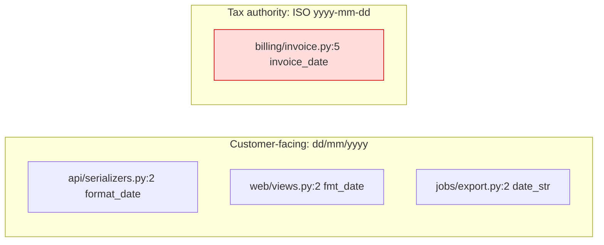
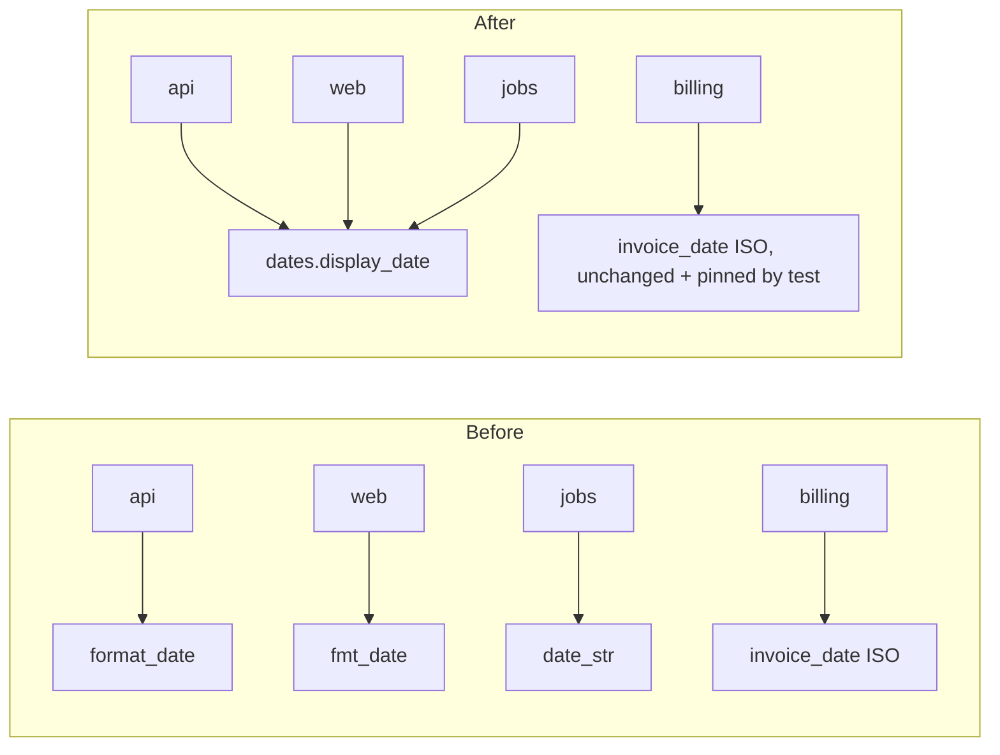

I ran the `arch-design` audit over `fixture/`. It's a review, so I made no edits.

**Verdict: messy in places.** The code is small (7 files, 45 lines), but it contains one trap that a well-meaning newcomer is likely to fall into, plus some copy-pasted code.

**Evidence I used:** I read every file. I ran all four date paths and the provider on the sample date 2026-03-04, which made the three display helpers return `04/03/2026` and billing return `2026-03-04`. I also searched the code for every caller.

**What's missing:** there is no `docs/architecture.md`, no ADRs, no tests and no git history. So I can't point to hotspots, and the "likely next changes" below are guesses from the code's shape, not from a log or a tracker. Running `/project-foundation` later would give the next person a map.

---

## Before Monday: the one thing they must know

**`billing/invoice.py:5` looks like a fourth copy of the date helper, but it is not one.**

The comment at `billing/invoice.py:2-4` says the tax authority's upload spec fixes this date as ISO-8601. If it changes, the **whole filing is rejected**. The obvious cleanup, "four date helpers, make one", would break tax filings without any error showing up. This date has to stay on its own, and no test protects it today.

---

## Candidates (best first)

### 1. One owner for the customer date format · *Strong*
- **How it hurts:** changing how dates look to customers (a locale change, say) takes 3 edits in 3 folders. Miss one and the API, the web page and the CSV export show different dates.
- **Where:** `api/serializers.py:1`, `web/views.py:1` and `jobs/export.py:1` are three identical bodies under three different names. I ran all three and they give the same output.
- **Same-reason test:** these three change for the same reason (the customer display format). Billing changes for a different reason (the tax spec), so it stays separate.

- **What gets cheaper:** a format change drops from 3 edits to 1. Billing becomes protected by a test instead of only a comment.
- **Reuse before you add:** no shared module owns formatting today, so this needs one small new file. I am *not* proposing a locale or i18n library: one format is one function.
- **The move:** each step keeps behaviour the same.
  1. Add a test that pins `billing.invoice.line()` to `7|2026-03-04` for 2026-03-04.
  2. Add `display_date(d)` in a new file, e.g. `fixture/formatting/dates.py`.
  3. Point `api`, `web` and `jobs` at it, one at a time, and delete their local copies.
- **Proof:** run this from `fixture/` before and after. The output must be identical, including `7|2026-03-04`:
  `python -c "import sys;sys.path.insert(0,'.');from datetime import date;from api.serializers import order_json;from web.views import order_page;from jobs.export import rows;from billing.invoice import line;o={'id':7,'placed_at':date(2026,3,4)};print(order_json(o),order_page(o),rows([o]),line(o))"`
- **Door:** two-way. It's a helper function and where it lives, so it's easy to undo.
- **The other option:** leave the three copies alone and only add the billing test. That's cheaper today, but the 3-edit cost stays.
- **One question for the owner:** is the CSV from `jobs/export.py` read by people, or parsed by another system that needs `dd/mm/yyyy` no matter what? If a machine reads it, it changes for its own reason (like billing) and should stay out of the shared helper.

### 2. The provider "plugin system" has only one plugin · *Speculative*
- **Where:** `providers/base.py:1` is a `Provider` base class whose own docstring says "Implemented once, by SmtpProvider". `providers/registry.py:3` is a one-entry lookup table. `registry.get()` is not called anywhere inside `fixture/`.
- **What a newcomer should know:** that's 3 files and 2 layers to send a message whose code is one line (`smtp.py:6`). If a second channel such as SMS is on the way, this structure finally pays for itself. If not, it's a guess nobody needed.
- **Why I'm not calling it dead:** with no git history I can't see why it exists, and code outside `fixture/` could call `registry.get` by name. Leave it alone until someone proves it's unused.

---

## Short version for the newcomer
1. **Never merge `invoice_date` with the other date helpers.** It's a tax-compliance contract (`billing/invoice.py:2-4`).
2. The customer date format lives in **3 places** (`api/`, `web/`, `jobs/`). Change all three, or do candidate 1 first.
3. `providers/` is built like a plugin system but has only SMTP behind it. Don't extend it until there's a real second provider.
4. There are no tests, so check any change by running the command above.

I didn't build the HTML report because this is a terminal session.

**Which candidate do you want to explore: 1 (date-format owner plus the billing test) or 2 (providers)?** Also, is `jobs/export.py`'s CSV read by people or by a machine?