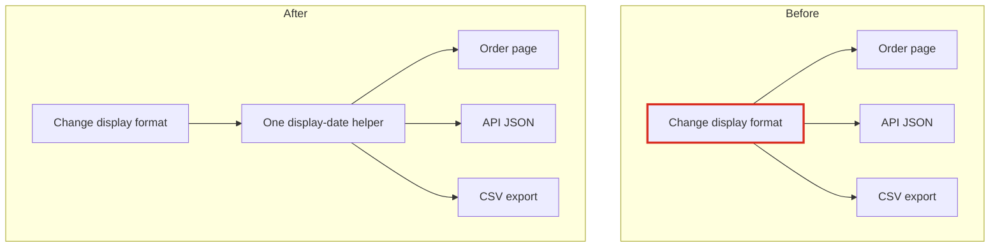
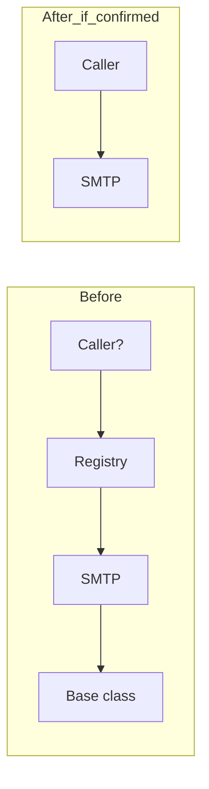

## Verdict: messy in places

`fixture/` is small and easy to read: 7 files, about 45 lines. Before Monday, the new person needs to know two things. The date customers see is written in three separate places. And one date that *looks* like a fourth copy must never be merged with the others, because the tax filing depends on it.

**Map check:** there's no architecture doc, no folder of recorded decisions, and no git history. The only written-down decision is a code comment at `billing/invoice.py:2-4`.

**Evidence:** I read every file and ran each output function on one order dated 2026-03-04 to see the actual output. Running the code created `__pycache__` folders in the repo, and I deleted them, so the repo is back to its 7 files.

---

### 1. Changing the customer date format takes 3 edits, not 1 (**Strong**)
`web/views.py:1-2`, `api/serializers.py:1-2` and `jobs/export.py:1-2` each have their own copy of the same one-line `%d/%m/%Y` formatter. All three output `04/03/2026`. If someone changes one, the others quietly stay on the old format.

- **What gets better:** a format change goes from 3 edits to 1.
- **How to do it:** (1) add `display_date` to a shared module; (2) move each of the 3 callers to it, one commit each, with output unchanged; (3) delete the local copies.
- **How to check it:** for the 2026-03-04 order, `order_page`, `order_json` and `rows` must all still contain `04/03/2026`.
- **Undoable?** Yes, easily. One caution: the API and the CSV are read by outside systems. Before tying them to the web page's format, ask whether they *should* change whenever the page does.

### 2. The invoice date looks like a copy, but it isn't (**Strong**: leave it alone)
`billing/invoice.py:1-5` outputs `7|2026-03-04` (ISO-8601). The tax authority's spec fixes that format, and per the comment, changing it gets the whole filing rejected. The display date and the invoice date change for different reasons, so they are two separate jobs that happen to look alike. Someone who merges all the date helpers into one would break the tax filing.

- **Do:** keep it out of #1, and add a test that pins `line(...) == '7|2026-03-04'`. Right now only a comment protects it.
- **Undoable?** Breaking it is not: a rejected filing has real consequences outside the code.

### 3. A plug-in system with only one plug-in (**Speculative**)
Email sending is set up for many providers but only one exists: `providers/base.py` (the docstring says "implemented once"), `registry.py:3` (one entry) and `smtp.py`. That's 3 files wrapping 1 line of real work. Nothing inside `fixture/` calls `registry.get`.

- **Don't delete it yet.** Callers outside this folder, or lookups by the string `"smtp"`, may exist, and there's no history explaining why it was built. If a second provider or a test fake is planned, the base class is worth keeping.

---

**Start here:** the invoice pin test (#2) is cheap and protects the riskiest thing, so do it first. Then #1. Leave #3 until someone confirms who calls the registry.

I changed nothing in the code. The full report with diagrams is at `<tmp>\architecture-review-20261026.html`.

**Which candidate do you want to explore?**