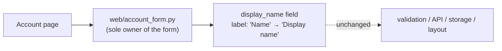

The fix is to change one label string, and no new structure is needed. I ran `arch-design` in design mode. This is the case where the skill says "settled small changes stay direct," so I didn't run the candidates, competing-designs or new-design steps.

**One caveat first:** `fixture/` holds only `requirements.md`. `web/account_form.py` isn't there, so I couldn't find the label line itself. The single-owner claim below comes from the requirements, not from code I read.

## Structure

- **Where it changes:** only `web/account_form.py`, in the visible label of the existing `display_name` field.
- **What doesn't change:** the field name, validation, API, persistence and layout. There's no new component, module, dependency, data or public contract.
- **Risk:** low and easy to undo. It's a copy change with no stored or public contract behind it.

## Smallest step

1. Change the `display_name` label in `web/account_form.py` from `Name` to `Display name`.
2. Before editing, search for `"Name"` in tests, translation files and snapshots. Update the ones that check this label so the copy has only one owner. Leave unrelated uses of "Name" alone.
3. **Proof:** render the account form, or run its existing test, and confirm it shows `Display name`. Then confirm the submitted payload still uses the key `display_name`.

## What I'm not adding
- **A shared label constant or translation key** for this one label. It has one owner, so a lookup layer would just be another place to keep in sync.
- **An architecture record.** `docs/architecture.md` and an ADR don't need updating, because nothing structural changes.

If you want it built, step 1 is a one-line edit once `web/account_form.py` is available.