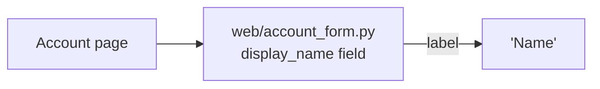
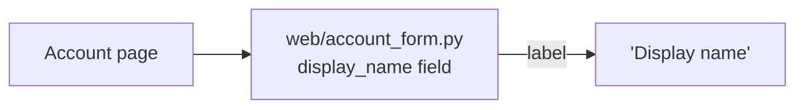

**Verdict:** This change is settled and small, so it needs no new structure. It's a one-line edit to a string in the form's one existing owner. Per the skill's rule, "settled small changes stay direct," I skipped the candidate cards, competing designs and the new-part template.

**What I checked:** `fixture/` holds only `requirements.md`. There is no code, no `docs/architecture.md` and no ADRs. So I could not confirm the brief's claim that the form "has one owner in `web/account_form.py`" against code. It's **suspected** (stated in the brief, not traced). That doesn't matter much here, because the change can be undone either way.

**Structure, before and after**

Same nodes, same edges. Only the label text changes.

**Smallest step**
1. In `web/account_form.py`, change the `display_name` field's label from `Name` to `Display name`. Leave the field name, validators, API, model and layout alone.
2. Before editing, search for other copies of the visible string (`grep -rn "\"Name\"\|'Name'" web/ templates/ tests/`). If a template or a translation file overrides the label, that's a second owner. Change it there too, or make the form the only source. Don't add a constant or i18n seam for one string.
3. Update any test that asserts the old label text.

**Proof:** render the account page, or run the form's test, and check that the `display_name` field shows `Display name` and that the submitted field key is still `display_name`. For example: `pytest -k account_form`, plus one assertion on the rendered label.

**Door:** two-way. It's a visible copy change with no stored data and no public contract.

**Alternative I'm not recommending:** a shared labels/copy module. It would add a second place that owns UI text for a single string, and nothing in scope asks for it.

There's nothing to deep-dive. Once the edit lands, add a line to `docs/architecture.md` only if that file exists and mentions the label. When you want it built, it's ready to hand off.