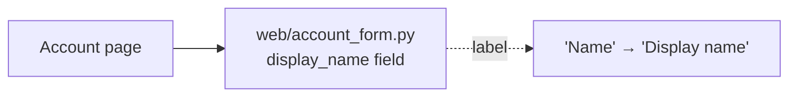

**Design verdict:** this change needs no new structure. Change one string in the form that already owns it.

I followed the arch-design skill. For a settled small change it says to give the answer directly, without the candidate and competing-design steps. I didn't edit anything.

**What I found:** `fixture/` holds only `requirements.md`. There's no `docs/architecture.md`, no ADRs, and no `web/account_form.py`. So I couldn't open the form, and the claim that it has one owner is *suspected*, not traced. When the real code is available, search for the label to confirm there's only one copy.

**Structure**

- **Owner:** `web/account_form.py`, which per the requirements is the only place that defines the form.
- **Changes:** only the visible label of the `display_name` field.
- **Unchanged:** the field name, validation, API, how it's saved, and the layout.
- **Not adding:** a constants or i18n module, a shared label helper, or a new component. Nothing would use them except this one string.

**Smallest step**

1. In `web/account_form.py`, change the `display_name` field's label from `"Name"` to `"Display name"`.
2. Search for other places that show this label, such as templates, tests or snapshots that check for `"Name"`, and update only the ones that refer to this field.

**Proof:**
- Render the account form, or run its test, and check that the label reads `Display name`.
- Check that submitting the form still posts the field as `display_name` with the same validation.
- A test that checks the label text should fail before the edit and pass after it.

**Risk:** it's a single string with no change to stored data or the API, so it's easy to undo. No architecture doc or ADR update is needed.