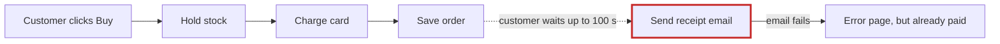
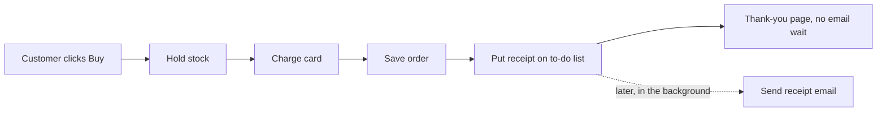

**In short:** the shop is messy in places, and one cause explains both problems you noticed. Checkout waits for the email server after the card has already been charged. When email is slow, checkout is slow, by up to 100 seconds. When email fails, the customer has paid but sees an error page.

I didn't change anything in your shop. I opened a page with pictures of all this: `<tmp>\architecture-review-shop.html`

## ⚠ First: your design document is wrong

`docs/architecture.md` (lines 14–15) says the receipt email is handed to a background helper, so "the customer never waits for email." The code doesn't do that. Checkout sends the email itself while the customer waits (`shop/checkout.py:12`). The background helper can't send receipts at all; it only knows refund emails (`shop/jobs/worker.py:6-8`). Anyone reading that document, a person or an AI, would think this problem was already solved.

## What's wrong, best fix first

I ran a test of each problem below to confirm it really happens.

**1. Send the receipt in the background** (strong)

The shop tries the email 3 times, waiting up to 30 seconds each time, with a 5-second pause between tries. That adds up to 100 seconds. I switched the mail server off in a test: the card was charged, the order was saved, and the customer still got an error.

**Better:**

The shop already has this to-do list, and refunds already use it, so nothing new is needed. It's also easy to undo.

**2. Stop the to-do list from losing emails** (strong; must come before #1)

The list marks a job "done" *before* trying it. If the email fails, that email is lost. One failure also stops the helper completely, so every email after it waits until someone restarts it. Some refund emails may already have gone missing this way. **Better:** mark a job done only after it works, retry failures, and keep going.

**3. Put stock back when a card is declined** (strong)

Checkout takes items off the shelf before charging the card, and nothing ever puts them back. In my test: 5 pens in stock, a declined order for 2, and the shop then thought it had 3. Products can show "out of stock" while they're still on the shelf.

**4. Orders are kept only in memory** (worth exploring)

If the website restarts, all orders and stock counts may disappear (`shop/db.py:3-4`). This copy of the code might just use a placeholder here, so it's worth checking what the live site runs. A fix would store orders in the database file the to-do list already uses. How orders are stored is hard to change later, so we'd agree on that together first.

## Where I'd start

Do **2, then 1**. Together they fix both of your problems using parts the shop already has. #3 is a small follow-up.

One question only you can answer for #1: **is it fine if the receipt arrives about a minute after purchase instead of instantly?** And which fix would you like to explore first?

For an engineer

- Path of the slow checkout: `web.py:5` → `checkout.py:9` (charge) → `:10` (save) → `:12` `send_receipt` → `emailer.py:8-16` (3 tries × `timeout=30`, 2 × `sleep(5)`, re-raises after the last try).
- Queue: `queue.py:18` sets `done=1` before the job runs; `worker.py:18` has no try/except, and an unknown task raises `KeyError`.
- Stock: `checkout.py:6-9` reserves stock, then charges; `inventory.py` has no `release`.
- Steps for #1: (a) land #2; (b) add a `send_receipt` handler; (c) replace the direct call at `checkout.py:12` with `enqueue(...)`; (d) fix `docs/architecture.md`.
- Proof for #1: with SMTP stubbed to fail, `place_order` returns an order and leaves one pending job, which the worker sends once SMTP is back.
- The simpler alternative is to catch the error and cut to one 5-second try inline. I rejected it because customers still wait on the mail server and failed receipts are silently dropped.
- #1 is easy to undo: it reuses the existing `jobs` table rather than adding a message broker.

