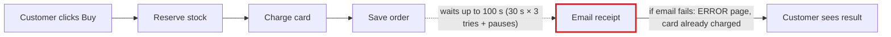
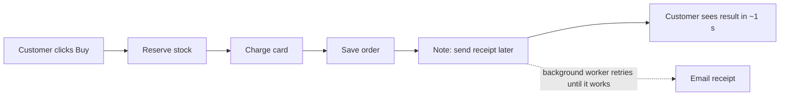

# Your shop: architecture review

**Verdict: messy in places.** Checkout makes the customer wait while the receipt email is sent. When the email server is slow, the customer waits up to about 100 seconds. When the email server doesn't answer at all, the card has **already been charged**, and the customer gets an error page anyway. That one cause explains both things you noticed.

I checked this by running your shop's code with the email server simulated as down. I changed nothing in your shop. The full illustrated report has opened in your browser: `<tmp>\architecture-review-20261026.html`

## ⚠ First: your architecture document is wrong
The document says checkout "puts the receipt email on the job queue. The customer never waits for email." The code doesn't do that. Checkout sends the email itself, while the customer waits (`shop/checkout.py:12`). The background worker has no instructions for receipts at all (`shop/jobs/worker.py:6-8`). Anyone reading that document will think this problem is already solved.

## 1. Send the receipt in the background — *Strong*

**Before:** the customer waits for the email.

**After:** the email goes out in the background.

- **What gets better:** the customer's wait for email goes from up to 100 s to 0 s. Email can no longer cause "charged but saw an error".
- **Nothing new to buy or run:** the shop already has a background queue, used today for refund emails.
- **Risk:** easy to undo. One condition: candidate 2 below has to be fixed first.

## 2. The background queue loses emails and stops after one failure — *Strong*
The worker crosses a job off its list *before* sending it. If sending fails, that email is lost, and the worker crashes, so every email after it gets stuck too. When I tested it with the mail server down, refund email 1 was marked "done" but never sent, and email 2 was stuck (`jobs/queue.py:18`, `worker.py:18`). Some refund customers may already have missed their confirmation.

## 3. Stock "disappears" when an order fails partway — *Worth exploring*
A cart with 2 mugs and 1 sold-out hat was refused, but the mug stock still dropped from 5 to 3 (`checkout.py:6-9`). A declined card does the same. The result is items that show as sold out while they're on the shelf.

## 4. Orders and stock are only kept in memory — *Worth exploring, needs care*
If the program restarts, every order record is gone (`db.py:4`, `inventory.py:1`). After that, support can't refund those orders. The fix would reuse the storage the email queue already has, rather than adding a second database. This one is hard to change later, so it needs its own discussion. It may also just be a placeholder in this copy of the code, so please confirm.

## Where I'd start
**Fix 2, then 1.** Together they're one fix in two steps, and they address both of the problems you noticed. The report's "Details for engineers" sections list the exact steps and a test that proves each step works. There's no change history to check here (the folder isn't tracked in git), so I ranked these by your two complaints, not by how often each part changes.

**Which one would you like to explore?** If it's #1, one question only you can answer: *is it fine if the receipt email sometimes arrives a minute or two after the order instead of instantly?*