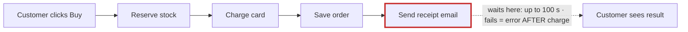
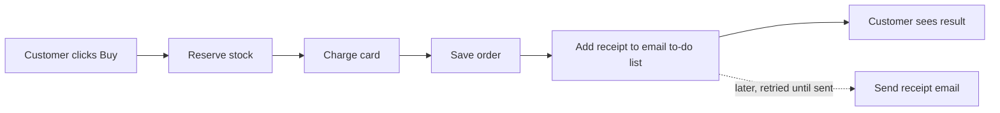
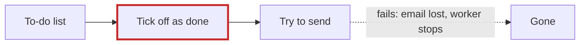

# Your shop's architecture

**Verdict: messy in places.** At checkout, your shop waits for the email server before it shows the customer anything. When email is slow, checkout is slow, up to 100 seconds. When email fails, the customer sees an error page even though their card was already charged. I changed nothing in your shop's files.

I tested each finding by running your shop's code with a fake mail server that was switched off. I didn't just read the code.

The full illustrated report has opened in your browser. It's saved at `<tmp>\architecture-review-20261026-0256.html`.

## ⚠ First: your architecture document is wrong

The document says checkout puts the receipt on a background "to-do list" (a queue) so that "the customer never waits for email" (`docs/architecture.md:8`, `:14-15`). The code doesn't do that. Checkout sends the email itself while the customer waits (`shop/checkout.py:12`). The background worker can't send receipts at all; it only knows refund emails (`shop/jobs/worker.py:6-8`). Anyone who trusts the document would think this problem is already solved.

## 1. Send the receipt in the background, not during checkout (Strong)

**What you feel:** "checkout takes ages" and "charged but saw an error page."

**Why:** after the card is charged, checkout tries to reach the email server. If it gets no answer, it waits 30 seconds per try and makes 3 tries, with 5-second pauses between them. That adds up to 100 seconds, and then it shows an error. When I ran it with email down, the customer waited 100 seconds, got an error page, and was still charged.

**After:**

**What gets better:**
- The worst-case wait drops from 100 seconds to under 1 second.
- A mail outage can no longer cause "charged but error page."
- All customer emails go through one route instead of two.

**Risk:** easy to undo. It reuses the to-do list you already have, so there's nothing new to run.

**For engineers:** add a `send_receipt` handler in `worker.py`, then swap `checkout.py:12` for `enqueue(...)`. Don't add Redis or Celery; that would be a whole new service for one email type. The simpler alternative is to catch the error and make a single 5-second attempt. I rejected it because customers still wait, and receipts are silently lost whenever mail is down.

## 2. The to-do list throws away emails that fail (Strong, must land with #1)

The worker ticks an email off as done *before* sending it (`queue.py:18`). If sending fails, the email is gone and the worker stops. When I tested it, 1 refund email went into the list and 0 were left after the failed send. Some refund confirmations are probably not arriving today, and nobody would know.

**After:** try to send first, then tick it off. If sending fails, the email stays on the list and is retried.

## 3. Failed orders keep stock locked up (Worth exploring)

Checkout sets items aside one at a time and never puts them back when the order fails (`inventory.py` has no "put back" step). In my test you had 5 mugs. An order for 2 mugs and 1 sold-out t-shirt failed, but only 3 mugs were left. A declined card leaks stock the same way.

**Better:** check that everything is in stock first, then set it all aside, and put it back if the card is declined.

## 4. Orders and stock are forgotten on restart (Speculative)

Orders and stock are kept only in memory (`db.py:3-4`, `inventory.py:1`), so a restart would wipe them. The payment code is also clearly a placeholder that never contacts a bank, so this may be demo code. This change would be hard to undo later, so I need your answer before anyone touches it.

## Where I'd start

I'd do **#1 and #2 together**. They fix both problems you've noticed and stop refund emails from disappearing, and they add nothing new to run.

Two questions for you:
1. **Which one would you like to explore first?**
2. **Is this the code running your live shop, or a demo?** Your answer decides whether #4 matters.