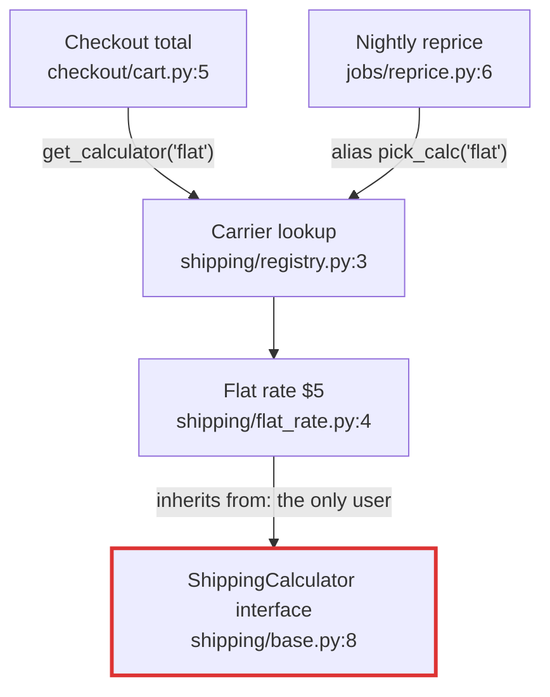
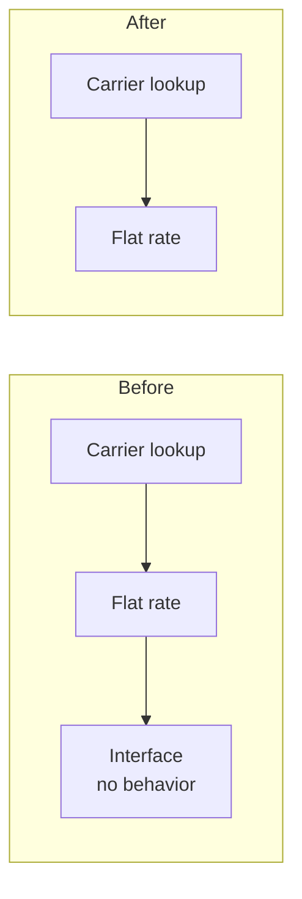

**Verdict: yes, it's safe to remove, but not by deleting the file on its own.** The interface is `ShippingCalculator` in `shipping/base.py`. It isn't unused: the one real calculator inherits from it. If you delete `base.py` alone, both checkout and the nightly reprice job crash as soon as they load. Removing it properly takes two edits in one file, and both callers keep working.

Overall the codebase is clean, with one piece of structure nobody needs.

**Map check:** there's no `docs/architecture.md`, no ADRs and no git history, so I drew the map from the code. The only stated reason for the interface is its docstring (`shipping/base.py:3`): "Kept as a seam in case a second carrier is ever needed. Today only one implementation exists."

## Who actually touches it (traced: every file read, all 5 of them)

- **1 user:** `shipping/flat_rate.py:1` imports it and `:4` subclasses it. No other file mentions it. I also searched for `isinstance`, `issubclass`, `__subclasses__`, `getattr` and `importlib`, and found none.
- **It does nothing:** its only method, `quote`, just raises `NotImplementedError` (`base.py:10`). `FlatRateCalculator` overrides it (`flat_rate.py:7`), so that code never runs.
- **Why it "looks unused":** the callers never name it. They get calculators through the registry by the string `"flat"`, and the reprice job also renames the lookup function (`get_calculator as pick_calc`, `jobs/reprice.py:2`). Searching from the callers' side finds nothing, but the dependency is real.

## Candidate 1: Remove the interface (Strong)

**What has to change (2 edits in 1 file, plus deleting 1 file):**
1. `shipping/flat_rate.py:1`: delete `from shipping.base import ShippingCalculator`.
2. `shipping/flat_rate.py:4`: change `class FlatRateCalculator(ShippingCalculator):` to `class FlatRateCalculator:`.
3. Delete `shipping/base.py`.

`registry.py`, `cart.py` and `reprice.py` need no edits.

**What gets better:** 1 fewer file and 1 fewer layer to read. A second carrier still only needs a class with a `quote(order)` method and one entry in `CALCULATORS` (`registry.py:3`). The registry is already the seam the docstring wanted. Python doesn't need a base class for that.

**Proof (proven):** I ran a smoke test on three scratch copies outside the repo. It calls `total_with_shipping` and `reprice_open_orders`.

| Copy | Result |
|---|---|
| As it is now | `cart: 15.0`, `reprice: [5.0, 5.0]` |
| Only `base.py` deleted | `ModuleNotFoundError: No module named 'shipping.base'` |
| Steps 1–3 applied | `cart: 15.0`, `reprice: [5.0, 5.0]`, the same as now |

**Door: two-way** as long as the code stays internal. Restoring it is a 10-line file. If `shipping/` is published as a package that outside code can import, the class name becomes public API, which is one-way. Removing it before release is the cheap moment.

**Second option:** keep it as a `typing.Protocol`, with no inheritance, if you want a type checker to enforce the `quote` signature. The project has no type checking and only one implementation, so that's structure for a second carrier that doesn't exist. I'd delete it.

## Candidate 2: The one-entry carrier lookup (Worth exploring, I'd leave it)

`registry.py` maps one name to one class, and two callers depend on the string `"flat"` (`cart.py:5`, `reprice.py:6`). Inlining it would cost 2 caller edits and remove the one place a second carrier would plug in. It's under 10 lines, so keeping it is cheap. If anything, this is the seam to keep once the interface is gone.

## Not checked

- There are no tests, so the smoke test above is the only check.
- With no git history, I couldn't look for an older reason the interface was added.
- I couldn't see code outside `fixture/`. If anything else imports `shipping.base`, it would break too, so search the wider repo for `shipping.base` and `ShippingCalculator` first.

I haven't changed anything in `fixture/`. Do you want to go deeper on Candidate 1 (for example, settling whether `shipping/` is ever imported from outside), or on Candidate 2?