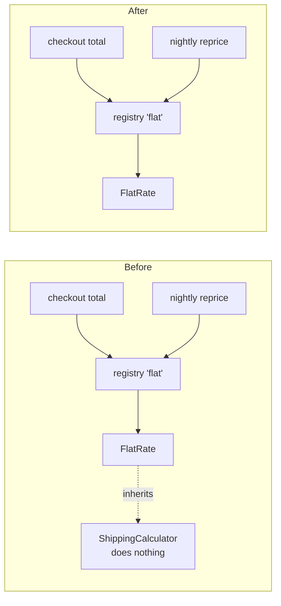

## The short answer

Yes, `ShippingCalculator` (`shipping/base.py:8`) can be removed. It isn't unused, though, so deleting the file by itself breaks checkout and the nightly repricing job. Change two things together:

1. Delete `fixture/shipping/base.py`.
2. In `fixture/shipping/flat_rate.py`, remove the import on line 1 and the base class on line 4, so it reads `class FlatRateCalculator:`.

Nothing else needs to change. I tested this on a throwaway copy, not the fixture:

| State | Result |
|---|---|
| As-is | `15.0`, both orders get `shipping: 5.0` |
| Only `base.py` deleted | `ModuleNotFoundError: No module named 'shipping.base'`. Both checkout and the nightly job fail when they load |
| `base.py` deleted and `flat_rate.py` edited | `15.0`, both orders get `shipping: 5.0`. Same as before |

## Why it looked unused

A search for callers of the interface finds none, because nobody calls it directly. It is still in use:

- `flat_rate.py:1,4` imports it and inherits from it. Its only content is `quote()` raising `NotImplementedError` (`base.py:9-10`).
- Both real callers reach the calculator without naming it. They go through a lookup by the string `"flat"` (`registry.py:3,7`). The nightly job also renames the lookup function on import (`reprice.py:2`, `get_calculator as pick_calc`), so searching for `get_calculator(` misses that call.
- Nothing checks the type: there is no `isinstance` or `issubclass` anywhere in `fixture/`.

## Audit

**Verdict: messy in places.** It's tidy apart from one placeholder kept "in case a second carrier is ever needed" (`base.py:3`), and it has only one implementer.

**Candidate 1: remove `ShippingCalculator` (Strong, tested above).**
- **Problem:** it's a layer that adds nothing, and someone has to keep it in mind. Its own docstring says "Today only one implementation exists." One implementer is a guess, not a confirmed need.
- **What gets cheaper:** one fewer file and one fewer import, and the next reader doesn't have to hunt for other implementations that don't exist.
- **Losing the option of a second carrier?** No. The lookup table in `registry.py` already lets you add one: a second class with a `quote()` method plus one line in `CALCULATORS`.

**Candidate 2: replace the lookup table with a direct call (Speculative, I wouldn't do it now).** The table has one entry, and both callers pass the same hard-coded `"flat"` (`cart.py:5`, `reprice.py:6`). Folding it into a direct call would save one more small file. But once the base class is gone, this table is the only place a second carrier would plug in, so removing it makes nothing meaningfully cheaper. Leave it.

## The move

1. Edit `flat_rate.py` to drop the import and the base class. Behavior stays the same, because the base class only defined a method that `FlatRateCalculator` already overrides.
2. Delete `shipping/base.py`.
3. Check: import `checkout.cart` and `jobs.reprice`, then call `total_with_shipping({"subtotal": 10.0})`. It should return `15.0`, and `reprice_open_orders` should set `shipping` to `5.0` on each order. That's what my table above ran.
4. An alternative, if a second carrier really is coming soon: keep the base class, but as a `typing.Protocol` that doesn't need to be inherited. You'd still get type-checking without an empty class every implementer must subclass.

**How reversible is it:** fully, as long as this is internal code. You can put the file back in a minute. The only risk is code outside `fixture/` that imports `shipping.base` or `ShippingCalculator`, such as another repo, a plugin or type stubs. I couldn't check that. There's no git history, no `docs/architecture.md` or decision records, and no tests in the fixture. So "nothing else uses it" is confirmed inside `fixture/` and only suspected beyond it. If this package ships to anyone else, search their code for those two names before deleting.

I haven't changed anything in `fixture/`. Should I apply Candidate 1, switch to the `Protocol` alternative, or look into something else?