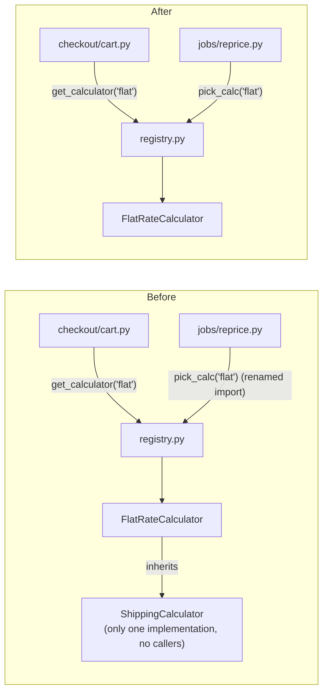

**Verdict:** Yes, it's safe to remove, but deleting the file alone breaks the app. The interface is `ShippingCalculator` in `shipping/base.py`. It isn't unused: the one real calculator inherits from it, so deleting it means editing one more file. Overall the fixture is clean, with this one piece of structure nobody needs.

I couldn't check the project's design notes or history: there is no `docs/architecture.md`, no recorded decisions, no git history and no tests. The only stated reason for the interface is its own docstring: "Kept as a seam in case a second carrier is ever needed" (`shipping/base.py:3`). I drew the map below from the code itself.

## Candidate 1: Remove `ShippingCalculator` (Strong)

**Why it looks unused.** No caller uses the interface. Both callers ask the registry for a calculator by the name `"flat"`, and neither mentions the interface:
- `checkout/cart.py:5` calls `get_calculator("flat")`
- `jobs/reprice.py:2,6` calls the same function under a different name, `pick_calc`, so a search for `get_calculator` would miss this one.

I searched for the class name, `isinstance`/`issubclass` checks, `getattr` and dynamic imports. The only matches are where it's defined and `shipping/flat_rate.py:1,4`.

**Why deleting just the file fails.** `flat_rate.py` imports and inherits from it. I deleted `base.py` alone in a scratch copy and the app wouldn't load:
```
from shipping.base import ShippingCalculator
ModuleNotFoundError: No module named 'shipping.base'
```
Both checkout and the nightly reprice job go through that import, so both would break.



**What has to change: 2 edits, 1 deletion.**
1. In `shipping/flat_rate.py`, delete line 1 (`from shipping.base import ShippingCalculator`).
2. In `shipping/flat_rate.py:4`, change `class FlatRateCalculator(ShippingCalculator):` to `class FlatRateCalculator:`.
3. Delete `shipping/base.py`.

Nothing else changes. `registry.py`, `cart.py` and `reprice.py` stay as they are.

**What it buys:** one file and one inheritance level fewer, and no stub method that only raises `NotImplementedError`. If a second carrier ever arrives, that's when there are two implementations to justify an interface. Even then the registry already handles the choosing, so a shared base class may still not be needed.

**Proof (proven, ran this session).** I ran checkout and the reprice job on a scratch copy before and after the change. The output was identical: `15.0 [{'subtotal': 10, 'shipping': 5.0}]`. To repeat it, run a script that calls `total_with_shipping({"subtotal": 10})` and `reprice_open_orders([{"subtotal": 10}])` with `fixture/` on the import path, before and after the edit.

**Reversibility: easy to undo.** The class hasn't shipped and isn't part of any stored data or public API. Bringing it back is three lines. One caveat: I only checked inside `fixture/`. If code in another repo or a plugin imports `shipping.base`, it would break too. Since nothing has shipped yet, that's unlikely, but it's worth a quick grep elsewhere.

## Not flagged: the registry
`registry.py` is a one-entry dictionary looked up by name. It looks like spare structure too, but it's the piece both callers actually use. Removing it would mean editing two files for no real gain, so I'd leave it.

Do you want to go ahead with candidate 1? I haven't changed anything in `fixture/`; all the testing was on throwaway copies.