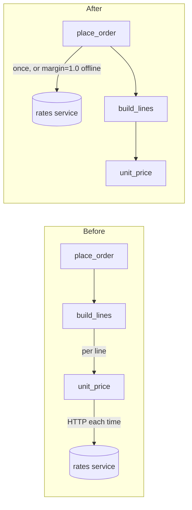

I ran the audit over `fixture/` and changed nothing in it. Probes ran in throwaway copies, and the helper's check passed (`ARCH-GATE: done`).

**Verdict: messy in places.** Order logic, pricing, shipping and reporting all depend on each other's internals. So a change ripples across packages, and placing an order needs the company network even when you'd expect it to run on its own. There's no architecture doc in the repo to check against.

## Where the structure is going wrong (worst first)

1. **Pricing makes a hidden network call for every line of an order.** This is why the order flow can't run on a train.
   - `unit_price` in `pricing/quote.py:19` calls `urlopen("https://rates.example.internal/...")` each time it runs, and `orders/lines.py:6` calls it once per line.
   - **Proven:** a 3-line order made 3 network calls. Each can wait up to 2 s, so up to 6 s for that order, and the DNS lookup isn't covered by that timeout.
   - Worse, when the network fails, the error is swallowed and the margin defaults to 1.0. Offline you don't get an error; you quietly get different prices.

2. **Three packages import each other in a loop.** `orders/status.py:1` imports `shipping/tracking.py`, which imports `notifications/email.py`, which imports `orders/status.py` again.
   - It only works because all three use `import x` rather than `from x import y`.
   - **Proven:** in a copy, changing just `shipping/tracking.py:1` to `from notifications.email import send` makes `import notifications.email` crash with "partially initialized module".
   - So those 3 files in 3 packages have to change together.

3. **The same knowledge is repeated across packages.** This is a direct cause of changes touching too many files.
   - The order is a plain dict built in `orders/place.py:16`, and its fields are read directly in 5 files across 4 packages: `api/schemas.py:9`, `orders/status.py:9`, `reporting/sales.py:6,10`, `reporting/exports.py:10`. Renaming one field touches all of them.
   - The rule "use the customer's default-address country, else US" is written twice (`orders/place.py:11`, `shipping/rates.py:10`), and the address is looked up twice per order.

4. **Smaller sources of churn:**
   - `core/util.py` is a grab-bag of unrelated helpers: 16 files import it, and 10 of those import names they never use.
   - `services/order_service.py` only forwards the call, so it's one more file to edit whenever the order-flow signature changes.
   - `api/routes.py:10` hardwires `LiveGateway`, so the API entry point can't use the existing `payments/fake.py`.

## What to do first: fetch the margin once per order and pass it in

`place_order` already receives the payment gateway as an argument (`orders/place.py:9`), which is why a fake gateway works today. The margin should come in the same way.

1. Rename `_fetch_margin` to `current_margin` (keep the old name as an alias). Give `unit_price` an optional `margin` argument and only fetch when none is passed.
2. Pass `margin` through `build_lines`.
3. In `place_order`, fetch the margin once if none was passed, and hand it down. That's one fetch per order instead of one per line.
4. Pass `margin` through `services/order_service.place`. On a laptop or in tests you then call `place(..., FakeGateway(), margin=1.0)` with no network at all.

- **Callers of `unit_price`:** only `orders/lines.py:1` and `:6`.
- **Risk:** it's easy to undo. Every new argument has a default, and nothing stored or public changes.
- **Proof:** this check blocks the network, places a 3-line order with code `WELCOME10`, and asserts the total is 4427. It passes in a copy today; rerun it after each step.
  ```
  python -B -c "import urllib.request as u; u.urlopen=lambda *a,**k: (_ for _ in ()).throw(OSError('offline')); from catalog.products import add_product; from inventory.stock import receive; from services.customer_service import register; from services.order_service import place; from payments.fake import FakeGateway; [add_product(s,'item '+s,1000) and receive(s,10) for s in 'ABC']; a=register('<email>','1 St','NYC','US'); o=place(a['id'],[{'sku':'A','qty':1},{'sku':'B','qty':2},{'sku':'C','qty':1}],FakeGateway(),'WELCOME10'); assert o['total']==4427, o['total']; print('ok', o['total'])"
  ```
- **Not doing:** a separate "margin source" interface with live and fake versions plus a config switch for offline mode. That's 2–3 new files and a config path for a single number. If one number turns out too thin (say, margins per currency), switching to that interface later only touches `place_order` and its callers, so starting simple costs nothing.



## Problems spotted while reading (not structural)

- **Login can be faked:** `api/auth.py:5` accepts any token in the form `<customer-id>:<anything>` and never checks a secret or signature. Anyone who knows or guesses an ID like `cus-000001` can place orders as that customer.
- **Crash on unknown customers:** `api/routes.py:10` crashes with a `TypeError` when the account isn't found, because the lookup returns `None`.
- **Stock gets stuck:** `orders/place.py:14-16` reserves stock line by line, then charges. If a later line is short or the charge fails, the stock already reserved is never released.
- **Silent offline prices:** the fallback to margin 1.0 in `pricing/quote.py:15` (finding 1) is a correctness risk on its own, not just a speed one.

Which should we explore: the margin move above, breaking the import loop (2), or giving the order one owned shape (3)?