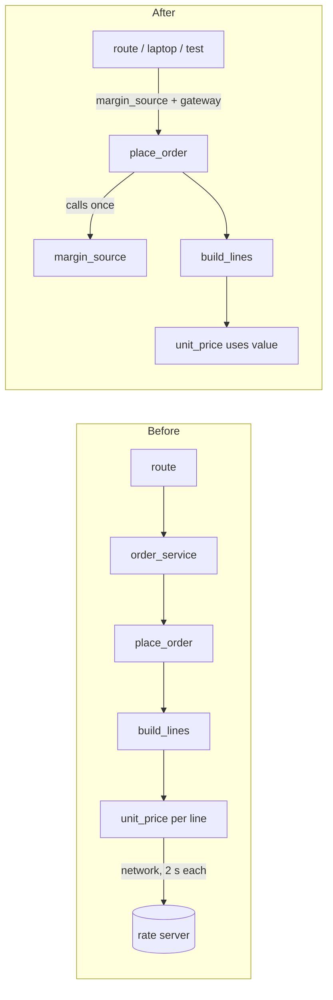

# Architecture audit: `fixture/`

**Verdict: messy in places.** The order flow can't run on a train because pricing quietly calls a rate server once for every order line. Changes spread across many files because each order input is handed down through about six layers.

No architecture docs exist in the repo, so I judged the code directly. I read all 53 files (431 lines) and ran the order flow in a throwaway copy with the network cut off.

## Where the structure goes wrong (worst first)

1. **A hidden network call on every order line.** I ran this one and saw the result. `pricing/quote.py:10` (`_fetch_margin`) contacts `rates.example.internal` from `unit_price` (`pricing/quote.py:19`). That happens once per line, four calls below the route (`routes` → `order_service` → `place` → `lines` → `quote`).
   - A 3-line order made 3 network calls and took **6.0 s**. That's 2 s per line, so a 10-line order would take 20 s.
   - When offline, the margin quietly falls back to 1.0, so **the price is different from the online price**.
2. **The route hard-codes `LiveGateway`** (`api/routes.py:1,10`). `FakeGateway` (`payments/fake.py:1`) and a `PaymentGateway` protocol (`payments/gateway.py:4`) already exist, but you can't use the fake one at the entry point without editing `routes.py`.
3. **Inputs are passed down through layers that only forward them.** The discount `code` passes through 6 files: `schemas` → `routes` → `order_service` → `place` → `lines` → `quote`. Any new pricing input (currency, margin) would touch the same 6 files. `services/order_service.py` does nothing except forward the call.
4. **Import cycle:** `orders/status.py:1` → `shipping/tracking.py:1` → `notifications/email.py:1` → `orders.status`. It only works because these files use `import x`; switching to `from x import y` would break it. Showing an order's status label also loads the email sender.
5. **The customer's country is looked up twice per order**, in `orders/place.py:11` and `shipping/rates.py:10`. Each place has its own `'US'` default, so tax and shipping can end up using different countries.

## What to do first: fetch the margin once per order, passed in like the gateway

This is low-risk and easy to undo: it only adds an optional argument to four internal functions, and the default keeps today's behaviour.

1. `unit_price(sku, code=None, margin=None)`: use `margin` when given, otherwise call `_fetch_margin` as it does today.
2. `build_lines(..., margin=None)`: pass it through.
3. `place_order(..., margin_source=_fetch_margin)`: call it **once** and pass the value down.
4. `services/order_service.place` passes `margin_source` on. The route keeps the live default. On a laptop or in tests, pass `lambda: 1.0` and `FakeGateway()`.

Behaviour stays the same at every step, and an order makes 1 network call instead of N.

- **Code that references what changes (7 places):** `pricing/quote.py:19`, `orders/lines.py:1,6`, `orders/place.py:1,10`, `services/order_service.py:5`, `api/routes.py:10`.
- **What it builds on:** the existing gateway pattern (`payments/gateway.py:4`, `payments/fake.py:1`).
- **Proof that behaviour holds:** a one-line script, run from `fixture/`, that cuts the network and places a 3-line order with `WELCOME10`. It asserts the total is `3464` and passes today in a throwaway copy. Rerun it after each step.
  ```
  python -B -c "import sys,urllib.request as u; sys.path.insert(0,'.'); u.urlopen=lambda *a,**k: (_ for _ in ()).throw(OSError()); from catalog.products import add_product as p; from inventory.stock import receive as r; from services.customer_service import register; from orders.place import place_order; from payments.fake import FakeGateway; [(p(s,s,1000),r(s,10)) for s in 'ABC']; c=register('x@y','1','NYC','US')['id']; o=place_order(c,[{'sku':s,'qty':1} for s in 'ABC'],FakeGateway(),'WELCOME10'); assert o['total']==3464, o['total']; print('ok', o['total'])"
  ```
- **Not doing:** a TTL cache around `_fetch_margin`, or a global `OFFLINE` flag.
  - A cache still blocks for 2 s on the first line after every cold start and keeps the hidden global state, so tests would depend on the order they run in.
  - A flag adds a second setting that people have to know about.
  - If my move turns out wrong, undoing it means removing one optional argument from four functions.



## Bugs and security holes I saw along the way (not structural)

- **Anyone can log in as any customer.** `api/auth.py:5` uses the part of the token before `:` as the customer ID and never checks the rest. `cus-000001:anything` logs in as that customer.
- **An unknown token crashes instead of returning 401.** `post_order('nobody:x', …)` raises `TypeError: 'NoneType' object is not subscriptable` at `api/routes.py:10`.
- **Stock isn't returned if a payment fails.** `orders/place.py:14-16` reserves the stock and then charges the card; if the charge raises, the reserved stock is never released.
- **Prices change offline without warning** (see finding 1).
- **Minor:** five files import `clamp, as_cents, slug, first` from `core.util` and mostly don't use them. `reporting/sales.py` imports `lines_total` and never uses it.

Nothing in `fixture/` was changed, and no `__pycache__` was left behind. Should I work out the margin move in detail, or would you rather look at breaking the import cycle or making the route accept a gateway first?