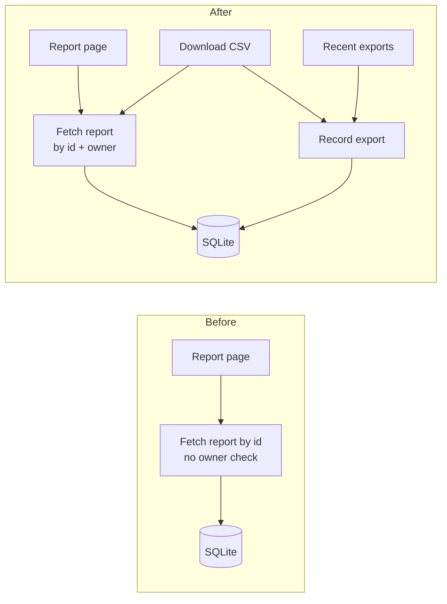

I ran the arch-design review over `fixture/` and it's finished. The skill's own check passed all three stages and confirmed nothing in `fixture/` was changed. Here's how I'd structure the feature.

**Verdict:** the layout is clean and has one obvious place for this feature. But there's a security hole that the CSV button would make worse if someone built it on the existing code.

## The problem: opening a report never checks who owns it
- `get_report` (`app/reports/models.py:10`) fetches a report by `id` alone, and `report_detail` (`app/reports/views.py:9`) calls it without checking the owner.
- I proved it in a throwaway copy: user 99 opened report 1, which belongs to user 7, and got the whole report back.
- A CSV button that reuses `get_report` would let anyone download any report by guessing its id.

## How to structure it: keep everything in `app/reports`, using the existing database helper
1. **Add an owner-checked fetch.** Add `get_owned_report(report_id, owner_id)` to `models.py`, filtering on `WHERE id = ? AND owner_id = ?`. Leave the existing views alone for now.
2. **Add a history table.** Create `report_exports (id, user_id, report_id, title, exported_at)`. Add `record_export` and `recent_exports(user_id, limit=5)` to `models.py`, both going through `app/db.py::execute`. Nothing new to the stack.
3. **Add the CSV view.** Add `report_export_csv(request, report_id)` to `views.py`. It calls `get_owned_report`, builds the CSV with Python's built-in `csv` module, calls `record_export`, and returns the file with `text/csv` and `Content-Disposition` headers.
4. **Add the history view.** Add `export_history(request)`, which returns `recent_exports(request.user_id)`.
5. **Fix the existing page separately.** Switch `report_detail` to `get_owned_report` in its own change and review, because it changes current behaviour.

Today's references to `get_report` are only in `app/reports/views.py` (the import on line 1 and the call on line 10). `users/` and `db.py` don't need to change.

## The decision that's hard to undo: where history is stored
This adds stored data, so it's worth agreeing on before anyone writes code. In priority order, what matters:
1. Users only ever see their own reports and their own history.
2. History survives logging out and switching devices.
3. As few new pieces as possible.
4. The title shown in history is the title at the time of export.

- **A (recommended):** the `report_exports` table in the existing SQLite database. It stores a copy of the title plus `report_id`, and history is read with `ORDER BY exported_at DESC LIMIT 5`.
- **B:** keep history only in the browser's local storage.

A wins on points 1 and 2. B loses history on another device or when storage is cleared, and it relies on the browser to say whose history it is.

**What I'm not recommending:** a background job that writes CSV files to disk or cloud storage. That means a worker, file cleanup and a separate permission check on downloads, for reports that are a single text column today. If exports ever get large, a job can replace the direct download and keep the same `report_exports` table, so little is lost.

## How to check nothing breaks
Run `python <tmp>/arch-design/da04f3dedfe2/proof.py` from `fixture/`. It points the app at a temporary database and checks that the report list and report page still work. It passes today; rerun it after each step.

## Other things I noticed
- **The ownership hole above** is the most serious and needs fixing whether or not the CSV feature ships.
- **The location of the database file depends on where the app is started.** `DB_PATH = "app.sqlite3"` (`app/db.py:4`) is relative, so running the app from a different folder silently creates a new empty database there.
- **There's nowhere to put the new table yet.** The repo has no schema or migrations folder, so the `reports` and `users` tables are created somewhere outside it. Someone needs to decide where `report_exports` gets created.
- **Pages don't actually render yet.** `render` (`views.py:14`) just hands the data back, so the CSV view will need to build its own response with headers.

Should we explore this move as written, or start with the standalone ownership fix?