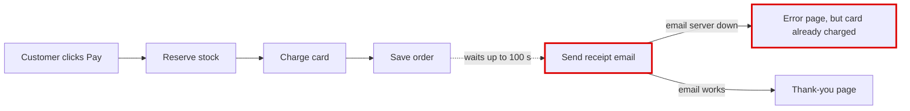
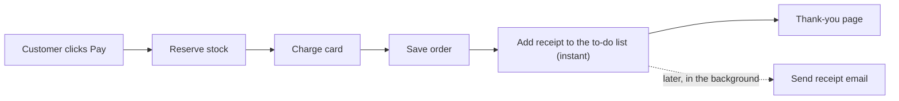

# Your shop's checkout, explained

**In short:** your structure is mostly fine, but one part is badly arranged. **Checkout waits for the email server before it shows the customer anything.** That one problem causes both things in your note: checkout that "sometimes takes ages," and customers who were "charged but saw an error page."

I also opened a one-page visual version in your browser: `<tmp>\architecture-review-20261026-024413.html`

## ⚠️ First: your design notes are out of date
The notes in `docs/architecture.md` say the receipt email goes on a background to-do list and "the customer never waits for email." The code doesn't do that. Checkout sends the email itself while the customer waits.

## What's wrong
After the card is charged and the order is saved, checkout calls the email server and waits for a reply. If that server is slow or down, it tries 3 times, waiting up to 30 seconds each time with 5-second pauses in between. **That adds up to 100 seconds.** If all 3 tries fail, the customer gets an error page even though their money was already taken.

I tested this on a copy of your shop with the email server switched off. The customer waited 100 seconds, the card was charged, the order was saved, and they still got an error page.

## What better looks like
Checkout should put the receipt on the background to-do list and show the thank-you page straight away. Your shop already has this to-do list, and refund emails already use it. Receipts just never got switched over to it.

**What gets better:**
- The email no longer adds any wait to checkout (today it can add up to 100 seconds).
- A broken email server can no longer show a charged customer an error page.

**Risk:** low and easy to undo. It's a change to 2 files, no stored customer or payment data changes, and it reuses a system you already run.

**The option I'm not recommending:** keep sending the email during checkout, but wait less and hide the error. Customers would still wait on bad email days, and failed receipts would be lost without anyone knowing.

## Other bugs I noticed
These aren't about how the shop is laid out, but they matter:
1. **Background jobs are marked "done" before they actually run.** If an email fails, it's lost and never retried. This already affects refund emails, and after the change above it would affect receipts too, so it should be fixed at the same time.
2. **One failing job stops all emails.** Any error crashes the background worker that sends emails.
3. **The background worker crashes on a fresh start** if nothing has been queued yet.
4. **Stock isn't put back when a payment fails.** Items are set aside before the card is charged, and nothing releases them if the charge fails.

## For your engineer
- **Cause:** `shop/checkout.py:12` calls `emailer.send_receipt` directly, and `shop/emailer.py:8-16` retries 3 times with a 30-second timeout and 5-second sleeps. The notes are wrong at `docs/architecture.md:8` and `:14-15`.
- **Fix:**
  1. Add a `"send_receipt"` handler to `shop/jobs/worker.py:6`.
  2. In `place_order`, replace the direct call with `enqueue("send_receipt", {...})`.
- **Places that use the changed code:** `shop/web.py:1,5` and `shop/checkout.py:1,12`. The fix reuses `shop/jobs/queue.py:7`, the same queue `shop/refunds.py:7` uses.
- **Check:** I wrote a one-line test that places an order and confirms exactly one receipt goes out. It passes today on a copy and should still pass after each step.
- **Bugs above:** `shop/jobs/queue.py:18`, `shop/jobs/worker.py:18`, `shop/jobs/queue.py:15` and `shop/checkout.py:6-9`.

I didn't change anything in your shop's files. All the testing was done on throwaway copies.

**My suggestion is to start with moving the receipt to the background, together with bug 1 so no receipt can get lost. Should I plan that change in detail?**