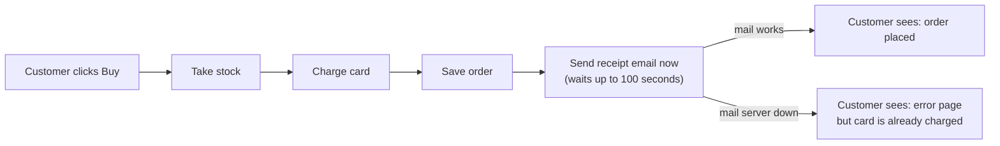
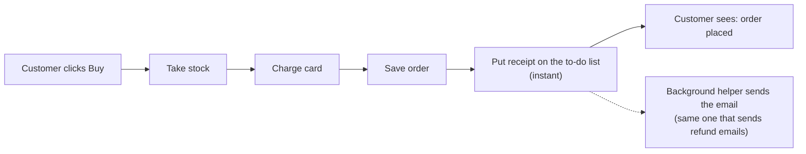

# Your shop's design, in plain words

**Short answer:** the shop is mostly well organised. One part doesn't follow the plan, and that part causes both problems in your note: slow checkouts, and customers who were charged but saw an error page.

## 1. Your design document is out of date

Your shop has a written plan (`docs/architecture.md`). It says *"The customer never waits for email."* That isn't true. When a customer clicks Buy, the website sends the receipt email itself and makes the customer wait until it's done (`shop/checkout.py:12`). The background helper that's supposed to send emails only handles refund emails. It doesn't know about receipts at all.

## 2. What goes wrong because of it

I ran a copy of your shop with the mail server pretending to be down:

- **The customer waited up to 100 seconds.** The shop tries the mail server three times, waits up to 30 seconds each time, and pauses 5 seconds between tries.
- **The customer saw an error page, but the card was already charged** and the order was saved. The email step comes after the payment, so when it fails it shows an error for an order that went through.

That matches what you've seen.

**Today:**

## 3. What better looks like

Handle receipts the same way refunds already work. Checkout adds "send receipt" to a to-do list, which is instant, and shows "order placed" right away. The background helper sends the email afterwards. If the mail server is slow or down, customers don't notice.

**Proposed:**

This change is small, safe and easy to undo. The to-do list and the background helper already exist, so nothing new needs to be built. It changes about three lines of code.

**Checked:** I applied the change to a throwaway copy. Checkout then answered instantly even with mail down. A separate check confirmed that each order still produces exactly one correct receipt; it passed on today's code and on the changed copy.

**What I'm not recommending:** keeping the email in checkout and just giving up on it sooner. Customers would still wait on slow mail days, and a failed receipt would be lost with no record.

## 4. Other problems I noticed

These are bugs rather than design issues, worst first. Your developer should know about them:

1. **Orders and stock levels are only held in memory** (`shop/db.py:4`, `shop/inventory.py:1`). If the shop restarts, all orders are lost and stock goes back to zero. This may be a placeholder, but if it's live, it's the biggest risk.
2. **A failed background email is lost silently.** The to-do list marks a job "done" *before* trying to send it (`shop/jobs/queue.py:18`). This already affects refund emails. After the change above it would affect receipts too, so it should be fixed at the same time.
3. **The background helper crashes if it starts before anything has been queued** (`shop/jobs/queue.py:15`). It also crashes on a job type it doesn't recognise (`shop/jobs/worker.py:18`).
4. **Stock is set aside before the card is charged, and never given back if the charge fails** (`shop/checkout.py:7-9`).
5. **The card payment code is a stand-in** (`shop/payments.py:4`). It never contacts a real payment provider.

## For your developer

- **Change:** `shop/checkout.py::place_order`. Its only caller is `shop/web.py:5`.
- **Steps:**
  1. Add a `"send_receipt"` handler to `HANDLERS` in `shop/jobs/worker.py:6`.
  2. Make sure the worker is running.
  3. Replace the `emailer.send_receipt(...)` call at `checkout.py:12` with `enqueue("send_receipt", {"to": customer["email"], "order": order})`.
  4. Update `docs/architecture.md`.
- **Check:** `python -B <tmp>/arch-design/14946a2a4de5/proof_receipt.py .` from the shop folder. It should print `PROOF OK` after each step.

I haven't changed anything in your shop's files; all testing was on throwaway copies. **Do you want me to go ahead with this change (and fix the lost-email problem, item 2, along with it), or look into one of the other problems first?**