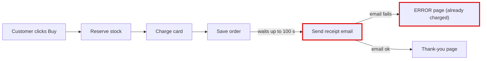
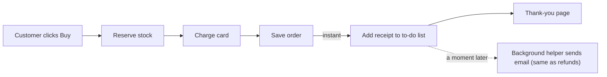

I found what's behind both things in your note. Checkout stops and waits for the email server before it shows the customer the thank-you page. That's why checkout is sometimes slow, and why some customers were charged but saw an error.

I opened a page with pictures in your browser: `<tmp>/architecture-review-20261026-0244.html`. Here's the same story in short.

## 1. Your design notes don't match the shop
The notes (`docs/architecture.md:14`) say the receipt email goes on a background to-do list so "the customer never waits for email." That's the right design. But the shop doesn't work that way. It sends the email in the middle of checkout (`shop/checkout.py:12`).

## 2. What goes wrong
Checkout runs in this order: reserve stock, charge the card, save the order, then send the receipt email. If the email server is slow or down, the shop tries 3 times and waits up to 30 seconds each time, with short pauses in between. That adds up to **100 seconds** for one checkout. If all 3 tries fail, the customer gets an error page, but their card has already been charged.

I tested this on a copy of your shop with the email server switched off. The card was charged, the order was saved, and the customer got an error.

**Before**

**After**

## 3. The fix: send the receipt in the background
- **What gets better:** checkout no longer waits for email, and an email problem can't show a paying customer an error page. The receipt arrives a few seconds later instead.
- **Effort and risk:** low, and easy to undo. It's two small edits, and the background helper already exists because refunds use it.
- **Checked:** I made the change in a separate copy and ran a test of a full checkout on both versions. The test passes on both: the order goes through, one correct receipt is sent and stock goes down.
- **What I'm not suggesting:** adding a separate email service. It's another system to run and pay for, and you don't need it.

## Smaller problems I noticed
- If the background helper fails to send an email, that email is lost for good, and the helper stops running. This already affects refund emails today.
- On a brand-new setup, the helper crashes if it starts before anything has been added to its to-do list. I hit this during testing.
- If a card is declined, the stock reserved for that order is never put back.
- Orders and stock levels aren't stored anywhere permanent, so a restart wipes them.

I haven't changed anything in your shop's files; all the testing happened on separate copies. **Should I make the background-receipt change, or look into one of the smaller problems first?** Once a change is in, I'll update the design notes to match.