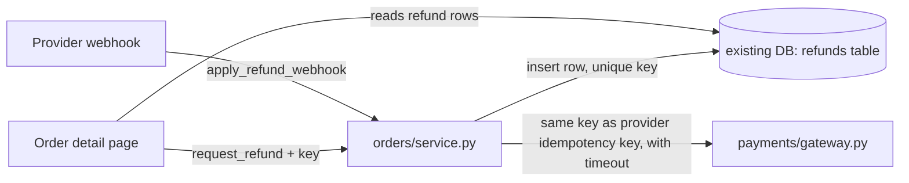

I ran `arch-design` in design mode over `fixture/` and the helper's gate passed (`ARCH-GATE: done`). One caveat first: `fixture/` contains only `requirements.md`. The files it describes (`orders/service.py`, `web/order_views.py`, `payments/gateway.py`, `db/connection.py`) aren't there. So this design comes from reading the requirements, not the code, and there was nothing I could run to prove anything. Nothing in the repo was changed, and I used about $0.21 and a few minutes of the budget.

**Verdict: messy in places.** No part of the system currently records that a refund already happened. That means a double-click, a repeated webhook from the payment provider, or a retry after a provider failure could each refund the same order a second time.

## The problem
- **Three ways to refund twice:** an operator submitting again, the provider re-sending a webhook, and a retry after a failure (`requirements.md:5`, `:7`). Each one reaches the provider again because there is no refund table and no idempotency key (`requirements.md:13`).
- **The operator can't see the outcome:** nothing stores refund state, so there's nothing to show them (`requirements.md:6`).
- **The provider call may hang:** its response time isn't documented (`requirements.md:11`), so calling it during the web request could block for an unknown time.

## Recommended design
Keep it synchronous. Add a `refunds` table to the existing database and run everything through `orders/service.py`.

**Why:** the safety comes from one unique key, stored in the database you already use for order writes. A queue wouldn't make refunds any safer; it would only add a worker to deploy, monitor and secure, plus a new status endpoint other code would come to depend on. With an expected 20 refunds a day and no response-time target, that buys nothing.

**What I'm not doing, and what it costs if I'm wrong:** a queue, a worker and a status endpoint. If the provider turns out to be slow, or volume grows well past 20 a day, refunds will start landing in `unknown`. Moving to a worker later is cheap, because the `refunds` table is already the list a worker would read from (it picks up `requested`/`unknown` rows) and the stored data doesn't change.

**This is hard to undo.** The table, the stored idempotency key and the status values become stored data and a contract that the page and webhook handler depend on. So I compared two options against these criteria, in order:
1. Never refund twice.
2. The operator sees whether the refund completed or failed.
3. Fewest new parts to run and secure.
4. The stored shape survives a later move to async without a migration.

The synchronous option wins on criterion 3, and its table already satisfies criterion 4.

## Implementation plan
Each step only adds code, so existing order actions keep working as before.

1. **Migration:** add a `refunds` table with:
   - `id`, `order_id`, `amount`
   - `idempotency_key` (unique)
   - `provider_refund_id` (unique, can be empty)
   - `status`: `requested`, `succeeded`, `failed` or `unknown`
   - `last_error` and timestamps

   Nothing reads the table yet.
2. **`orders/service.py::request_refund(order_id, amount, key)`:**
   - In one transaction: check the order is settled and the amount is no more than what's left after earlier refunds, then insert a `requested` row. If the key already exists, return that row instead.
   - Commit, then call the gateway with a hard timeout, passing the same key as the provider's idempotency key.
   - Write back `succeeded`, `failed`, or `unknown` (on a timeout).
3. **`web/order_views.py`:** add a refund form to the existing order detail page.
   - The key is created when the form is shown, so a double-submit reuses it.
   - The page lists refund rows with their status.
   - Failed or unknown rows get a **Retry** button that reuses the same key.
4. **`apply_refund_webhook(provider_refund_id, status)`:** update the row by `provider_refund_id`, and only ever move status forward (from `requested`/`unknown` to `succeeded`/`failed`). A repeated webhook then changes nothing.
5. **Tests for the first PR**, since there's no code here to check against:
   - Same key sent twice → one gateway call.
   - Webhook sent twice → one status change.
   - Gateway timeout → `unknown`, then Retry → exactly one refund.

**Check before building:** whether the payment provider actually honours an idempotency key on refunds. If it doesn't, the `unknown` → Retry path could refund twice. In that case Retry should first ask the provider whether the refund already happened.

**Other problems spotted:** none, since there was no code to read.

Should I go ahead with this design, or look at the queue-based option in more detail first?