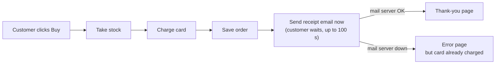
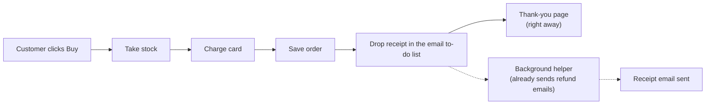

Your feeling is right. The shop is mostly sensible, but one wrong turn in checkout explains both things in your note: checkout sometimes takes ages, and some customers were charged but saw an error page. I didn't change anything in your shop. All my tests ran on a throwaway copy.

## What's wrong

**1. Your shop's description doesn't match what the shop does.** Your design document (`docs/architecture.md`, line 8) says the receipt email is put on a to-do list and sent in the background, so customers never wait. That isn't true. Checkout sends the receipt email itself while the customer waits on the page (`shop/checkout.py:12`).

**2. That's why checkout is slow and why customers get charged but see an error.** When someone clicks Buy, the shop does four things in order:

When the mail server is slow or down, the shop tries three times. Each try can take 30 seconds, with a 5-second pause in between, so the customer can stare at a spinning page for up to **100 seconds**. If all three tries fail, the customer gets an **error page even though their card was already charged**. I tested this on the copy with the mail server switched off: the card was charged, and the customer saw "mail server unreachable."

## What better looks like

Your shop already has a background helper that sends **refund** emails from a to-do list. Checkout just doesn't use it. The fix is to have checkout drop the receipt on that same list and show the thank-you page straight away:

- **Effort:** one file changes, and the helper gets one new line so it knows how to send receipts. It copies exactly how refunds already work, and it makes your design document true again.
- **Risk:** low and easy to undo. No customer data or payments change.
- **Proof for whoever does it:** there's a short check that places a test order. It passes today, and they should run it again after each step to confirm checkout still works.
- **Why not add a new email service or a second to-do list:** you'd have another thing to pay for, secure and keep running, when you already have one that works.
- **Why not just make the shop give up on email faster:** customers would still wait on every mail problem, and failed receipts would be lost with no retry.

## Other problems I noticed (not about structure, but worth fixing)

Worst first:
1. **Orders and stock counts are only kept in the computer's short-term memory** (`shop/db.py:4`, `shop/inventory.py:1`). Every time the shop restarts, all orders and stock levels are wiped.
2. **If a card payment fails, the stock taken for that order isn't put back** (`shop/checkout.py:7-9`). Items slowly "disappear" from stock.
3. **The background helper ticks an email off its list before sending it** (`shop/jobs/queue.py:18`). If sending fails, that email is lost and never retried. This is worth fixing alongside the main change, since receipts would start going through this list.
4. **If the helper finds a type of email it doesn't recognise, it stops completely** (`shop/jobs/worker.py:18`), and every email after it stops too.

**Next step:** should we go ahead with moving receipts onto the background list? I'd suggest fixing problem 3 at the same time. Or would you rather start with the memory problem (1), since that one risks losing orders?