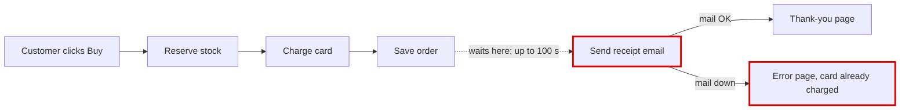
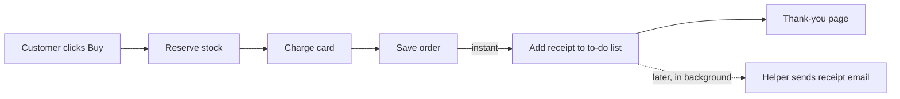

Your shop has one structural problem, and it explains both things in your note. **Checkout waits for the email server before it shows the customer the thank-you page.** That's why checkout sometimes takes ages, and why some customers were charged but saw an error page.

I've also opened a one-page visual version in your browser: `<tmp>\architecture-review-20261026.html`

## First: your shop's written plan doesn't match what it actually does

Your shop has a design document (`docs/architecture.md`, line 14). It says the receipt email goes on a background to-do list, so "the customer never waits for email." The shop doesn't actually work that way. Checkout sends the email itself, in the middle of the purchase, and the background helper isn't set up to send receipts at all.

## What's wrong

After the card is charged and the order is saved, checkout contacts the email server and waits:

- **If the email server is slow:** checkout tries 3 times, waiting up to 30 seconds each time, with a 5-second pause between tries. The customer can stare at a loading screen for **up to 100 seconds**.
- **If the email server is down:** checkout gives up and shows an error page. By then the card has **already been charged** and the order saved.

I tested this on a copy of the shop with the email server switched off. The order was charged and saved, and the customer got an error.

## What better looks like

Checkout should just drop the receipt onto the background to-do list and show the thank-you page straight away. A background helper sends the email a moment later. Your shop already has this to-do list and helper, because refund emails use them. Receipts just never got connected.

- **What gets better:** I tried the change on a copy. The time checkout spends waiting on email went from up to 100 seconds to none. With the mail server off, the customer got a normal thank-you page instead of an error.
- **Risk:** low and easy to undo. Two small files change, and nothing new needs to be set up or paid for.
- **What I'm not suggesting:** keeping the email inside checkout and just making it give up faster. Customers would still wait on the email server for every order, and failed receipts would be lost silently.

## Other problems I noticed while reading

1. If one item in an order is out of stock or the card is declined, stock already set aside for the other items isn't put back.
2. The background helper marks an email "done" *before* sending it. If it crashes midway, that email is lost for good.
3. The helper stops completely, and stops sending **all** emails, if it meets a task it doesn't recognise. It also stops if it starts before anything has ever been added to the to-do list.
4. Orders and stock levels are kept only in the computer's memory, so a restart wipes them. Your developer will probably want to know about this one soon.

## For your developer

- **Where:** `shop/checkout.py:12` sends the receipt directly (retry loop in `shop/emailer.py:8-16`).
- **The change:** add a `"send_receipt"` handler to `shop/jobs/worker.py:6`, then replace the direct send in `shop/checkout.py::place_order` with `enqueue("send_receipt", ...)`. This reuses `shop/jobs/queue.py:7`, which refunds already use. The only code that calls checkout is `shop/web.py:1` and `shop/web.py:5`.
- **Proof it still works:** I wrote a test that places an order, lets the helper run, and checks that exactly one receipt went out. It passed on a copy of today's code and on a copy with the change.

I haven't changed anything in your shop's files. **Should I go ahead with the background-receipt change?** It fixes both of your complaints. Or would you rather start with one of the other problems?