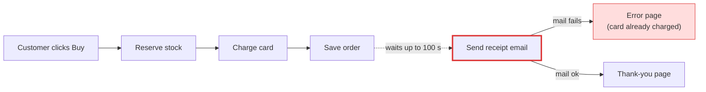
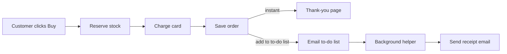

# Your shop, explained

**In one sentence:** when a customer pays, checkout stops and waits for the email server to send the receipt before it shows them anything. That's why checkout is sometimes slow, and why some customers were charged and then saw an error page.

I've opened a one-page visual version in your browser: `<tmp>\architecture-review-20261026.html`

## First: your architecture document is wrong

The shop has a document describing how it's built. It says receipts go on a background **"to-do list"**, so customers never wait for email. The code doesn't do that. Checkout sends the receipt itself and waits until it's done. Refunds do use the to-do list, but receipts don't.

## What's going wrong

When the email server is slow or down, checkout waits up to 30 seconds, rests 5 seconds, and tries again, up to three times. That's up to **100 seconds** of waiting for one checkout. If all three tries fail, the customer sees an **error page**, but by then their card has already been charged and their order saved.

I tested this on a copy of the shop with the email server switched off, and that's exactly what happened: card charged, stock taken, error shown.

**Today:**

**After the fix:**

## The fix I recommend

Put receipts on the same to-do list refunds already use, which is what your document says should happen.

- **What gets better:** checkout no longer waits for email at all (it could wait up to 100 seconds before). A broken email server can no longer cause the "charged but error page" problem.
- **How big it is:** 2 files, about 3 lines. Nothing new to run or pay for.
- **Risk:** low and easy to undo. No stored data changes.
- **What I'm not suggesting:**
  - **Adding a new background system just for receipts:** it would be one more thing to run, secure and look after, for no gain.
  - **Keeping email in checkout but giving up sooner:** customers would still wait, and receipts would quietly go missing.

I tried the fix on a copy of the shop. A test checkout went through as before (order saved, stock reduced), and the background helper then sent the receipt.

## Other problems I noticed (not about the overall design)

1. **Failed emails go missing silently.** The to-do list ticks a job off *before* doing it, so if an email fails it's never retried. This affects refund emails today, and would affect receipts after the fix, so it's worth fixing at the same time.
2. **The background helper crashes if it gets a job it doesn't recognise.** No email gets sent until someone restarts it.
3. **Stock is held before the card is charged and never released.** If a payment fails, those items stay "reserved" for nobody.

I haven't changed anything in your shop's files; all testing happened on copies. Once a fix goes in, I'll update the architecture document so it matches the shop again.

**Want me to go ahead with the receipt fix, and the "failed emails go missing" fix along with it?**