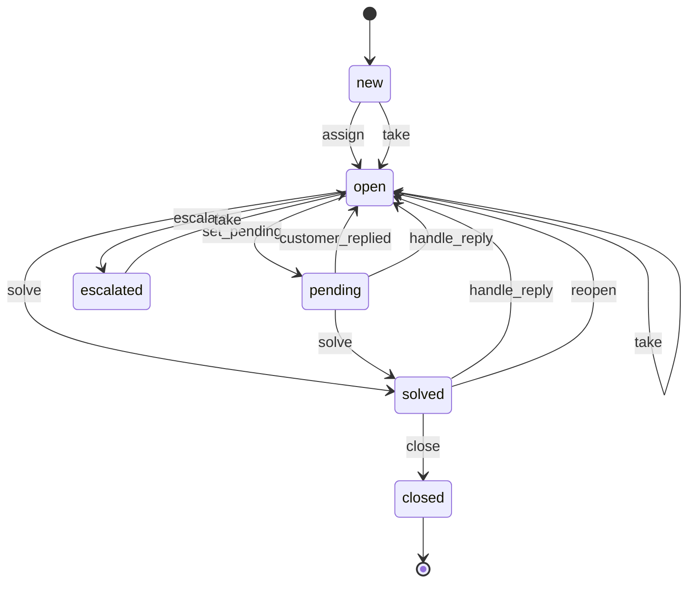
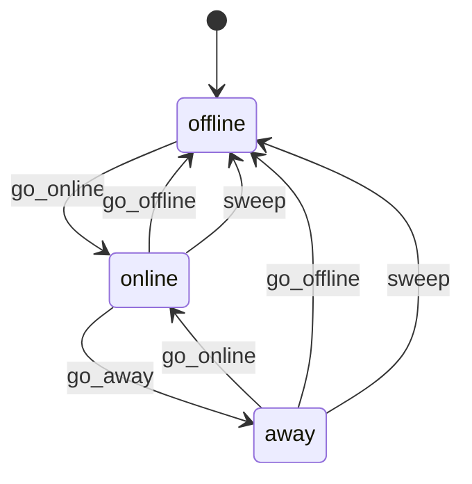
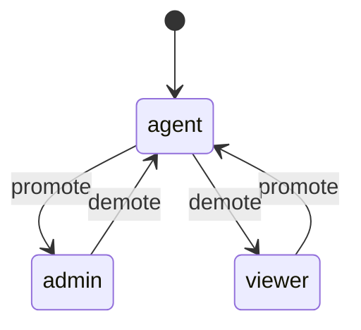
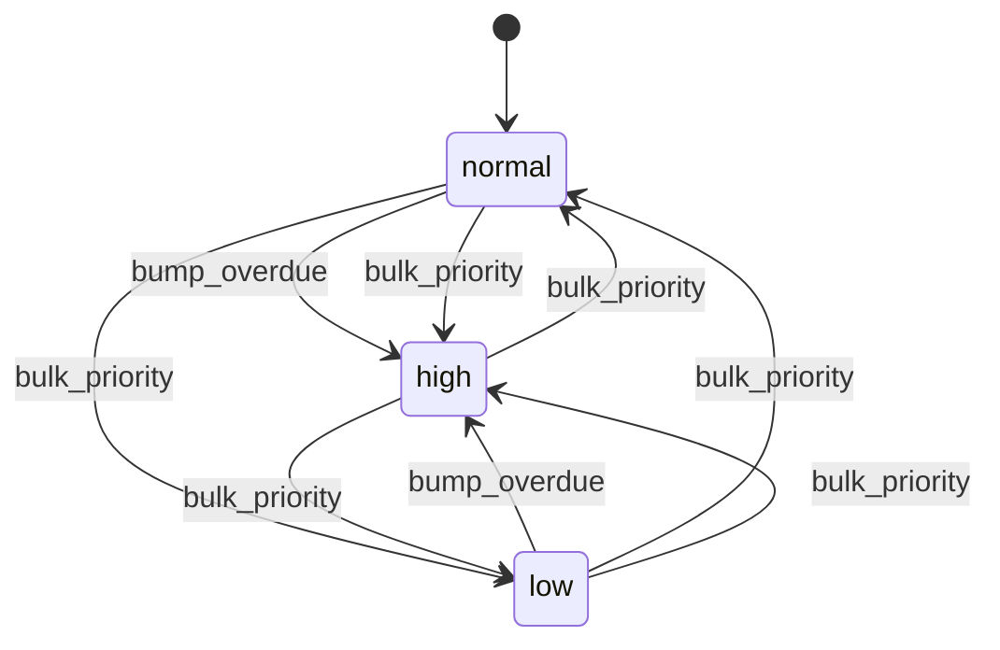
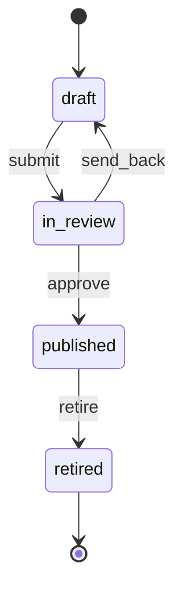
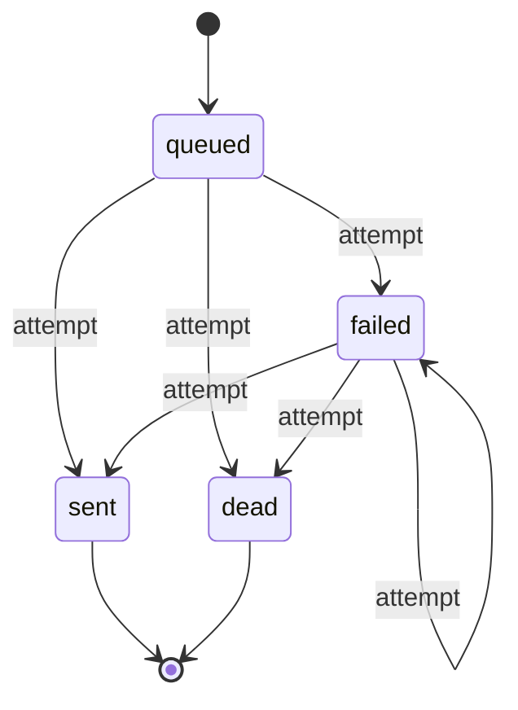
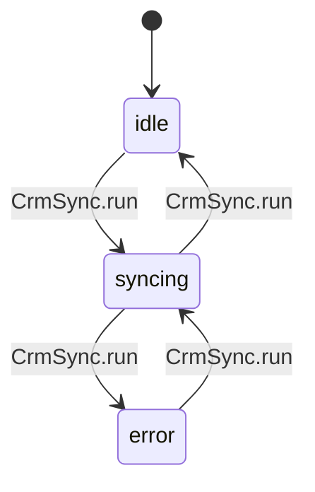

I found 7 state machines and 8 bugs. I fixed 7 of them and left one open. Every bug has a test that fails on the original code, and all 19 tests pass now (the 9 original ones plus 10 new ones). The skill's final check accepted the map and the tests (`STATES: done`). The diagrams are in `fixture/.states/MACHINES.md`.

## The machines

1. **Ticket state**: new → open ⇄ pending → solved → closed, plus open → escalated → open, and solved → open (an agent reopens it).
2. **Agent presence**: offline ⇄ online ⇄ away, and the sweep drops anyone it stops hearing from to offline.
3. **Agent role**: viewer ⇄ agent ⇄ admin, changed by promote and demote.
4. **Ticket priority**: low, normal, high.
5. **Help article** (knowledge base): draft ⇄ in review → published → retired.
6. **Webhook delivery**: queued → sent, failed or dead; failed retries until it is sent or dead.
7. **CRM sync**: idle → syncing → idle or error.

The desktop and mobile notification switches are not a state machine. They are two separate choices, and the README says any mix is fine.

## Bugs I fixed

1. **Auto-assign never gave out a ticket.** It looked for agents who were "available", but nothing ever sets that; the real state is "online". Changed it to "online" (`desk/routing/assign.py:9`).
2. **The SLA report always said 0 solved.** It counted tickets that were "resolved", which nothing sets; the real state is "solved". Changed it (`desk/sla/report.py:10`).
3. **Escalated tickets could never leave escalated.** `take` only accepted new or open tickets, so a senior agent couldn't pick up an escalated one. It now accepts escalated too, and still turns away agents who aren't senior (`desk/tickets/actions.py:67`).
4. **An email reply could reopen a closed ticket.** The code set any ticket the reply pointed at to open. A reply to a closed ticket now starts a new ticket with the old one's subject and requester, linked by `parent_id`, as the README says (`desk/inbound/email.py`).
5. **An email reply let escalated tickets skip the senior agent.** The reply moved them straight to open. They now stay escalated (same function).
6. **An email reply could leave a new ticket open with nobody assigned.** It moved the new ticket to open, and auto-assign only picks up new tickets, so it was never assigned. It now stays new. After fixes 4–6, a reply only reopens tickets that are pending or solved (same function).
7. **The CRM sync stopped for good after a rate limit.** It never cleared its "syncing" flag on that path, so once the wait was over every run answered "busy". It now clears the flag (`desk/crm/sync.py`).

The tests for these are in `tests/test_states.py`.

## Bug I left open

- **The partner API accepts any priority**, such as "urgent". The admin bulk screen only allows low, normal or high, but `desk/inbound/partner_api.py:12` doesn't check. I didn't fix it because refusing those tickets might break partners that send other values today. The other options are to reject unknown values or map them onto the three real ones, and that's your call. The proving test is in `.states/proofs/` and fails until this is fixed (`python -m unittest discover -s .states/proofs`).

## Choices to check, and things that look odd but aren't bugs

- **Customer email on a solved ticket:** I kept the old behaviour, where the reply reopens it. The README only says agents can reopen, so if customers shouldn't, that's a one-line change.
- **Ends with no way out are on purpose:** closed is final, a retired article stays retired, and a webhook stops once it is sent or has failed 5 times.
- **`reopen` does check the state:** it has no check inside the function, but a decorator only lets it run on solved tickets.
- **Left alone:** a senior agent can `take` a ticket that already belongs to someone else, and that agent's ticket count isn't reduced. Assigning a ticket again to the agent who already has it also adds one to their count. Neither goes against the README, so I didn't touch them.

<!-- file written by the agent: fixture/.states/MACHINES.md -->
# State machines

## ticket

fields: field:state

- **bug, fixed**: the SLA report counts tickets in state 'resolved', which nothing sets (the state is 'solved'), so solved is always 0 (desk/sla/report.py:10) Test: `python -m unittest tests.test_states.StateMachineBugs.test_report_counts_solved`
- **bug, fixed**: escalated is a dead end: take() refused escalated tickets, so nothing could ever leave escalated (desk/tickets/actions.py:67) Test: `python -m unittest tests.test_states.StateMachineBugs.test_senior_can_take_escalated`
- **bug, fixed**: an email reply forced any ticket to open, so closed tickets reopened; closed should be final and the reply should start a linked follow-up (desk/inbound/email.py:handle_reply) Test: `python -m unittest tests.test_states.StateMachineBugs.test_reply_to_closed_starts_linked_ticket`
- **bug, fixed**: an email reply moved escalated tickets to open, skipping the senior take (desk/inbound/email.py:handle_reply) Test: `python -m unittest tests.test_states.StateMachineBugs.test_reply_to_escalated_waits_for_senior`
- **bug, fixed**: an email reply moved a new unassigned ticket to open with no assignee; auto-assign only looks at new tickets, so it was never assigned (desk/inbound/email.py:handle_reply) Test: `python -m unittest tests.test_states.StateMachineBugs.test_reply_to_new_stays_new_for_auto_assign`
- **ok**: closed has no exit (desk/tickets/actions.py:close) Why: README: closed is final
- **ok**: reopen has no inline state check (desk/tickets/actions.py:reopen) Why: guarded by the from_states(solved) decorator

## presence

fields: field:presence

- **bug, fixed**: auto-assign only picks agents whose presence is 'available', which nothing ever sets (the state is 'online'), so auto-assign never assigns any ticket (desk/routing/assign.py:9) Test: `python -m unittest tests.test_states.StateMachineBugs.test_auto_assign_uses_online_agents`

## role

fields: field:role

## priority

fields: field:priority

- **bug, open**: the partner API stores any priority string (e.g. urgent); bulk_priority validates but create does not, so an out-of-set priority is reachable (desk/inbound/partner_api.py:12) Test: `python -m unittest discover -s .states/proofs`

## kb_article

fields: field:status

- **ok**: retired has no exit (desk/kb.py:retire) Why: retirement is the end of an article

## webhook_delivery

fields: field:status

- **ok**: sent and dead have no exit (desk/webhooks.py:attempt) Why: delivered, or given up after MAX_ATTEMPTS, by design

## crm_sync

fields: flags:desk/crm/sync.py:CrmSync

- **bug, fixed**: on a rate limit, run() returned without clearing syncing, so after the backoff every run returned busy forever (desk/crm/sync.py:CrmSync.run) Test: `python -m unittest tests.test_states.StateMachineBugs.test_crm_resumes_after_rate_limit`

## Not state machines

- flags:desk/models.py:Agent: desktop and mobile notifications are independent preferences; README says any mix is fine

<!-- file written by the agent: fixture/.states/candidates.md -->
# State-machine candidates

Leads, not verdicts. Map each one in `.states/machines.json` or dismiss it with a reason.
Every write below must be a transition (`at`) or listed in `also` with why. `at` is
`path:line` or `path:function`.

## field:presence
values written: away, offline, online
**checked but never set: available**
written but never compared: away, online
writes:
- desk/models.py:45 (Agent.__init__) presence = 'offline'
- desk/presence.py:6 (go_online) presence = 'online'
- desk/presence.py:13 (go_away) presence = 'away'
- desk/presence.py:18 (go_offline) presence = 'offline'
checks:
- desk/presence.py:11 (go_away) == 'offline'
- desk/presence.py:22 (heartbeat) == 'offline'
- desk/presence.py:31 (sweep) == 'offline'
- desk/routing/assign.py:9 (eligible) == 'available'

## field:priority
values written: high, normal
written but never compared: normal
writes:
- desk/admin/bulk.py:28 (bulk_priority) priority = <computed>
- desk/inbound/partner_api.py:12 (create) priority = <computed>
- desk/models.py:13 (Ticket.__init__) priority = 'normal'
- desk/models.py:31 (Ticket.from_dict) priority = <computed>
- desk/sla/timers.py:20 (bump_overdue) priority = 'high'
checks:
- desk/routing/assign.py:14 (auto_assign) == 'high'
- desk/sla/timers.py:19 (bump_overdue) == 'high'

## field:role
values written: admin, agent, viewer
writes:
- desk/auth.py:19 (promote) role = 'agent'
- desk/auth.py:21 (promote) role = 'admin'
- desk/auth.py:27 (demote) role = 'agent'
- desk/auth.py:29 (demote) role = 'viewer'
- desk/models.py:43 (Agent.__init__) role = <computed>
checks:
- desk/auth.py:18 (promote) == 'viewer'
- desk/auth.py:20 (promote) == 'agent'
- desk/auth.py:26 (demote) == 'admin'
- desk/auth.py:28 (demote) == 'agent'
- desk/routing/assign.py:9 (eligible) == 'viewer'

## field:state
values written: closed, escalated, new, open, pending, solved
**checked but never set: resolved**
written but never compared: escalated
writes:
- desk/inbound/email.py:26 (handle_reply) state = 'open'
- desk/models.py:11 (Ticket.__init__) state = 'new'
- desk/models.py:29 (Ticket.from_dict) state = <computed>
- desk/tickets/actions.py:13 (assign) state = 'open'
- desk/tickets/actions.py:27 (set_pending) state = 'pending'
- desk/tickets/actions.py:33 (customer_replied) state = 'open'
- desk/tickets/actions.py:39 (solve) state = 'solved'
- desk/tickets/actions.py:46 (close) state = 'closed'
- desk/tickets/actions.py:51 (reopen) state = 'open'
- desk/tickets/actions.py:60 (escalate) state = 'escalated'
- desk/tickets/actions.py:71 (take) state = 'open'
checks:
- desk/automations.py:17 (run) == 'solved'
- desk/automations.py:20 (run) == 'pending'
- desk/admin/bulk.py:10 (bulk_close) == 'solved'
- desk/routing/assign.py:15 (auto_assign) == 'new'
- desk/sla/report.py:10 (counts) == 'resolved'
- desk/sla/report.py:12 (counts) == 'pending'
- desk/sla/timers.py:19 (bump_overdue) == 'new'
- desk/sla/timers.py:19 (bump_overdue) == 'open'
- desk/tickets/actions.py:7 (assign) == 'new'
- desk/tickets/actions.py:7 (assign) == 'open'
- desk/tickets/actions.py:17 (reply) == 'solved'
- desk/tickets/actions.py:17 (reply) == 'closed'
- desk/tickets/actions.py:25 (set_pending) == 'open'
- desk/tickets/actions.py:32 (customer_replied) == 'pending'
- desk/tickets/actions.py:37 (solve) == 'open'
- desk/tickets/actions.py:37 (solve) == 'pending'
- desk/tickets/actions.py:44 (close) == 'solved'
- desk/tickets/actions.py:56 (escalate) == 'open'
- desk/tickets/actions.py:67 (take) == 'new'
- desk/tickets/actions.py:67 (take) == 'open'

## field:status
values written: dead, draft, failed, in_review, published, queued, retired, sent
written but never compared: dead, retired, sent
writes:
- desk/kb.py:11 (Article.__init__) status = 'draft'
- desk/kb.py:20 (submit) status = 'in_review'
- desk/kb.py:29 (approve) status = 'published'
- desk/kb.py:35 (send_back) status = 'draft'
- desk/kb.py:41 (retire) status = 'retired'
- desk/webhooks.py:9 (Delivery.__init__) status = 'queued'
- desk/webhooks.py:21 (attempt) status = 'sent'
- desk/webhooks.py:23 (attempt) status = 'dead'
- desk/webhooks.py:25 (attempt) status = 'failed'
checks:
- desk/kb.py:16 (submit) == 'draft'
- desk/kb.py:24 (approve) == 'in_review'
- desk/kb.py:33 (send_back) == 'in_review'
- desk/kb.py:39 (retire) == 'published'
- desk/kb.py:45 (visible) == 'published'
- desk/webhooks.py:15 (attempt) == 'queued'
- desk/webhooks.py:15 (attempt) == 'failed'
- desk/webhooks.py:30 (retry_due) == 'failed'

## flags:desk/crm/sync.py:CrmSync
flags: last_error, syncing (4 combinations; which are legal?)
writes:
- desk/crm/sync.py:17 (CrmSync.__init__) syncing = False
- desk/crm/sync.py:18 (CrmSync.__init__) last_error = None
- desk/crm/sync.py:27 (CrmSync.run) syncing = True
- desk/crm/sync.py:35 (CrmSync.run) last_error = <computed>
- desk/crm/sync.py:36 (CrmSync.run) syncing = False
- desk/crm/sync.py:39 (CrmSync.run) last_error = None
- desk/crm/sync.py:40 (CrmSync.run) syncing = False

## flags:desk/models.py:Agent
flags: notify_desktop, notify_mobile (4 combinations; which are legal?)
writes:
- desk/models.py:48 (Agent.__init__) notify_desktop = True
- desk/models.py:49 (Agent.__init__) notify_mobile = False
- desk/models.py:52 (Agent.set_notifications) notify_desktop = <computed>
- desk/models.py:53 (Agent.set_notifications) notify_mobile = <computed>

