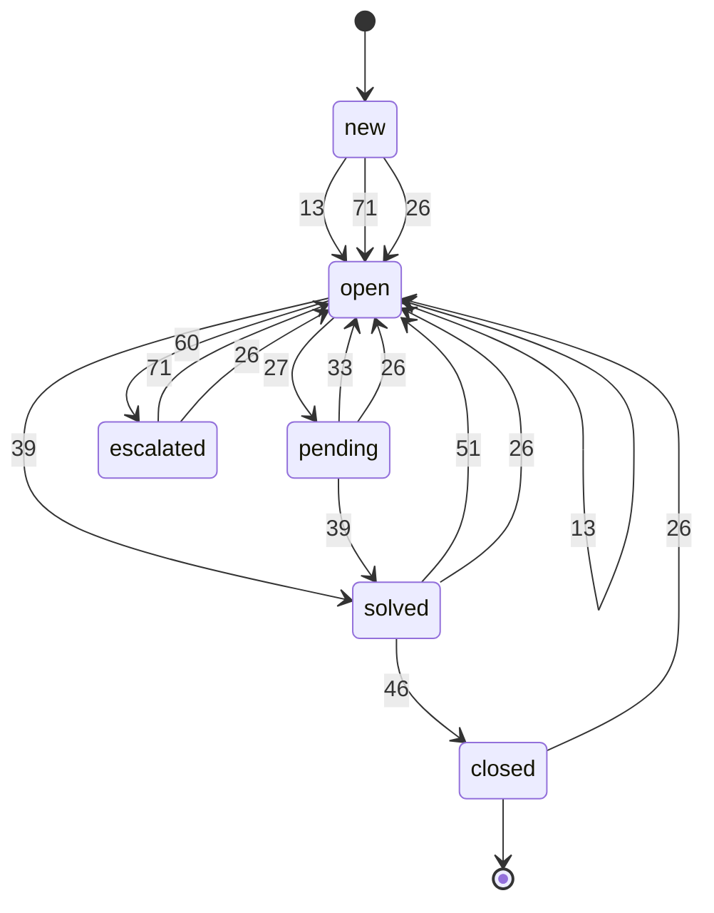
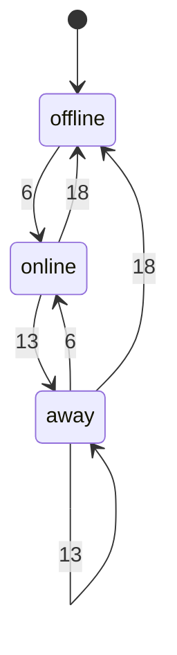
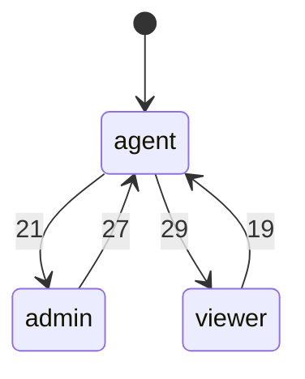
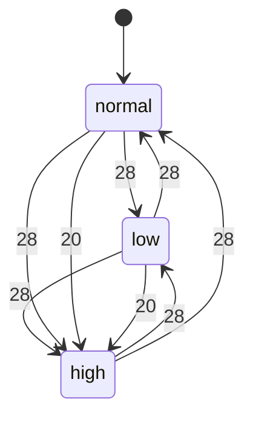
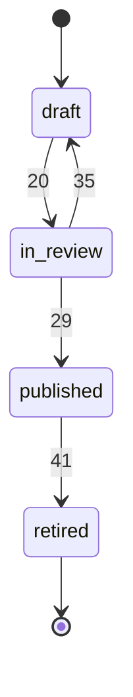
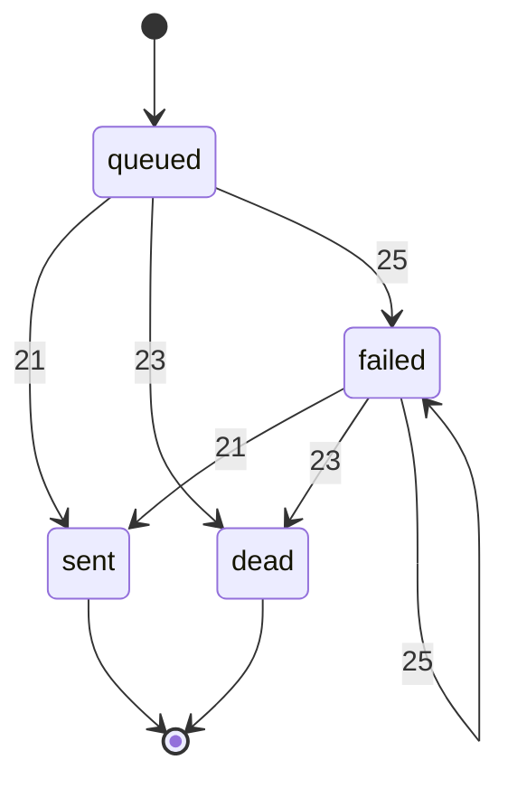
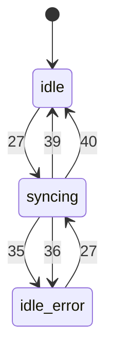

I found seven state machines and seven bugs. I fixed six and left one open. The skill's checker passes: all 18 tests are green (the 9 originals plus 9 new ones). Each fixed bug has a test in `tests/test_state_bugs.py` that fails on the original code and passes now. The diagrams are in `fixture/.states/MACHINES.md`.

## The machines

| Thing | States | Moves |
|---|---|---|
| **Ticket** (`state`) | new → open ⇄ pending, open → solved → closed, solved → open (reopen), open → escalated → open (senior `take`) | `desk/tickets/actions.py`, `desk/inbound/email.py`, `desk/automations.py`, `desk/admin/bulk.py` |
| **Agent presence** | offline, online, away | `desk/presence.py` |
| **Agent role** | viewer ⇄ agent ⇄ admin | `desk/auth.py` |
| **Ticket priority** | low, normal, high | `desk/admin/bulk.py`, `desk/sla/timers.py`, `desk/inbound/partner_api.py` |
| **Knowledge-base article** | draft ⇄ in_review → published → retired | `desk/kb.py` |
| **Webhook delivery** | queued → failed (retried) → sent or dead | `desk/webhooks.py` |
| **CRM sync** (`syncing` + `last_error` flags) | idle, syncing, idle with error | `desk/crm/sync.py` |

## Bugs I fixed

1. **Auto-assign never assigns anyone.** It looks for agents whose presence is `"available"`, but nothing ever sets that; agents go `"online"`. I changed the check to `"online"` (`desk/routing/assign.py:9`). Away and offline agents are still skipped.
2. **The SLA report always says 0 solved.** It counts tickets in state `"resolved"`, which nothing ever sets. It now counts `solved` and `closed` (`desk/sla/report.py:10`). Including closed tickets was my call: they were all solved first, and otherwise they would drop out of the count after 4 days. Narrow it to `solved` if you only want tickets solved but not yet closed.
3. **A customer email reopened closed tickets.** The README says closed is final. Such a reply now starts a new ticket with the old one's subject and requester and `parent_id` pointing to the old ticket (`desk/inbound/email.py:25`).
4. **Any customer email forced the ticket to open.** This skipped every check: escalated tickets left the senior queue, new unassigned tickets became open with no owner (so auto-assign skipped them), and solved tickets reopened without an agent. A reply now only moves pending to open, like `customer_replied`. Other tickets just get the comment. Customers can no longer reopen a solved ticket by replying; the README says an agent reopens those.
5. **Escalated tickets could never leave escalated.** `take()` only accepted new or open tickets, so a senior agent could never pick one up. It now also accepts escalated (`desk/tickets/actions.py:67`), and non-senior agents are still refused.
6. **The CRM sync stopped after a rate limit.** The rate-limit path never cleared the `syncing` flag. After the wait, every run returned `"busy"` forever instead of carrying on as the README says. It now clears the flag (`desk/crm/sync.py:33`).

## Bug I left open

- **The partner API accepts any priority**, for example `"urgent"`, while the admin bulk action only allows low, normal or high. The SLA timer quietly treats an unknown priority as normal and the CRM sends it as priority 2. I didn't fix it because rejecting these would start failing partner requests that work today, so that's your decision. The proof test is in `.states/proofs/` and fails on purpose; run it with `python -m unittest discover -s .states/proofs`.

## Things that looked like bugs but aren't

- **States nothing leaves:** closed tickets (final by design), retired articles, and sent or dead webhooks (delivered, or given up after 5 tries).
- **`reopen()` has no state check in its body.** The `@from_states("solved")` decorator above it does the check.
- **Desktop and mobile notification flags:** I didn't treat these as a state machine because the README says any mix is fine.
- **Loading saved tickets and creating agents** can set any state or role. That's restoring data, not a move. I only noted it.

<!-- file written by the agent: fixture/.states/MACHINES.md -->
# State machines

## ticket

fields: field:state

- **bug, fixed**: SLA report counts state 'resolved', which nothing sets, so 'solved' is always 0 (desk/sla/report.py:10) Test: `python -m unittest tests.test_state_bugs.StateBugs.test_report_counts_solved_tickets`
- **bug, fixed**: an email reply to a closed ticket reopens it instead of starting a new linked ticket (closed should be final) (desk/inbound/email.py:handle_reply) Test: `python -m unittest tests.test_state_bugs.StateBugs.test_reply_to_closed_ticket_starts_linked_ticket`
- **bug, fixed**: an email reply forces any ticket to 'open', skipping every guard: escalated tickets drop out of the senior queue, new unassigned tickets become open with no owner, solved ones reopen without an agent (desk/inbound/email.py:handle_reply) Test: `python -m unittest tests.test_state_bugs.StateBugs.test_reply_does_not_unescalate`
- **bug, fixed**: escalated is a dead end: take() only accepts new/open, so a senior agent can never take an escalated ticket (desk/tickets/actions.py:67) Test: `python -m unittest tests.test_state_bugs.StateBugs.test_senior_can_take_escalated`
- **ok**: closed has no exit (desk/tickets/actions.py:46) Why: README: closed is final
- **ok**: reopen() has no state check in its body (desk/tickets/actions.py:49) Why: the @from_states('solved') decorator guards it

## presence

fields: field:presence

- **bug, fixed**: auto-assign checks presence 'available', which nothing ever sets (agents go 'online'), so auto-assign never hands out a ticket (desk/routing/assign.py:9) Test: `python -m unittest tests.test_state_bugs.StateBugs.test_auto_assign_gives_tickets_to_online_agents`

## role

fields: field:role

## priority

fields: field:priority

- **bug, open**: partner API stores any priority string (e.g. 'urgent'); bulk_priority refuses those. SLA silently treats it as normal and the CRM maps it to 2 (desk/inbound/partner_api.py:12) Test: `python -m unittest discover -s .states/proofs`

## kb article

fields: field:status

- **ok**: retired has no exit (desk/kb.py:41) Why: retiring is the end of an article's life

## webhook delivery

fields: field:status

- **ok**: sent and dead have no exit (desk/webhooks.py:14) Why: delivered, or given up after MAX_ATTEMPTS by design

## crm sync

fields: flags:desk/crm/sync.py:CrmSync

- **bug, fixed**: on a rate limit, syncing stays True, so after the backoff every run returns 'busy' forever (desk/crm/sync.py:31) Test: `python -m unittest tests.test_state_bugs.StateBugs.test_crm_sync_resumes_after_rate_limit`

## Not state machines

- flags:desk/models.py:Agent: notification preferences are independent; README says any mix is fine

<!-- file written by the agent: fixture/.states/candidates.md -->
# State-machine candidates

Leads, not verdicts. Map each one in `.states/machines.json` or dismiss it with a reason.
Every write below must be a transition (`at`) or listed in `also` with why. `at` is
`path:line` or `path:function`.

## field:presence
values written: away, offline, online
**checked but never set: available**
written but never compared: away, online
writes:
- desk/models.py:45 (Agent.__init__) presence = 'offline'
- desk/presence.py:6 (go_online) presence = 'online'
- desk/presence.py:13 (go_away) presence = 'away'
- desk/presence.py:18 (go_offline) presence = 'offline'
checks:
- desk/presence.py:11 (go_away) == 'offline'
- desk/presence.py:22 (heartbeat) == 'offline'
- desk/presence.py:31 (sweep) == 'offline'
- desk/routing/assign.py:9 (eligible) == 'available'

## field:priority
values written: high, normal
written but never compared: normal
writes:
- desk/admin/bulk.py:28 (bulk_priority) priority = <computed>
- desk/inbound/partner_api.py:12 (create) priority = <computed>
- desk/models.py:13 (Ticket.__init__) priority = 'normal'
- desk/models.py:31 (Ticket.from_dict) priority = <computed>
- desk/sla/timers.py:20 (bump_overdue) priority = 'high'
checks:
- desk/routing/assign.py:14 (auto_assign) == 'high'
- desk/sla/timers.py:19 (bump_overdue) == 'high'

## field:role
values written: admin, agent, viewer
writes:
- desk/auth.py:19 (promote) role = 'agent'
- desk/auth.py:21 (promote) role = 'admin'
- desk/auth.py:27 (demote) role = 'agent'
- desk/auth.py:29 (demote) role = 'viewer'
- desk/models.py:43 (Agent.__init__) role = <computed>
checks:
- desk/auth.py:18 (promote) == 'viewer'
- desk/auth.py:20 (promote) == 'agent'
- desk/auth.py:26 (demote) == 'admin'
- desk/auth.py:28 (demote) == 'agent'
- desk/routing/assign.py:9 (eligible) == 'viewer'

## field:state
values written: closed, escalated, new, open, pending, solved
**checked but never set: resolved**
written but never compared: escalated
writes:
- desk/inbound/email.py:26 (handle_reply) state = 'open'
- desk/models.py:11 (Ticket.__init__) state = 'new'
- desk/models.py:29 (Ticket.from_dict) state = <computed>
- desk/tickets/actions.py:13 (assign) state = 'open'
- desk/tickets/actions.py:27 (set_pending) state = 'pending'
- desk/tickets/actions.py:33 (customer_replied) state = 'open'
- desk/tickets/actions.py:39 (solve) state = 'solved'
- desk/tickets/actions.py:46 (close) state = 'closed'
- desk/tickets/actions.py:51 (reopen) state = 'open'
- desk/tickets/actions.py:60 (escalate) state = 'escalated'
- desk/tickets/actions.py:71 (take) state = 'open'
checks:
- desk/automations.py:17 (run) == 'solved'
- desk/automations.py:20 (run) == 'pending'
- desk/admin/bulk.py:10 (bulk_close) == 'solved'
- desk/routing/assign.py:15 (auto_assign) == 'new'
- desk/sla/report.py:10 (counts) == 'resolved'
- desk/sla/report.py:12 (counts) == 'pending'
- desk/sla/timers.py:19 (bump_overdue) == 'new'
- desk/sla/timers.py:19 (bump_overdue) == 'open'
- desk/tickets/actions.py:7 (assign) == 'new'
- desk/tickets/actions.py:7 (assign) == 'open'
- desk/tickets/actions.py:17 (reply) == 'solved'
- desk/tickets/actions.py:17 (reply) == 'closed'
- desk/tickets/actions.py:25 (set_pending) == 'open'
- desk/tickets/actions.py:32 (customer_replied) == 'pending'
- desk/tickets/actions.py:37 (solve) == 'open'
- desk/tickets/actions.py:37 (solve) == 'pending'
- desk/tickets/actions.py:44 (close) == 'solved'
- desk/tickets/actions.py:56 (escalate) == 'open'
- desk/tickets/actions.py:67 (take) == 'new'
- desk/tickets/actions.py:67 (take) == 'open'

## field:status
values written: dead, draft, failed, in_review, published, queued, retired, sent
written but never compared: dead, retired, sent
writes:
- desk/kb.py:11 (Article.__init__) status = 'draft'
- desk/kb.py:20 (submit) status = 'in_review'
- desk/kb.py:29 (approve) status = 'published'
- desk/kb.py:35 (send_back) status = 'draft'
- desk/kb.py:41 (retire) status = 'retired'
- desk/webhooks.py:9 (Delivery.__init__) status = 'queued'
- desk/webhooks.py:21 (attempt) status = 'sent'
- desk/webhooks.py:23 (attempt) status = 'dead'
- desk/webhooks.py:25 (attempt) status = 'failed'
checks:
- desk/kb.py:16 (submit) == 'draft'
- desk/kb.py:24 (approve) == 'in_review'
- desk/kb.py:33 (send_back) == 'in_review'
- desk/kb.py:39 (retire) == 'published'
- desk/kb.py:45 (visible) == 'published'
- desk/webhooks.py:15 (attempt) == 'queued'
- desk/webhooks.py:15 (attempt) == 'failed'
- desk/webhooks.py:30 (retry_due) == 'failed'

## flags:desk/crm/sync.py:CrmSync
flags: last_error, syncing (4 combinations; which are legal?)
writes:
- desk/crm/sync.py:17 (CrmSync.__init__) syncing = False
- desk/crm/sync.py:18 (CrmSync.__init__) last_error = None
- desk/crm/sync.py:27 (CrmSync.run) syncing = True
- desk/crm/sync.py:35 (CrmSync.run) last_error = <computed>
- desk/crm/sync.py:36 (CrmSync.run) syncing = False
- desk/crm/sync.py:39 (CrmSync.run) last_error = None
- desk/crm/sync.py:40 (CrmSync.run) syncing = False

## flags:desk/models.py:Agent
flags: notify_desktop, notify_mobile (4 combinations; which are legal?)
writes:
- desk/models.py:48 (Agent.__init__) notify_desktop = True
- desk/models.py:49 (Agent.__init__) notify_mobile = False
- desk/models.py:52 (Agent.set_notifications) notify_desktop = <computed>
- desk/models.py:53 (Agent.set_notifications) notify_mobile = <computed>

