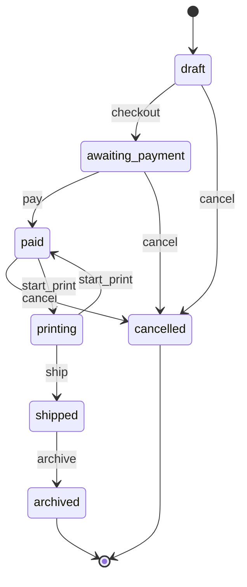
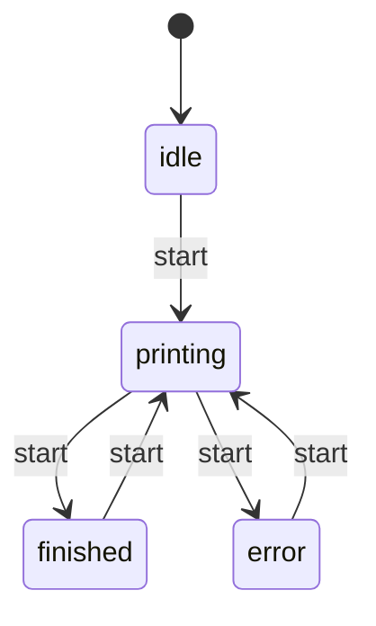

I found two state machines and five bugs. All five are fixed, and the full test suite passes (11 tests: the 6 that were there plus 5 new ones). Each new test failed on the original code and passes now. Diagrams of both machines are in `fixture/.states/MACHINES.md`.

## The machines

**1. Order** (`status` field, moved in `printshop/orders.py`)
- draft → awaiting_payment (`checkout`, which reserves paper) → paid (`pay`) → printing (`start_print`) → shipped (`ship`) → archived (`archive`)
- `start_print` moves printing back to paid if the print fails.
- draft, awaiting_payment or paid → cancelled (`cancel`, which returns the paper unless the order was still a draft).
- archived and cancelled are the end states. A refund only sets a `refunded` flag on a cancelled order that was paid; it doesn't change the status.

**2. Print job** (the `printing`, `finished` and `error` flags in `printshop/printer.py`)
- idle → printing → finished, or printing → error. From any of those, the next `start` begins printing again.

**Not a machine:** a customer's email and SMS notification settings. They are two separate preferences, and any combination is allowed.

## Bugs (all fixed)

1. **Refunds could never happen.** `refund` checked for the status `"canceled"`, but `cancel` sets `"cancelled"`, so nothing ever matched. I corrected the spelling in `orders.py`.
2. **The nightly job never cancelled anything.** `expire_unpaid` looked for status `"pending"`, which nothing ever sets. Unpaid orders are `"awaiting_payment"`, so they never expired and their paper stayed reserved. I changed it to `"awaiting_payment"` in `jobs.py`.
3. **Shipping wasn't refused for any order.** `ship` had no check, so draft, unpaid, unprinted or even cancelled orders could be marked shipped. It now uses the same `@allowed_from` check as `archive` and only accepts orders that are printing.
4. **One paper jam stopped the printer for good.** After a printer error the job stayed marked as printing, so every later print was refused as "printer is busy". `PrintJob.start` now always clears the printing flag. A jam still shows as `error: …`.
5. **An order could get stuck in "printing" without printing.** If the printer raised any error other than the expected printer error, the order stayed in `printing`. `start_print` now puts it back to `paid` and passes the error on.

The tests are in `fixture/tests/test_state_bugs.py`.

## Looked like bugs, but aren't
- `archive` has no check in its body, but the `@allowed_from("shipped")` decorator above it refuses every other state.
- archived and cancelled have no way out. That is intended, since they are the end states.

## Left alone (not sure they're bugs)
- Paper reserved for orders that get printed and shipped is never returned. That makes sense if printing uses the paper up, but nothing ever restocks the shelf.
- Loading saved orders trusts whatever status is in `data/orders.json`, even one that isn't a real state.
- An order can be cancelled after payment but before printing, which matches the README, and refunding it is a separate step. I didn't change how the two are linked.

<!-- file written by the agent: fixture/.states/MACHINES.md -->
# State machines

## order

fields: field:status

- **bug, fixed**: refund() checks for status 'canceled' but cancel() sets 'cancelled', so no order can ever be refunded (printshop/orders.py:refund) Test: `python -m unittest tests.test_state_bugs.StateBugs.test_paid_cancelled_order_can_be_refunded`
- **bug, fixed**: nightly expire_unpaid looks for status 'pending', which nothing sets; unpaid orders (awaiting_payment) are never expired and their paper is never freed (printshop/jobs.py:expire_unpaid) Test: `python -m unittest tests.test_state_bugs.StateBugs.test_nightly_expires_unpaid_orders`
- **bug, fixed**: ship() has no guard: draft, unpaid, paid-but-unprinted and even cancelled orders can be marked shipped (printshop/orders.py:ship) Test: `python -m unittest tests.test_state_bugs.StateBugs.test_cannot_ship_unprinted_order`
- **bug, fixed**: if job.start raises (PrinterBusy, or any non-PrinterError from the printer) start_print leaves the order in 'printing' though nothing printed; the job also stays printing=True (printshop/orders.py:start_print) Test: `python -m unittest tests.test_state_bugs.StateBugs.test_order_not_left_printing_when_print_blows_up`
- **ok**: archive() looks unguarded in its body (printshop/orders.py:archive) Why: the @allowed_from('shipped') decorator in guards.py refuses it from any other state
- **ok**: archived and cancelled have no way out (printshop/orders.py) Why: both are meant to be final; refund on a cancelled order only sets the refunded flag and does not change status

## print job

fields: flags:printshop/printer.py:PrintJob

- **bug, fixed**: after a PrinterError the job keeps printing=True and error set, so the one printer is stuck: every later start raises PrinterBusy forever (printshop/printer.py:start) Test: `python -m unittest tests.test_state_bugs.StateBugs.test_printer_usable_after_a_failed_print`

## Not state machines

- flags:printshop/models.py:Customer: independent notification preferences; all four email/sms combinations are legal (set_prefs only refuses a channel with no address)

<!-- file written by the agent: fixture/.states/candidates.md -->
# State-machine candidates

Leads, not verdicts. Map each one in `.states/machines.json` or dismiss it with a reason.
Every write below must be a transition (`at`) or listed in `also` with why. `at` is
`path:line` or `path:function`.

## field:status
values written: archived, awaiting_payment, cancelled, draft, paid, printing, shipped
**checked but never set: canceled, pending**
written but never compared: archived, cancelled, printing, shipped
writes:
- printshop/models.py:11 (Order.__init__) status = 'draft'
- printshop/models.py:23 (Order.from_dict) status = <computed>
- printshop/orders.py:10 (checkout) status = 'awaiting_payment'
- printshop/orders.py:16 (pay) status = 'paid'
- printshop/orders.py:25 (cancel) status = 'cancelled'
- printshop/orders.py:39 (start_print) status = 'printing'
- printshop/orders.py:41 (start_print) status = 'paid'
- printshop/orders.py:47 (ship) status = 'shipped'
- printshop/orders.py:52 (archive) status = 'archived'
checks:
- printshop/jobs.py:11 (expire_unpaid) == 'pending'
- printshop/orders.py:7 (checkout) == 'draft'
- printshop/orders.py:14 (pay) == 'awaiting_payment'
- printshop/orders.py:21 (cancel) == 'draft'
- printshop/orders.py:21 (cancel) == 'awaiting_payment'
- printshop/orders.py:21 (cancel) == 'paid'
- printshop/orders.py:23 (cancel) == 'draft'
- printshop/orders.py:29 (refund) == 'canceled'
- printshop/orders.py:37 (start_print) == 'paid'

## flags:printshop/models.py:Customer
flags: notify_email, notify_sms (4 combinations; which are legal?)
writes:
- printshop/models.py:34 (Customer.__init__) notify_email = <computed>
- printshop/models.py:35 (Customer.__init__) notify_sms = <computed>
- printshop/models.py:38 (Customer.set_prefs) notify_email = <computed>
- printshop/models.py:39 (Customer.set_prefs) notify_sms = <computed>

## flags:printshop/printer.py:PrintJob
flags: error, finished, printing (8 combinations; which are legal?)
writes:
- printshop/printer.py:14 (PrintJob.__init__) printing = False
- printshop/printer.py:15 (PrintJob.__init__) finished = False
- printshop/printer.py:16 (PrintJob.__init__) error = None
- printshop/printer.py:21 (PrintJob.start) printing = True
- printshop/printer.py:22 (PrintJob.start) finished = False
- printshop/printer.py:23 (PrintJob.start) error = None
- printshop/printer.py:27 (PrintJob.start) error = <computed>
- printshop/printer.py:29 (PrintJob.start) printing = False
- printshop/printer.py:30 (PrintJob.start) finished = True

