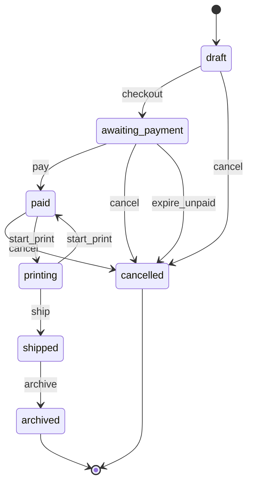
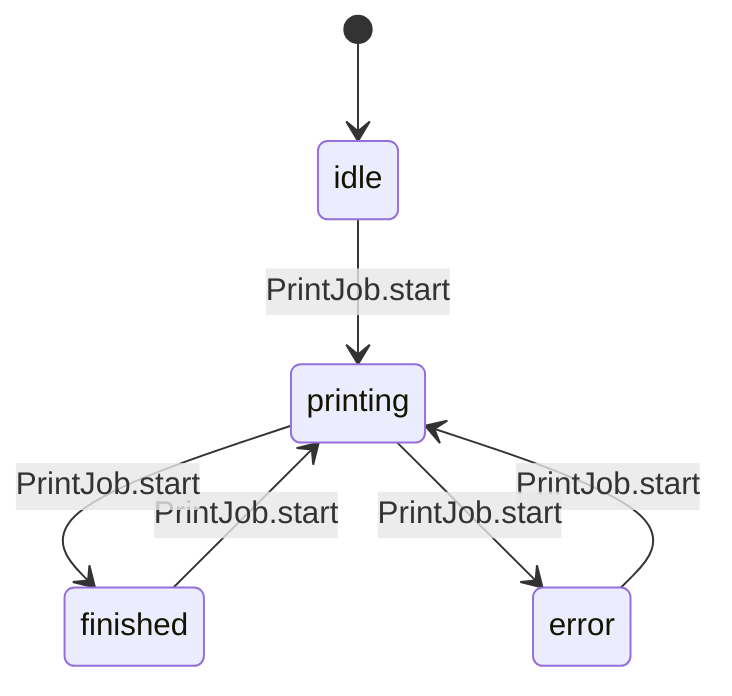

I found two state machines in the print shop app and five bugs in them. I fixed all five, and each fix has a test that fails on the original code and passes now. All 12 tests pass (the 6 that were already there plus the 6 I added in `tests/test_states.py`), and the skill's final check finished cleanly. The diagrams are in `fixture/.states/MACHINES.md`.

## The machines

**1. Order** (`status`): draft → awaiting_payment (checkout reserves paper) → paid → printing → shipped → archived. Before printing starts, an order in draft, awaiting_payment or paid can move to cancelled. If a print fails, the order drops from printing back to paid. Archived and cancelled are end states, which is intended. A refund doesn't change the status; it only sets the `refunded` flag.

**2. Print job** (`printing` / `finished` / `error` flags in `printer.py`): idle → printing → finished or error. From any of those three it can start again.

## Bugs (all fixed)

1. **No refund could ever happen** (`orders.py`, `refund`). It checked for the status `"canceled"`, but cancelling sets `"cancelled"`, so it was checking for a state nothing ever sets. I corrected the spelling.
2. **The nightly job never expired anything** (`jobs.py`, `expire_unpaid`). It looked for `"pending"`, which nothing sets; unpaid orders are `"awaiting_payment"`. Abandoned orders kept their paper reserved forever. It now checks `"awaiting_payment"`.
3. **Any order could be shipped** (`orders.py`, `ship`). There was no check, so a draft, unpaid, unprinted or cancelled order could be marked shipped. It now refuses unless the order is printing, using the same `@allowed_from` guard that `archive` uses.
4. **One printer error jammed the printer for good** (`printer.py`, `PrintJob.start`). After an error it left `printing = True`, so every later print failed with "printer is busy" and the job could never leave the error state. It now clears `printing` on error.
5. **An order could get stuck in "printing"** (`orders.py`, `start_print`). The order was marked printing before the printer was asked to start. If the printer was busy and refused, the order stayed "printing" although nothing had printed. It now goes back to paid and the error is passed on to the caller.

## Looked like problems but aren't
- **Cancelling a paid order is allowed.** The README says so ("cancel before printing starts", and paid cancellations can be refunded).
- **Customer email/SMS settings** aren't a state machine. The two settings are independent and all four combinations are valid.
- **Loading saved orders** (`Order.from_dict`) takes whatever status is in the file. That's reading stored data, not a move between states.

## Left alone
These are outside what you asked for, so I didn't change them:
- **Paper is never given back after printing or shipping.** Only cancelling releases it, so over time the 1000-page stock runs out for good.
- **Saved data isn't checked.** A bad status string in `data/orders.json` is loaded without complaint.

<!-- file written by the agent: fixture/.states/MACHINES.md -->
# State machines

## order

fields: field:status

- **bug, fixed**: refund() checks status 'canceled' but cancel() sets 'cancelled', so no order can ever be refunded (printshop/orders.py:refund) Test: `python -m unittest tests.test_states.StateMachineBugs.test_paid_then_cancelled_order_can_be_refunded`
- **bug, fixed**: nightly expire_unpaid looks for status 'pending', which nothing sets (unpaid orders are 'awaiting_payment'), so unpaid orders never expire and their paper is never freed (printshop/jobs.py:expire_unpaid) Test: `python -m unittest tests.test_states.StateMachineBugs.test_nightly_expires_orders_awaiting_payment`
- **bug, fixed**: ship() had no guard: a draft, unpaid, paid-but-unprinted or cancelled order could be marked shipped (printshop/orders.py:ship) Test: `python -m unittest tests.test_states.StateMachineBugs.test_ship_refused_unless_printing`
- **bug, fixed**: start_print() set the order to 'printing' before calling job.start; if that raised (PrinterBusy) the order was stuck in 'printing' though nothing printed (printshop/orders.py:start_print) Test: `python -m unittest tests.test_states.StateMachineBugs.test_busy_printer_does_not_leave_order_printing`
- **ok**: a paid order can be cancelled (printshop/orders.py:cancel) Why: README: a customer can cancel before printing starts, and a cancelled paid order can be refunded
- **ok**: archived and cancelled have no way out (printshop/orders.py:archive) Why: they are the intended end states (refund only sets the refunded flag, not the status)

## print job

fields: flags:printshop/printer.py:PrintJob

- **bug, fixed**: on a printer error, start() left printing=True, so the job sat in 'error' with printing still set and every later start raised PrinterBusy: a state nothing could leave (printshop/printer.py:PrintJob.start) Test: `python -m unittest tests.test_states.StateMachineBugs.test_printer_error_frees_the_printer`

## Not state machines

- flags:printshop/models.py:Customer: notify_email and notify_sms are independent preferences; all four combinations are legal (each only needs its contact detail, which set_prefs enforces)

<!-- file written by the agent: fixture/.states/candidates.md -->
# State-machine candidates

Leads, not verdicts. Map each one in `.states/machines.json` or dismiss it with a reason.
Every write below must be a transition (`at`) or listed in `also` with why. `at` is
`path:line` or `path:function`.

## field:status
values written: archived, awaiting_payment, cancelled, draft, paid, printing, shipped
**checked but never set: canceled, pending**
written but never compared: archived, cancelled, printing, shipped
writes:
- printshop/models.py:11 (Order.__init__) status = 'draft'
- printshop/models.py:23 (Order.from_dict) status = <computed>
- printshop/orders.py:10 (checkout) status = 'awaiting_payment'
- printshop/orders.py:16 (pay) status = 'paid'
- printshop/orders.py:25 (cancel) status = 'cancelled'
- printshop/orders.py:39 (start_print) status = 'printing'
- printshop/orders.py:41 (start_print) status = 'paid'
- printshop/orders.py:47 (ship) status = 'shipped'
- printshop/orders.py:52 (archive) status = 'archived'
checks:
- printshop/jobs.py:11 (expire_unpaid) == 'pending'
- printshop/orders.py:7 (checkout) == 'draft'
- printshop/orders.py:14 (pay) == 'awaiting_payment'
- printshop/orders.py:21 (cancel) == 'draft'
- printshop/orders.py:21 (cancel) == 'awaiting_payment'
- printshop/orders.py:21 (cancel) == 'paid'
- printshop/orders.py:23 (cancel) == 'draft'
- printshop/orders.py:29 (refund) == 'canceled'
- printshop/orders.py:37 (start_print) == 'paid'

## flags:printshop/models.py:Customer
flags: notify_email, notify_sms (4 combinations; which are legal?)
writes:
- printshop/models.py:34 (Customer.__init__) notify_email = <computed>
- printshop/models.py:35 (Customer.__init__) notify_sms = <computed>
- printshop/models.py:38 (Customer.set_prefs) notify_email = <computed>
- printshop/models.py:39 (Customer.set_prefs) notify_sms = <computed>

## flags:printshop/printer.py:PrintJob
flags: error, finished, printing (8 combinations; which are legal?)
writes:
- printshop/printer.py:14 (PrintJob.__init__) printing = False
- printshop/printer.py:15 (PrintJob.__init__) finished = False
- printshop/printer.py:16 (PrintJob.__init__) error = None
- printshop/printer.py:21 (PrintJob.start) printing = True
- printshop/printer.py:22 (PrintJob.start) finished = False
- printshop/printer.py:23 (PrintJob.start) error = None
- printshop/printer.py:27 (PrintJob.start) error = <computed>
- printshop/printer.py:29 (PrintJob.start) printing = False
- printshop/printer.py:30 (PrintJob.start) finished = True

