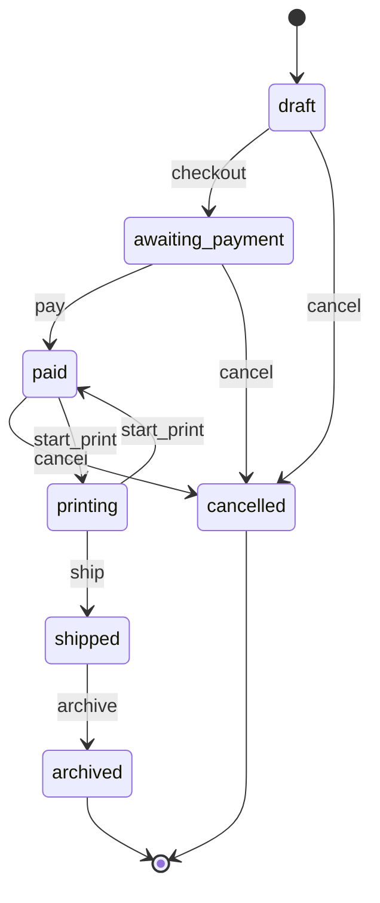
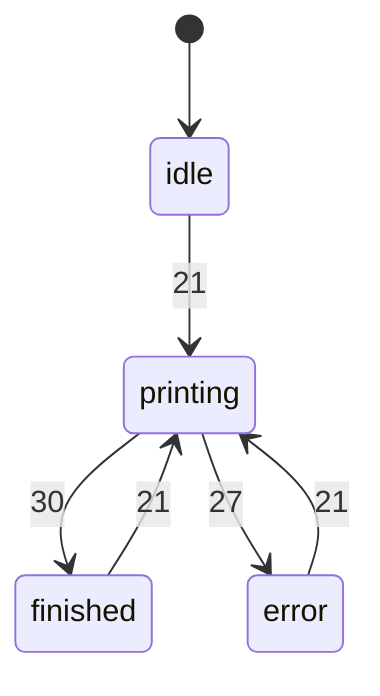

I found two state machines in the app and fixed five bugs in them. All 12 tests pass: the 6 that were already there and 6 new ones in `tests/test_states.py`. Before fixing anything I checked that each bug's test fails on the original code. The diagrams are in `fixture/.states/MACHINES.md`.

## 1. Order (`status`)
**States:** draft → awaiting_payment (paper reserved) → paid → printing → shipped → archived. From draft, awaiting_payment or paid, an order can go to cancelled. If a print fails, the order goes from printing back to paid. Cancelled and archived are end states. Refunding is a yes/no mark on a cancelled order, not a separate state.

**Bugs fixed:**
- **Refunds never worked.** `refund()` checked for `"canceled"` but `cancel()` writes `"cancelled"`, so every refund was refused. Fixed the spelling (`orders.py:29`).
- **The nightly job never expired anything.** It looked for `"pending"`, a state nothing sets, so unpaid orders kept their paper forever. It now looks for `"awaiting_payment"` (`jobs.py:11`).
- **Shipping had no check.** A draft, unpaid, cancelled, or paid-but-unprinted order could be marked shipped. `ship()` now only works from printing (same `@allowed_from` guard that `archive` uses).
- **Orders could get stuck in "printing".** If the print job raised an error (e.g. printer busy), the order stayed in "printing" with nothing printing it, and nothing could move it out. It now goes back to paid and the error is passed on.

## 2. Print job (`printing` / `finished` / `error` flags)
**States:** idle → printing → finished, or printing → error. A new print can start from idle, finished or error.

**Bug fixed:**
- **One paper jam broke the printer for good.** After an error, `printing` stayed true, so every later print was refused with "printer is busy". The flag is now cleared on error (`printer.py`).

## Left alone
- **Customer notification settings** (`notify_email`, `notify_sms`) are not a state machine. They are two separate on/off choices, and any combination is allowed. Each one is forced off only when that email or phone number is missing.
- **Cancelling a paid order** gives the paper back and allows a refund. That matches the README, so it isn't a bug.
- **Loading saved orders** accepts whatever status the file contains. A saved file with a bad status would be loaded without complaint. I didn't add a check for that.
- **Not fixed: expiry counts from when the order was created, not from checkout.** This only shows up now that the nightly job works. An order left as a draft for two days and then checked out gets cancelled at the very next nightly run, even if checkout was an hour ago. Fixing it means adding a checkout time to the saved order data, so I left that decision to you. A failing test for it is in `.states/proofs/test_expiry_clock.py` (run with `python -m unittest discover -s .states/proofs`). It sits outside the main tests so they stay green.

<!-- file written by the agent: fixture/.states/MACHINES.md -->
# State machines

## Order

fields: field:status

- **bug, fixed**: refund() checked for status 'canceled' but cancel() sets 'cancelled', so no order could ever be refunded (printshop/orders.py:29) Test: `python -m unittest tests.test_states.StateBugs.test_paid_cancelled_order_can_be_refunded`
- **bug, fixed**: nightly expire_unpaid() looked for status 'pending', which nothing sets, so unpaid orders were never cancelled and their paper never freed; now checks 'awaiting_payment' (printshop/jobs.py:11) Test: `python -m unittest tests.test_states.StateBugs.test_nightly_expires_unpaid_orders_and_frees_paper`
- **bug, fixed**: ship() had no guard: a draft, unpaid, paid-but-unprinted or cancelled order could be marked shipped; now only from printing (printshop/orders.py:ship) Test: `python -m unittest tests.test_states.StateBugs.test_cannot_ship_an_order_that_was_not_printed`
- **bug, fixed**: if job.start raised (e.g. PrinterBusy) the order was left in 'printing' with nothing printing it; now rolled back to paid (printshop/orders.py:start_print) Test: `python -m unittest tests.test_states.StateBugs.test_order_not_left_printing_when_job_raises`
- **ok**: cancel from paid releases paper and allows refund (printshop/orders.py:cancel) Why: README: a customer can cancel before printing starts; refund then applies to paid cancelled orders

## PrintJob

fields: flags:printshop/printer.py:PrintJob

- **bug, fixed**: on a printer error, printing stayed True, so the job was stuck (error + printing) and every later start raised PrinterBusy; now printing is cleared on error (printshop/printer.py:27) Test: `python -m unittest tests.test_states.StateBugs.test_printer_usable_again_after_an_error`

## Not state machines

- flags:printshop/models.py:Customer: notify_email and notify_sms are independent preferences; all four combinations are legal (each is only forced off when the contact detail is missing)

<!-- file written by the agent: fixture/.states/candidates.md -->
# State-machine candidates

Leads, not verdicts. Map each one in `.states/machines.json` or dismiss it with a reason.
Every write below must be a transition (`at`) or listed in `also` with why. `at` is
`path:line` or `path:function`.

## field:status
values written: archived, awaiting_payment, cancelled, draft, paid, printing, shipped
**checked but never set: canceled, pending**
written but never compared: archived, cancelled, printing, shipped
writes:
- printshop/models.py:11 (Order.__init__) status = 'draft'
- printshop/models.py:23 (Order.from_dict) status = <computed>
- printshop/orders.py:10 (checkout) status = 'awaiting_payment'
- printshop/orders.py:16 (pay) status = 'paid'
- printshop/orders.py:25 (cancel) status = 'cancelled'
- printshop/orders.py:39 (start_print) status = 'printing'
- printshop/orders.py:41 (start_print) status = 'paid'
- printshop/orders.py:47 (ship) status = 'shipped'
- printshop/orders.py:52 (archive) status = 'archived'
checks:
- printshop/jobs.py:11 (expire_unpaid) == 'pending'
- printshop/orders.py:7 (checkout) == 'draft'
- printshop/orders.py:14 (pay) == 'awaiting_payment'
- printshop/orders.py:21 (cancel) == 'draft'
- printshop/orders.py:21 (cancel) == 'awaiting_payment'
- printshop/orders.py:21 (cancel) == 'paid'
- printshop/orders.py:23 (cancel) == 'draft'
- printshop/orders.py:29 (refund) == 'canceled'
- printshop/orders.py:37 (start_print) == 'paid'

## flags:printshop/models.py:Customer
flags: notify_email, notify_sms (4 combinations; which are legal?)
writes:
- printshop/models.py:34 (Customer.__init__) notify_email = <computed>
- printshop/models.py:35 (Customer.__init__) notify_sms = <computed>
- printshop/models.py:38 (Customer.set_prefs) notify_email = <computed>
- printshop/models.py:39 (Customer.set_prefs) notify_sms = <computed>

## flags:printshop/printer.py:PrintJob
flags: error, finished, printing (8 combinations; which are legal?)
writes:
- printshop/printer.py:14 (PrintJob.__init__) printing = False
- printshop/printer.py:15 (PrintJob.__init__) finished = False
- printshop/printer.py:16 (PrintJob.__init__) error = None
- printshop/printer.py:21 (PrintJob.start) printing = True
- printshop/printer.py:22 (PrintJob.start) finished = False
- printshop/printer.py:23 (PrintJob.start) error = None
- printshop/printer.py:27 (PrintJob.start) error = <computed>
- printshop/printer.py:29 (PrintJob.start) printing = False
- printshop/printer.py:30 (PrintJob.start) finished = True

