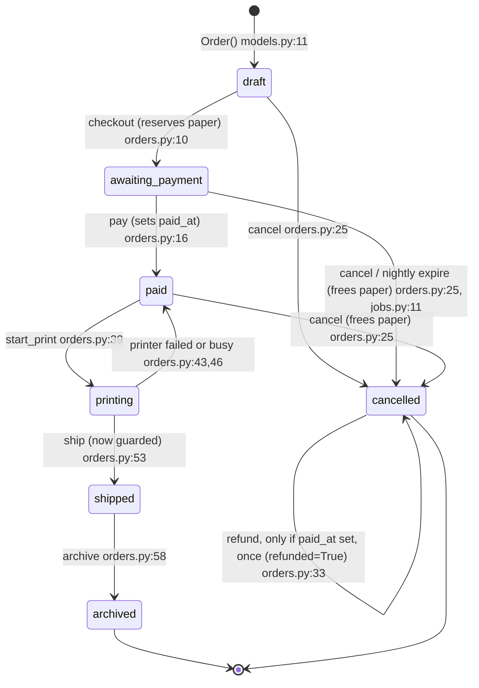
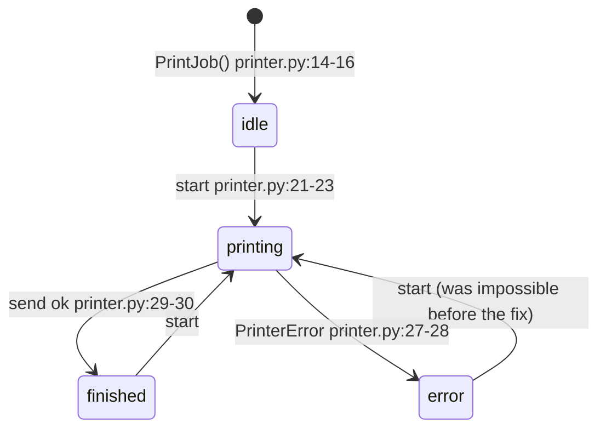

**Verdict:** Two things in the shop move through stages: orders and the printer. Both had bugs. I found five and fixed all five.

**What I found (most serious first):**
- **The printer stopped working for good after one error.** After a paper jam or similar failure, the shop's only printer counted as "busy" from then on and refused every later order until the app restarted: fixed
- **Refunds never worked.** A customer who paid and then cancelled could never be refunded. The system refused every refund as "not allowed": fixed
- **The nightly clean-up never cancelled anything.** Orders left unpaid stayed open forever and their paper stayed held, so the shop could look out of paper when it wasn't: fixed
- **Orders could be marked shipped without being printed or paid for.** Even a draft could be shipped: fixed. Shipping now only works for an order that is printing.
- **If the printer was busy with another order, the new order got stuck showing "Printing"** even though nothing was printing it: fixed. It goes back to "Paid" so it can be tried again.

**What looked wrong but is fine:**
- Cancelled and archived orders can't move anywhere. They're meant to be final.
- Email and text alerts can each be on or off in any mix. They're two separate settings, not stages.

**What I did:** Refunds, the nightly clean-up, printing after a failure, retrying when the printer is busy, and the shipping check all work now. Everything that worked before still works.

**Your call:**
- **Printed and shipped orders never give their paper back to the count.** Over time, available paper only goes down. That's correct if this is meant as "paper used up", but nothing ever adds paper back. Decide whether restocking should exist.
- **The paper count isn't saved between runs.** When the nightly clean-up frees paper, that has no lasting effect. Saving it would change how the app stores data, so I didn't touch it.
- **The nightly clean-up measures "a day" from when the order was created, not from checkout.** Say if it should count from checkout instead.

**Pictures:** `fixture/STATE_MACHINES.md`

---

**Details (for the developer or agent who picks this up)**

1. **Order: `Order.status` (+ `paid_at`, `refunded`)**
   - States: draft, awaiting_payment, paid, printing, shipped, archived, cancelled. Final: archived, cancelled.
   - Writes: `models.py:11` (initial), `orders.py:10,16,25,39,43,46,53,58`. `models.py:23` loads saved data; that's a non-move and accepts any value.
   - Bug: `refund` checked `"canceled"`, which nothing sets (`orders.py:29`): fixed
     - Proof: `python -m unittest tests.test_state_bugs` (`tests/test_state_bugs.py:24`) failed before with OrderError.
   - Bug: `expire_unpaid` checked `"pending"`, which nothing sets (`jobs.py:11`): fixed. It now checks `awaiting_payment`, so paper is released through `cancel`.
     - Proof: `tests/test_state_bugs.py:33` failed before with `[] != ['B2']`.
   - Bug: `ship` had no guard and no callers that check first (`orders.py:46` before): fixed with `@allowed_from("printing")`.
     - Proof: `tests/test_state_bugs.py:52` failed before with "OrderError not raised : draft".
   - Bug: when `job.start` raised `PrinterBusy`, the order was left in `printing` (`orders.py:40` before): fixed. A try/except puts it back to `paid` and re-raises.
     - Proof: `tests/test_state_bugs.py:66` failed before with `'printing' != 'paid'`.
2. **PrintJob: `printing`, `finished`, `error`**
   - States: idle, printing, finished, error.
   - Bug: the `PrinterError` path left `printing=True`. That produced an impossible "error + printing" state that nothing could leave, so every later `start` raised `PrinterBusy` (`printer.py:27`): fixed. The fix sets `printing = False`.
     - Proof: `tests/test_state_bugs.py:79` and `:89` failed before.
   - Still open: an exception other than `PrinterError` from `printer.send` would still leave `printing=True`. No test covers this and I'm not sure that case can happen, so I left it.

**Not bugs:**
- `notify.LABELS` has no "pending" label. That's consistent with the fix.
- The `LABELS.get(..., status)` fallback copes with unknown statuses loaded from the file.

**Not machines:**
- `Customer.notify_email` / `notify_sms`: independent preferences.
- `stock._reserved`: a counter.

**Fixed:** the five bugs above, in `orders.py`, `jobs.py` and `printer.py`. Their tests are in `tests/test_state_bugs.py` and pass now.

**Tests:** `python -m unittest discover tests` gave 6 passed before and 13 passed after (the 6 old tests plus 7 new ones). The folder isn't a git repo, so there's no diff to review; the edits are direct.

<!-- file written by the agent: fixture/STATE_MACHINES.md -->
# State machines in printshop

## 1. Order (`Order.status`, plus `paid_at` and `refunded`)

Fixed: refund looked for `canceled` (never set) so no refund ever worked; nightly expiry
looked for `pending` (never set) so it never ran; `ship` had no guard; a busy printer left
the order in `printing` with nothing printing.

## 2. Print job (`PrintJob.printing`, `finished`, `error`)

Fixed: after an error `printing` stayed true, so the state was "error and printing" and every
later start raised PrinterBusy: the printer could never be used again.

## Not machines
- `Customer.notify_email` / `notify_sms`: two independent preferences, every mix is valid.
- `stock._reserved`: a counter, not a set of stages.
