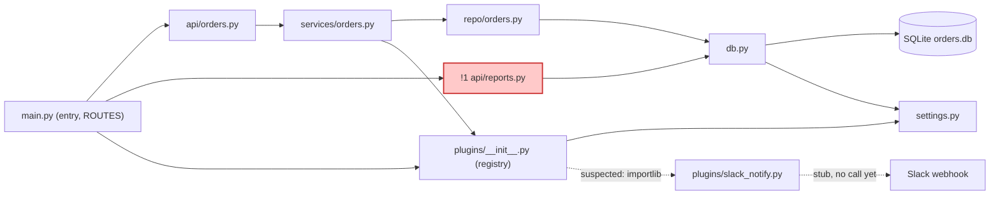

The map is at `fixture/docs/architecture.md`. I haven't rendered the Mermaid. I checked by hand that the labels are quoted, the ids are declared and the class line names an existing id.

The service is layered as `api/` → `services/` → `repo/` → `db.py` → SQLite, with Slack alerts as a plugin the service layer calls.

The README says nothing skips a layer, but `api/reports.py:5-7` queries the database directly. It carries its own TODO to move into `services/`. That is problem !1 in the file, with a suggested fix.

The plugin load from `settings.py` and the Slack call are drawn dashed as *suspected*. The plugin is loaded by name with `importlib`, and its Slack post is a `pass` stub.

The file records the map as true on 2026-10-11, so redraw it when the wiring changes.

<!-- file written by the agent: fixture/docs/architecture.md -->
<!-- context-paths: main.py, api/, services/, repo/, db.py, plugins/, settings.py -->
# orders-service architecture (as-is, modules)

A request goes `api/` → `services/` → `repo/` → `db.py` → SQLite, with Slack notification as a plugin off the service layer; notice that `api/reports.py` skips the service and repo layers and queries the database directly (!1), contrary to the README.

## Legend

| Mark | Meaning |
|---|---|
| `!1` (red fill) | problem, see table |
| dashed arrow | inferred, not a static import (*suspected*) |

## Request flow

- `/orders`, `/orders/new`: main → api/orders → services/orders → repo/orders → db → SQLite. `place_order` then calls `plugins.emit("order_placed")`.
- `/reports/daily`: main → api/reports → db → SQLite (no service, no repo).

## Evidence

| Arrow | file:line |
|---|---|
| main → api/orders, api/reports | main.py:4, 8-10 |
| main → plugins (load at startup) | main.py:5, 14 |
| api/orders → services | api/orders.py:1 |
| services → repo | services/orders.py:1, 6, 10 |
| services → plugins (emit) | services/orders.py:2, 11 |
| repo → db | repo/orders.py:1, 5, 10 |
| api/reports → db | api/reports.py:1, 6 |
| db → SQLite | db.py:7 |
| db → settings (DB_PATH) | db.py:3 |
| plugins → settings (ENABLED_PLUGINS) | plugins/__init__.py:3, 9 |
| plugins → slack_notify (*suspected*: dynamic import by name from settings.py:1) | plugins/__init__.py:10 |
| slack_notify → Slack (*suspected*: webhook elided, body is `pass`) | plugins/slack_notify.py:6 |

## Problems

| # | what's wrong | where | what it costs | fix |
|---|---|---|---|---|
| 1 | Reports endpoint queries the DB directly, skipping services and repo; README says nothing skips a layer | api/reports.py:5-7 (own TODO says "move into services/") | SQL lives in two layers; schema changes to `orders` must be found in two places | add a repo function and a service function for daily totals; route the endpoint through them |

*True on the day it was traced (2026-10-11); redraw when wiring, storage or integrations change.*
