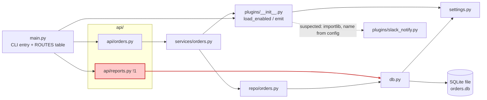

I've drawn the architecture and saved it at `docs/architecture.md` in the repo root. I didn't render the Mermaid diagram because `mmdc` isn't installed. I checked the syntax by hand.

The service is `api/ → services/ → repo/ → db.py` over SQLite, but the README's claim that nothing skips a layer is wrong. `api/reports.py` runs raw SQL through `db.connect()` and skips both the service and repo layers. A TODO in that file already says to move it. This is flagged as problem 1 in the file, with the fix.

The Slack plugin is loaded by name from `settings.py` via `importlib`, so its link in the diagram is dashed and marked *suspected*. `slack_notify.on_event` is also still a stub, so nothing posts to Slack today.

The file also has the request flow and a `file:line` table for every arrow. It reflects the code as of 2026-10-11, so re-check it when the code changes.

<!-- file written by the agent: docs/architecture.md -->
# orders-service architecture (as-is, modules)

The service is a layered `api/ → services/ → repo/ → db.py` stack over SQLite, **except** `api/reports.py`, which skips the service and repo layers and queries the database directly (!1), contradicting the "nothing skips a layer" claim in `fixture/README.md`.

Legend: `!N` red = problem N (see table). Dashed arrow = wired at runtime by config, not visible in imports. Not drawn: `__init__.py` files that are empty.

## Request flow

- `python main.py /orders` → `ROUTES` lookup → `api.orders.list_orders` → `services.orders.all_orders` → `repo.orders.fetch_all` → SQLite.
- `/orders/new` → `create_order` → `place_order` → `repo.insert`, then `plugins.emit("order_placed", id)` → every loaded plugin's `on_event`.
- `/reports/daily` → `api.reports.daily_totals` → SQL straight through `db.connect()`.

## Evidence

| arrow | file:line |
|---|---|
| main → api.orders / api.reports | fixture/main.py:4, 7-11 |
| main → plugins (load) | fixture/main.py:5, 14 |
| api.orders → services | fixture/api/orders.py:1 |
| services → repo | fixture/services/orders.py:1 |
| services → plugins (emit) | fixture/services/orders.py:2, 11 |
| repo → db | fixture/repo/orders.py:1 |
| api.reports → db (skips service + repo) | fixture/api/reports.py:1, 6 |
| db → settings (DB_PATH) | fixture/db.py:3, 7 |
| db → SQLite | fixture/db.py:1, 7 |
| plugins → settings (ENABLED_PLUGINS) | fixture/plugins/__init__.py:3, 9 |
| plugins → slack_notify (*suspected*: `importlib.import_module` of a name in `settings.py:1`; target is traced from config, not an import) | fixture/plugins/__init__.py:10 |

## Problems

| # | what's wrong | where | cost | fix |
|---|---|---|---|---|
| 1 | Reports endpoint bypasses services/ and repo/ and runs raw SQL in the API layer; a TODO already says to move it | fixture/api/reports.py:5-7 | Schema changes to `orders` must be fixed in two places; README's layering rule is false | Add a `repo` query and a `services` function, call them from `api/reports.py` |

Other notes: `slack_notify.on_event` is a stub (`pass`), so no Slack post happens today (fixture/plugins/slack_notify.py:6). Plugins only load when run via `main.py`'s `__main__` block (fixture/main.py:14).

This map is true on the day it was traced (2026-10-11); re-check it when the code moves. Render was not run (no `mmdc`); labels are quoted, all ids declared, and `linkStyle 7` is the `ar --> db` edge (the 8th edge declared).
