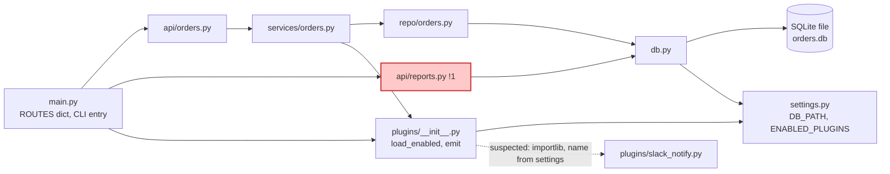

The architecture map is at `fixture/docs/architecture.md`. I didn't render the Mermaid, so I only checked by hand that the syntax is valid. I read every file but ran nothing.

The service is layered `api → services → repo → db`, with plugins hanging off the service layer. The README says no request skips a layer, but `/reports/daily` does: `api/reports.py:6` queries the database directly, which duplicates `orders` SQL that `repo/orders.py` already holds.

The Slack plugin is loaded by name from `settings.py` at runtime, so I drew that arrow dashed as suspected. Its `on_event` is also a stub, so no Slack message is sent today.

The map is true as of today (2026-10-11), so update it when the wiring changes.

<!-- file written by the agent: fixture/docs/architecture.md -->
# Architecture (as-is, modules)

The service is a layered `api/ → services/ → repo/ → db.py` stack, except that `/reports/daily` skips the service and repo layers and queries the database directly (`!1`). The README says nothing skips a layer; the code does.

## Legend

| Mark | Meaning |
|---|---|
| `!1` (red) | problem 1, see table |
| dashed arrow | wired at runtime by config, not by a visible import (*suspected*) |

## Request flow

- `python main.py <path>` looks `<path>` up in `ROUTES`, calls the handler and prints the result.
- `/orders`, `/orders/new`: api → service → repo → db.
- `/orders/new` also calls `plugins.emit("order_placed")` after the insert, which reaches each loaded plugin's `on_event`.
- `/reports/daily`: api → db, with the SQL written inline.

## Evidence (traced: every file was read in full; nothing was run)

| Arrow | file:line |
|---|---|
| main → api/orders, api/reports | main.py:4, 8-10 |
| main → plugins (load) | main.py:5, 14 |
| api/orders → services | api/orders.py:1 |
| services → repo | services/orders.py:1 |
| services → plugins (emit) | services/orders.py:2, 11 |
| repo → db | repo/orders.py:1, 5, 10 |
| api/reports → db | api/reports.py:1, 6 |
| db → SQLite | db.py:7 |
| db → settings | db.py:3 |
| plugins → settings | plugins/__init__.py:3 |
| plugins → slack_notify (*suspected*) | plugins/__init__.py:10 and settings.py:1 (dynamic import by name) |

## Problems

| # | What's wrong | Where | What it costs | Fix |
|---|---|---|---|---|
| 1 | `api/reports.py` talks to the DB directly, skipping services and repo. The code comment calls it a quick fix with a TODO. | api/reports.py:1-7 | The `orders` table SQL lives in two places (also repo/orders.py:6), so a schema change can break reports unnoticed. It also contradicts README.md:3-4. | Move the query into `repo/orders.py` and call it through a `services/` function. |

Note: `slack_notify.on_event` is a stub (plugins/slack_notify.py:6), so no Slack message is sent today.

*True on the day it was traced (2026-10-11). Update it when wiring changes.*
