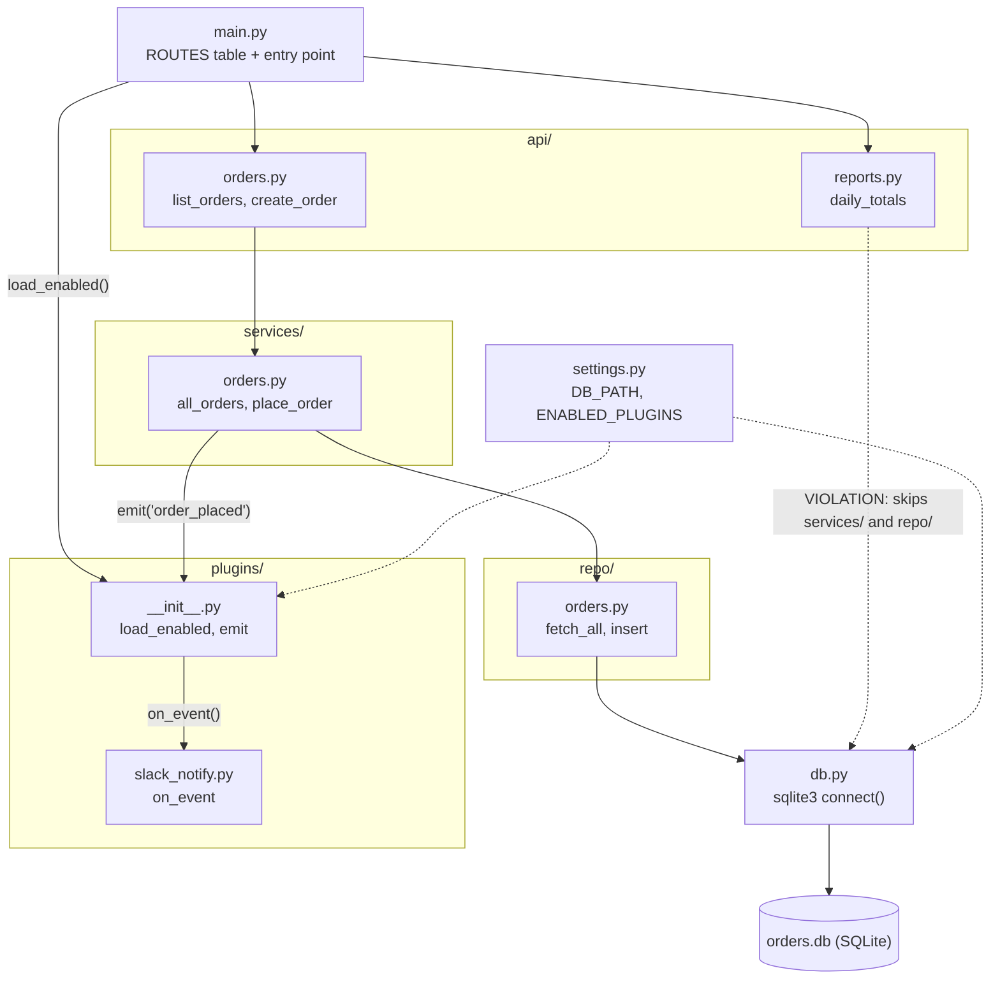

I added `ARCHITECTURE.md` at the repo root with a Mermaid diagram that GitHub renders. I haven't rendered the diagram myself. I also added a one-line link to it in `README.md`.

The file also covers a layer table, the request flow for each of the three routes, and how plugins are enabled.

The README says every request goes `api → services → repo → db` and nothing skips a layer. That isn't true. `api/reports.py` (`/reports/daily`) runs raw SQL through `db.connect()` directly. Its comment says it was a quick fix for the finance dashboard in 2026-08, with a TODO to move it into `services/`. I drew it as a dotted "violation" arrow and described it in the file as debt to avoid copying, so new hires don't take it as the pattern. I didn't change the README's claim or the code. Say if you'd rather I reword the README or move the report query into the service layer.

<!-- file written by the agent: fixture/ARCHITECTURE.md -->
# Architecture

orders-service is a small Python CLI-style service: `python main.py <route>` looks the route up in
`main.ROUTES`, calls the matching API handler and prints the result.

## Diagram

Solid arrows are calls/imports. Dotted arrows from `settings.py` are config reads. The dotted
red-flag arrow is a known exception to the layering rule (see below).

## Layers

| Layer | Path | Responsibility |
|---|---|---|
| Entry point | `main.py` | Maps routes to handlers; loads plugins; prints result. |
| API | `api/` | Request handlers. Should only call `services/`. |
| Services | `services/` | Business operations; emit plugin events after state changes. |
| Repository | `repo/` | SQL for each entity. Only layer meant to talk to `db.py`. |
| DB | `db.py` | Opens the SQLite connection at `settings.DB_PATH`. |
| Plugins | `plugins/` | Event handlers listed in `settings.ENABLED_PLUGINS`, imported dynamically by `plugins.load_enabled()`. |

## Request flows

- **`/orders`**: `api.orders.list_orders` → `services.orders.all_orders` → `repo.orders.fetch_all` → `db.connect`.
- **`/orders/new`**: `api.orders.create_order` → `services.orders.place_order` → `repo.orders.insert`,
  then `plugins.emit("order_placed", id)` → each loaded plugin's `on_event` (e.g. Slack).
- **`/reports/daily`**: `api.reports.daily_totals` → `db.connect` directly (see below).

## Plugins

A plugin is a module exposing `on_event(event, payload)`. Add its dotted path to
`ENABLED_PLUGINS` in `settings.py`. Plugins are only triggered from the service layer, and only
after `main.py` has called `load_enabled()`.

## Known deviation from the README

The README states that every request goes through the service layer and nothing skips a layer.
That is not true today: `api/reports.py` runs raw SQL through `db.connect()`, bypassing `services/`
and `repo/`. It was added as a quick fix for the finance dashboard (2026-08) and is marked
`TODO move into services/`. Treat it as debt, not as a pattern to copy. New code should follow the
`api → services → repo → db` path.
