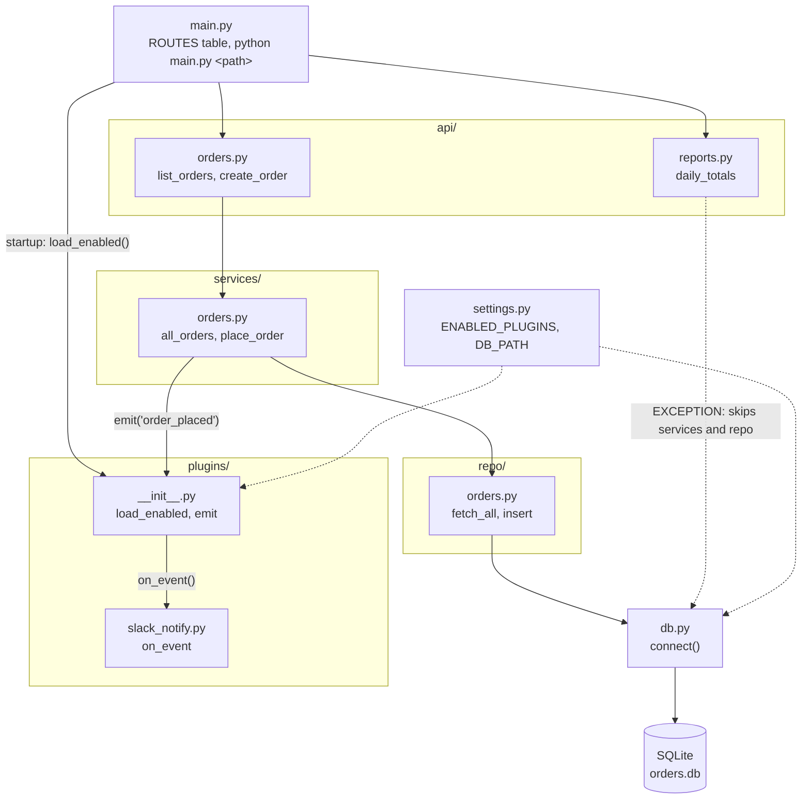

I drew the architecture as a Mermaid diagram in `fixture/docs/ARCHITECTURE.md` and linked it from the end of `fixture/README.md`. I haven't rendered it, so it's untested. GitHub and most editors render Mermaid inline.

The file has the diagram, a short walkthrough of the three request paths (`/orders`, `/orders/new`, `/reports/daily`), and a note on how plugins load.

**The README overstates the layering.** It says nothing skips a layer, but `api/reports.py` queries the database directly through `db.connect()`. A code comment calls this a quick fix for the finance dashboard from August 2026, with a TODO to move it into `services/`. I drew it as a dashed edge and documented it as a known exception, so new hires see what the code does. The README sentence itself is unchanged.

<!-- file written by the agent: fixture/docs/ARCHITECTURE.md -->
# Architecture

orders-service is a small Python app with a layered design: `api/` → `services/` → `repo/` → `db.py`
(SQLite). Plugins hang off the service layer and react to events.

## Request flows

- **`/orders`**: `api.orders.list_orders` → `services.orders.all_orders` → `repo.orders.fetch_all` → `db.connect`.
- **`/orders/new`**: `api.orders.create_order` → `services.orders.place_order` → `repo.orders.insert`,
  then `plugins.emit("order_placed", id)`, which calls every loaded plugin's `on_event`.
- **`/reports/daily`**: `api.reports.daily_totals` runs SQL directly through `db.connect` (see below).

## Plugins

`main.py` calls `plugins.load_enabled()` at startup. It imports each module named in
`settings.ENABLED_PLUGINS`. A plugin is a module with an `on_event(event, payload)` function.
`plugins.emit` calls it for every event. Only the service layer emits events.

## Known deviation from the layering rule

The README says nothing skips a layer. `api/reports.py` does: it queries the database through `db.connect()`
and bypasses `services/` and `repo/`. A code comment marks it as a quick fix for the finance dashboard
(2026-08) with a TODO to move it into `services/`. It is drawn as the dashed edge above. New code should
follow the layered path.
