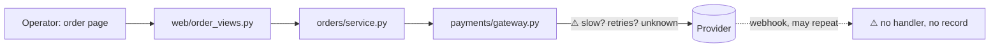
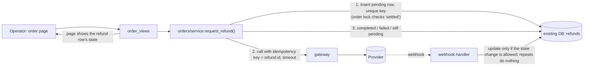

I ran `arch-design` in design mode and changed nothing. One thing up front: **`fixture/` contains only `requirements.md`.** `orders/service.py`, `web/order_views.py`, `payments/gateway.py` and `db/connection.py` aren't there, so every boundary below comes from the requirements doc. I haven't checked any of it against code, so treat it all as unverified. I also kept to the session's $2 cap, which is tighter than your $8.

## Verdict

The current shape can do this. You don't need a queue, a worker or a status endpoint. You do need one new thing: a stored refund record with a unique key. Without it, nothing stops the same refund going out twice.

## The problem

A refund calls an outside provider (`payments/gateway.py`) whose speed and retry behaviour aren't documented. It can't be undone. Three things can send the same refund twice:

1. a double-click,
2. a webhook delivered more than once,
3. a retry after a timeout where the first call actually succeeded.

Today nothing records "this refund was already attempted", so all three are open.

## Two options

| | **A. Record first, then a synchronous call (recommended)** | B. Queue and worker |
|---|---|---|
| Flow | Save a `pending` refund row in the existing database, call the provider with a timeout, update the row, show the result on the order page | Save a row and enqueue a job; a worker calls the provider; the page polls a status endpoint |
| Protects against duplicates | Unique key on the row, and the same key sent to the provider | Same |
| New infrastructure | One table | Table, queue, worker, status endpoint (things to run, secure and monitor) |
| Earned by the requirements? | Yes: 20 refunds a day and no response-time target | No. It's only worth it if the provider proves too slow for one web request |

The duplicate protection is the same in both. B only adds a way to run the call in the background, and at 20 a day with no response-time target that isn't needed yet. A also leaves room for B later: the refund row is exactly what a worker would read.

## Design rules

- **Unique key.** A double-click hits the unique constraint, and the second request just gets back the existing row.
- **Allowed states.** `pending → completed | failed`. A repeated webhook is harmless because a finished refund can't move to another state.
- **Retry.** Only `failed` (or a stuck `pending`) can be retried, and it reuses the same key. If the provider honours idempotency keys, a retry can't refund twice. If it doesn't, a `pending` refund must be checked with the provider before anything is resent. This is the riskiest unknown.
- **Timeout.** It counts as "pending, outcome unknown", never as "failed". The page shows "pending" until a webhook or a check settles it.
- **Status stays internal.** It's shown on the existing order page. No public refund-state endpoint for now.

## Decisions that are hard to undo

1. **The refund table and its stored key (hard to undo).** It's unavoidable. What still needs deciding is what the key is unique on:
   - Unique per order (full refunds only): simplest. Cost if wrong: a migration when partial refunds arrive.
   - A request ID the form creates: supports partial refunds, but makes "never refund the same amount twice" weaker to enforce.
2. **A public refund-state contract.** I recommend not creating one now. Rendering on the order page can change later without breaking anyone who depends on it.
3. **Folder layout, and where the webhook handler lives.** Easy to change. I'd put the logic in `orders/service.py` (it owns order actions) and keep the provider details in `gateway.py`.

## First implementation plan

Each step keeps existing behaviour working.

1. **Confirm the facts.** Read the real `gateway.py` and the provider docs: does the provider accept idempotency keys, and does it send refund webhooks? **Check:** a written yes or no, with the source.
2. **Add the refunds table** (`id, order_id, amount, state, provider_ref, created/updated`, plus the unique key) as an add-only migration. Hand this to `safe-release`. **Check:** the migration applies and rolls back on a copy of the database, and existing order tests still pass.
3. **`request_refund()` in the service** (lock the order, insert or return the existing row, call the gateway with the key and a timeout, update the state). Use a fake gateway in tests. **Check:** tests for double-click, timeout leaving `pending`, provider failure leaving `failed`, and retry reusing the key, run against the real database.
4. **Webhook handler**, idempotent. **Check:** sending the same webhook twice results in one state change and no refund call.
5. **Order page:** a button for settled orders, plus a state badge and a retry button for failed refunds. **Check:** an end-to-end click-through against a provider sandbox.

Step 2 is the only one that can't be fully undone. Steps 3–5 can sit behind a flag. To build it, use `build-discipline` (with `safe-release` for step 2).

## Before I go further

1. **Full refunds only for the first version, or partial refunds too?** This decides what the refund key is unique on, which is the main thing that's hard to undo.
2. **Can you add the real `orders/`, `web/`, `payments/` and `db/` sources to `fixture/`?** Then I can check these boundaries and the provider's behaviour against code instead of the requirements doc.